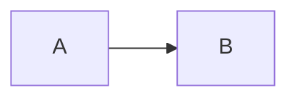

# 見出し

段落の本文。**強調**と `code`。

- 項目 1
- 項目 2

| 名前 | 数量 |
| --- | --- |
| りんご | 3 |

```ts
const a = 1;
```

    indented code



> [!NOTE]
> 補足の本文

<!-- html -->

<div><p>範囲の中</p>
<mdmark-param>{"title":"値","params":[{"name":"n","type":"range","min":0,"max":10,"value":3}],"template":"n={{n}}"}</mdmark-param></div>

<!-- /html -->
