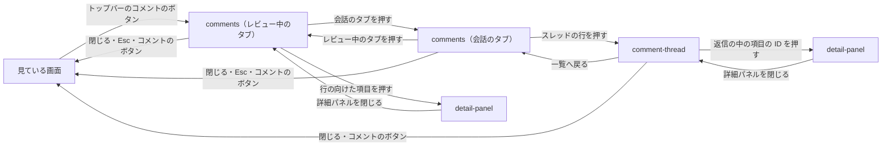

# プレビュー

## 現状

| 分類 | ページ / ファイル | 概要 | 補足 |
| --- | --- | --- | --- |
| ドキュメント | [dev/設計書/画面設計/プレビュー/コメントの一覧.yaml](https://github.com/shuhei1101/mindstella/blob/develop/dev/%E8%A8%AD%E8%A8%88%E6%9B%B8/%E7%94%BB%E9%9D%A2%E8%A8%AD%E8%A8%88/%E3%83%97%E3%83%AC%E3%83%93%E3%83%A5%E3%83%BC/%E3%82%B3%E3%83%A1%E3%83%B3%E3%83%88%E3%81%AE%E4%B8%80%E8%A6%A7.yaml) | トップバーのコメントのボタンで左から出すパネル。レビュー中のコメントを並べ、チェックしたものをまとめて送る | タブが無く、送った後のコメントは一覧から外れて見えなくなる |
| ドキュメント | [dev/設計書/インターフェース定義/プレビュー/プレビューを開く.yaml](https://github.com/shuhei1101/mindstella/blob/develop/dev/%E8%A8%AD%E8%A8%88%E6%9B%B8/%E3%82%A4%E3%83%B3%E3%82%BF%E3%83%BC%E3%83%95%E3%82%A7%E3%83%BC%E3%82%B9%E5%AE%9A%E7%BE%A9/%E3%83%97%E3%83%AC%E3%83%93%E3%83%A5%E3%83%BC/%E3%83%97%E3%83%AC%E3%83%93%E3%83%A5%E3%83%BC%E3%82%92%E9%96%8B%E3%81%8F.yaml) | URL のハッシュが指す画面を開き、書き換えで描き直す | スレッドを読み、書き換えで描き直す流れを足す |
| ドキュメント | [dev/設計書/部品設計/プレビュー/トップバー.ts.yaml](https://github.com/shuhei1101/mindstella/blob/develop/dev/%E8%A8%AD%E8%A8%88%E6%9B%B8/%E9%83%A8%E5%93%81%E8%A8%AD%E8%A8%88/%E3%83%97%E3%83%AC%E3%83%93%E3%83%A5%E3%83%BC/%E3%83%88%E3%83%83%E3%83%97%E3%83%90%E3%83%BC.ts.yaml) | コメントのボタンとレビュー中の件数 | 会話のタブの件数を出すかを設計で決める |
| ドキュメント | [dev/設計書/部品設計/プレビュー/コメントの入力.ts.yaml](https://github.com/shuhei1101/mindstella/blob/develop/dev/%E8%A8%AD%E8%A8%88%E6%9B%B8/%E9%83%A8%E5%93%81%E8%A8%AD%E8%A8%88/%E3%83%97%E3%83%AC%E3%83%93%E3%83%A5%E3%83%BC/%E3%82%B3%E3%83%A1%E3%83%B3%E3%83%88%E3%81%AE%E5%85%A5%E5%8A%9B.ts.yaml) | コメントを溜める入力欄 | 返信の入力欄に使い回せるかを部品設計で見る |
| ドキュメント | [dev/設計書/モジュール構成/プレビュー/画面と部品.ts.yaml](https://github.com/shuhei1101/mindstella/blob/develop/dev/%E8%A8%AD%E8%A8%88%E6%9B%B8/%E3%83%A2%E3%82%B8%E3%83%A5%E3%83%BC%E3%83%AB%E6%A7%8B%E6%88%90/%E3%83%97%E3%83%AC%E3%83%93%E3%83%A5%E3%83%BC/%E7%94%BB%E9%9D%A2%E3%81%A8%E9%83%A8%E5%93%81.ts.yaml) | コメントの一覧の画面ほか | 更新対象 |
| ドキュメント | [dev/設計書/モジュール構成/プレビュー/基盤.ts.yaml](https://github.com/shuhei1101/mindstella/blob/develop/dev/%E8%A8%AD%E8%A8%88%E6%9B%B8/%E3%83%A2%E3%82%B8%E3%83%A5%E3%83%BC%E3%83%AB%E6%A7%8B%E6%88%90/%E3%83%97%E3%83%AC%E3%83%93%E3%83%A5%E3%83%BC/%E5%9F%BA%E7%9B%A4.ts.yaml) | サーバーの配信とのやり取り | スレッドの受け口の呼び出しを足す |
| 実装 | [plugins/mindstella/skills/mindmap/preview/screens/comments.ts](https://github.com/shuhei1101/mindstella/blob/develop/plugins/mindstella/skills/mindmap/preview/screens/comments.ts) | コメントの一覧 | 更新対象 |
| 実装 | [plugins/mindstella/skills/mindmap/preview/components/topbar.ts](https://github.com/shuhei1101/mindstella/blob/develop/plugins/mindstella/skills/mindmap/preview/components/topbar.ts) | トップバー | 件数の出し方を変えるときだけ更新する |

## 変更方針

| 対象 | 方針 | 補足 |
| --- | --- | --- |
| タブ | 左から出すパネルの上端に「レビュー中のコメント」と会話のタブを置き、切り替える。レビュー中のコメントのタブは今の一覧のまま | タブの名前・既定で開くタブはモック作成で決める |
| スレッドの一覧 | 会話のタブにスレッドを並べ、各行に要約か最初の書き込み・書き手・最後の書き込みの日時・状態・タグを出す。オープンとクローズで絞れる | 行に出す値と並びはモック作成で決める |
| スレッドを読む | 行を押すとスレッドの書き込みを書いた順に並べ、利用者と AI の書き込みを見分けられる形にする。AI の返信の中の項目の ID は、その項目の詳細パネルを開くリンクにする | パネルの中で一覧からスレッドへ切り替える（`### 画面一覧` の `comment-thread`） |
| 返信とクローズ | スレッドを読む画面の下端に返信の入力欄を置き、クローズ（とオープンへの戻し）のボタンを置く | 返信の送り方は要件の `未確定`（決める段: モック作成） |
| 反映 | AI の返信と AI が立てたスレッドを、書き換えの知らせで開いている画面へ反映する | - |
| アクセシビリティ | タブはキーボードで切り替えられ、読み上げでタブの名前と選んだ状態が分かる | - |

### 画面一覧

| 種別 | 画面 | 概要 | アクション | 判定の根拠 | 補足 |
| --- | --- | --- | --- | --- | --- |
| 変更 | `comments` | 左から出すパネル。上端の「レビュー中のコメント」と会話のタブで切り替え、会話のタブにスレッドの一覧を並べる | タブを切り替える （レビュー中のタブ）今の一覧の操作のまま （会話のタブ）オープン・クローズ・全部で絞る 行のタグを押してそのタグで絞る タグの絞り込みを解除する スレッドを開く パネルを閉じる | レビュー中のコメントとスレッドは、同じコメントについて関連するが別のまとまりのため、画面内のタブにする。各タブに件数（レビュー中の件数・オープンのスレッドの件数）を出す。オープン・クローズ・全部は同じ一覧の絞り込みのため、会話のタブの中でセグメントで切り替える。タグの絞り込みは解除のチップを一覧の上に置く（選ぶ部品を結果より上に置く） | タブの名前・既定で開くタブ・行に出す値はモック作成で決める（`## 変更方針`） |
| 新規 | `comment-thread` | 会話のタブで開いたスレッド 1 件。書き込みを書いた順に並べ、下端に返信の入力欄、上端にクローズ（とオープンへの戻し）を置く | 書き込みを読む 返信の中の項目の ID を押す 返信する クローズにする オープンに戻す 一覧へ戻る パネルを閉じる | 一覧から 1 件を選んで中身を見る関係だが、左のパネルは狭い幅の置き方（幅 900px 以下は画面いっぱい）で、右は項目の詳細パネルの置き場のため、パネルの中で一覧と切り替え、戻る操作で一覧へ戻す。戻ると一覧のスクロールと絞り込みを保つ。返信は 1 件をすばやく足すだけのため、その場（スレッドの下端）に置く。クローズはオープンへ戻せて取り消せない操作ではないため、確認のモーダルを挟まない | 返信の送り方は要件の `未確定`（決める段: モック作成）。オープンに戻すボタンを出すかは要件の `未確定`（決める段: 単一ユースケース設計） |

項目の ID から開く詳細パネル（`detail-panel`）は既存のまま使い、コメントの行から項目を開くときと同じく、パネルを開いたまま右に出す。

### 画面遷移

- タブの切り替え・スレッドを開く・一覧へ戻るは履歴に積まない（パネルの中の切り替えのため）
- `comment-thread` の Esc は返信の入力欄にフォーカスがあるときは入力から外れるだけにし、それ以外は一覧へ戻る。詳細パネルを開いているときの Esc は詳細パネルを先に閉じる（今の `comments` と同じ）
- 返信を送った・クローズにした後は `comment-thread` に留まる。クローズにしたスレッドは、一覧へ戻ったときに絞り込みがオープンだけなら一覧から外れる
