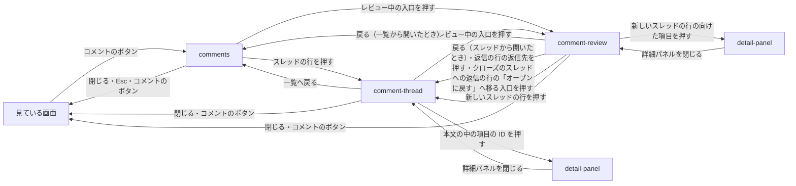

# プレビュー

## 現状

| 分類 | ページ / ファイル | 概要 | 補足 |
| --- | --- | --- | --- |
| ドキュメント | [dev/設計書/画面設計/プレビュー/コメントの一覧.yaml](https://github.com/shuhei1101/mindstella/blob/develop/dev/%E8%A8%AD%E8%A8%88%E6%9B%B8/%E7%94%BB%E9%9D%A2%E8%A8%AD%E8%A8%88/%E3%83%97%E3%83%AC%E3%83%93%E3%83%A5%E3%83%BC/%E3%82%B3%E3%83%A1%E3%83%B3%E3%83%88%E3%81%AE%E4%B8%80%E8%A6%A7.yaml) | トップバーのコメントのボタンで左から出すパネル。レビュー中のコメントを並べ、チェックしたものをまとめて送る | タブが無く、送った後のコメントは一覧から外れて見えなくなる |
| ドキュメント | [dev/設計書/インターフェース定義/プレビュー/プレビューを開く.yaml](https://github.com/shuhei1101/mindstella/blob/develop/dev/%E8%A8%AD%E8%A8%88%E6%9B%B8/%E3%82%A4%E3%83%B3%E3%82%BF%E3%83%BC%E3%83%95%E3%82%A7%E3%83%BC%E3%82%B9%E5%AE%9A%E7%BE%A9/%E3%83%97%E3%83%AC%E3%83%93%E3%83%A5%E3%83%BC/%E3%83%97%E3%83%AC%E3%83%93%E3%83%A5%E3%83%BC%E3%82%92%E9%96%8B%E3%81%8F.yaml) | URL のハッシュが指す画面を開き、書き換えで描き直す | スレッドを読み、書き換えで描き直す流れを足す |
| ドキュメント | [dev/設計書/部品設計/プレビュー/トップバー.ts.yaml](https://github.com/shuhei1101/mindstella/blob/develop/dev/%E8%A8%AD%E8%A8%88%E6%9B%B8/%E9%83%A8%E5%93%81%E8%A8%AD%E8%A8%88/%E3%83%97%E3%83%AC%E3%83%93%E3%83%A5%E3%83%BC/%E3%83%88%E3%83%83%E3%83%97%E3%83%90%E3%83%BC.ts.yaml) | コメントのボタンとレビュー中の件数 | 件数はレビュー中の書き込みの件数のまま |
| ドキュメント | [dev/設計書/部品設計/プレビュー/コメントの入力.ts.yaml](https://github.com/shuhei1101/mindstella/blob/develop/dev/%E8%A8%AD%E8%A8%88%E6%9B%B8/%E9%83%A8%E5%93%81%E8%A8%AD%E8%A8%88/%E3%83%97%E3%83%AC%E3%83%93%E3%83%A5%E3%83%BC/%E3%82%B3%E3%83%A1%E3%83%B3%E3%83%88%E3%81%AE%E5%85%A5%E5%8A%9B.ts.yaml) | コメントを溜める入力欄 | 返信の入力欄に使い回せるかを部品設計で見る |
| ドキュメント | [dev/設計書/モジュール構成/プレビュー/画面と部品.ts.yaml](https://github.com/shuhei1101/mindstella/blob/develop/dev/%E8%A8%AD%E8%A8%88%E6%9B%B8/%E3%83%A2%E3%82%B8%E3%83%A5%E3%83%BC%E3%83%AB%E6%A7%8B%E6%88%90/%E3%83%97%E3%83%AC%E3%83%93%E3%83%A5%E3%83%BC/%E7%94%BB%E9%9D%A2%E3%81%A8%E9%83%A8%E5%93%81.ts.yaml) | コメントの一覧の画面ほか | 更新対象 |
| ドキュメント | [dev/設計書/モジュール構成/プレビュー/基盤.ts.yaml](https://github.com/shuhei1101/mindstella/blob/develop/dev/%E8%A8%AD%E8%A8%88%E6%9B%B8/%E3%83%A2%E3%82%B8%E3%83%A5%E3%83%BC%E3%83%AB%E6%A7%8B%E6%88%90/%E3%83%97%E3%83%AC%E3%83%93%E3%83%A5%E3%83%BC/%E5%9F%BA%E7%9B%A4.ts.yaml) | サーバーの配信とのやり取り | スレッドの受け口の呼び出しを足す |
| 実装 | [plugins/mindstella/skills/mindmap/preview/screens/comments.ts](https://github.com/shuhei1101/mindstella/blob/develop/plugins/mindstella/skills/mindmap/preview/screens/comments.ts) | コメントの一覧 | 更新対象 |
| 実装 | [plugins/mindstella/skills/mindmap/preview/components/topbar.ts](https://github.com/shuhei1101/mindstella/blob/develop/plugins/mindstella/skills/mindmap/preview/components/topbar.ts) | トップバー | 件数の出し方を変えるときだけ更新する |

## 変更方針

| 対象 | 方針 | 補足 |
| --- | --- | --- |
| スレッドの一覧 | 左から出すパネルはタブを持たず、スレッドの一覧 1 つにする。各行に要約（まだ無ければ最初の書き込みの先頭）・向けた項目の ID・最後の書き手・最後の書き込みの日時・状態・タグを出す。オープン・クローズ・すべてと、行のタグで絞れる | - |
| レビュー中の印 | レビュー中の書き込みを持つスレッドの行に、レビュー中の印を出す。まだ送っていない新しいスレッドも一覧に並べ、状態の札の代わりに「レビュー中」の札を出す | まだ送っていない新しいスレッドの行を押すと `comment-thread` を開き、最初の書き込みをその場で修正・削除する |
| スレッドを読む | 行を押すとスレッドの書き込みを書いた順に並べ、利用者と AI の書き込みを見分けられる形にする。本文の中の項目の ID は、AI と利用者の両方の書き込みで、その項目の詳細パネルを開くリンクにする。クローズ・オープンへの戻しの書き手（利用者・AI）・日時・理由も、書き込みの並びの中に出す | パネルの中で一覧からスレッドへ切り替える（`### 画面一覧` の `comment-thread`） |
| 書き込みを溜める | 新しいスレッドの最初の書き込みと、スレッドへの返信は、どれも「レビューに追加」でレビュー中に溜める。溜めた返信は、そのスレッドの書き込みの末尾にレビュー中の印つきで出す | 項目の詳細パネルの入力（今の「レビューに追加」）は、その項目へ向けた新しいスレッドの最初の書き込みとして溜める。画面は変えない |
| 新しいスレッドを立てる | 一覧の「新しいスレッド」を押すと、パネルの下端に入力欄を出し、項目を指さないスレッドの最初の書き込みを溜める | レビュー中を確かめる入口の名前は「レビュー中（件数）」 |
| レビュー中を確かめて送る | パネルの見出しの帯に、レビュー中の件数つきの入口を置く。押すとレビュー中の書き込み（新しいスレッドと返信）を並べ、全てチェックした状態から外して選び、まとめて送る。行ごとに修正・削除・元に戻すができる | 今のレビュー中のコメントの一覧の操作を引き継ぐ |
| クローズとオープンへの戻し | スレッドを読む画面の上端にクローズ（クローズのスレッドではオープンに戻す）を置き、任意で理由を書ける。クローズにしたスレッドには返信の入力を出さない | 「クローズにする」「オープンに戻す」を押すと、その場（見出しの下）に理由の入力欄（任意）と確定・キャンセルを出し、確定で状態と理由を 1 回で書く |
| 書きかけ | 返信と新しいスレッドの入力欄の書きかけは、向けた先ごとに残す | - |
| 反映 | AI の返信と AI が立てたスレッドを、書き換えの知らせで開いている画面へ反映する | - |
| トップバー | コメントのボタンの件数は、今と同じくレビュー中の書き込みの件数にする | - |
| アクセシビリティ | 状態の絞り込みは押した状態を読み上げられるボタンにし、レビュー中の印・状態の札は色に加えて文字で示す | - |

### 画面一覧

| 種別 | 画面 | 概要 | アクション | 判定の根拠 | 補足 |
| --- | --- | --- | --- | --- | --- |
| 変更 | `comments` | 左から出すパネル。スレッドの一覧 1 つを並べ、見出しの帯にレビュー中を確かめる入口、一覧に新しいスレッドを立てる入口を置く | オープン・クローズ・すべてで絞る 行のタグを押してそのタグで絞る タグの絞り込みを解除する スレッドを開く 新しいスレッドを立てる（入力欄を出して書き、レビューに追加する） レビュー中を確かめる画面を開く パネルを閉じる | オープン・クローズ・すべては同じ一覧の絞り込みのため、セグメントで切り替える。タグの絞り込みは解除のチップを一覧の上に置く（選ぶ部品を結果より上に置く）。新しいスレッドは 1 件をすばやく足すだけのため、別画面にせず、その場（パネルの下端）に入力欄を出す。レビュー中を確かめる入口は、一覧とスレッドのどちらを見ていても同じ場所から開けるよう、見出しの帯に 1 つだけ置く（入口の単一性） | まだ送っていない新しいスレッドも一覧の先頭に並べ、状態の札の代わりに「レビュー中」の札を出す。入口の名前は「新しいスレッド」と「レビュー中（件数）」 |
| 新規 | `comment-thread` | 一覧で開いたスレッド 1 件。書き込みと状態の変更を書いた順に並べ、下端に返信の入力欄、上端にクローズ（とオープンへの戻し）を置く。まだ送っていない新しいスレッドは、最初の書き込みをレビュー中の印つきで出し、クローズと返信の入力を出さない | 書き込みを読む 本文の中の項目の ID を押す 返信を書いてレビューに追加する レビュー中の書き込み（返信と、まだ送っていない新しいスレッドの最初の書き込み）を修正する・削除する・元に戻す クローズにする（任意で理由を書く） オープンに戻す（任意で理由を書く） 一覧へ戻る レビュー中を確かめる画面を開く パネルを閉じる | 一覧から 1 件を選んで中身を見る関係だが、左のパネルは狭い幅の置き方（幅 900px 以下は画面いっぱい）で、右は項目の詳細パネルの置き場のため、パネルの中で一覧と切り替え、戻る操作で一覧へ戻す。戻ると一覧のスクロールと絞り込みを保つ。返信は 1 件をすばやく足すだけのため、その場（スレッドの下端）に置く。クローズはオープンへ戻せて取り消せない操作ではないため、確認のモーダルを挟まない | 理由は、押すとその場（見出しの下）に出す入力欄（任意）で書き、確定で状態と理由を 1 回で書く。利用者のクローズとオープンへの戻しは、溜めずにその場で書く。AI がクローズにした・オープンに戻した記録も並びに出る（要件） |
| 新規 | `comment-review` | レビュー中の書き込み（新しいスレッドの最初の書き込みと、スレッドへの返信）を溜めた順に並べ、選んだものをまとめて送る | 送るものを選ぶ（1 件ずつ・すべて） まとめて送る 書き込みを修正する・削除する・元に戻す 返信の行から、返信先のスレッドを開く クローズのスレッドへの返信の行から、そのスレッドを開いてオープンに戻す 新しいスレッドの行から、そのスレッドを開く 新しいスレッドの行から、向けた項目を開く 開く前の画面（一覧かスレッド）へ戻る パネルを閉じる | 溜めた書き込みは、スレッドの一覧とは別のまとまり（まだ送っていないもの）で、送る前に全体を見直して選ぶ作業のため、パネルの中で一覧と切り替える画面にする。モーダルにしないのは、返信先のスレッドや向けた項目を開いて見比べる（判断に外の情報が要る）ため。全てチェックした状態で開き、外して選ぶ（一覧のまとめて選ぶ操作は先頭の 1 つのチェックボックス） | 今の `comments`（レビュー中のコメントの一覧）の行・まとめて送る帯・送った結果の出し方を引き継ぐ。クローズのスレッドへの返信の行はチェックできず、まとめて送る対象に入らない。「オープンに戻す」へ移る入口を出す |

項目の ID から開く詳細パネル（`detail-panel`）は既存のまま使い、パネルを開いたまま右に出す。

### 画面遷移

一覧のまだ送っていない新しいスレッドの行も、スレッドの行と同じく `comment-thread` を開く。

- パネルを開くと、いつも `comments`（スレッドの一覧）から始める
- スレッドを開く・レビュー中を確かめる画面を開く・一覧へ戻るは履歴に積まない（パネルの中の切り替えのため）
- `comment-thread` と `comment-review` の Esc は、入力欄にフォーカスがあるときは入力から外れるだけにし、それ以外は戻る操作と同じ画面へ戻る（`comment-thread` は一覧、`comment-review` は開く前の画面）。詳細パネルを開いているときの Esc は詳細パネルを先に閉じる（今の `comments` と同じ）
- `comment-review` を開く前に見ていたまだ送っていない新しいスレッドが、送るか消すかで無くなっていたら、戻る操作（Esc を含む）は一覧へ戻る
- レビューに追加した後は、その画面に留まる。まとめて送った後は `comment-review` に留まり、送った結果を出す。送った新しいスレッドは一覧に、送った返信はスレッドの書き込みに移る
- クローズにした後は `comment-thread` に留まる。クローズにしたスレッドは、一覧へ戻ったときに絞り込みがオープンだけなら一覧から外れる
