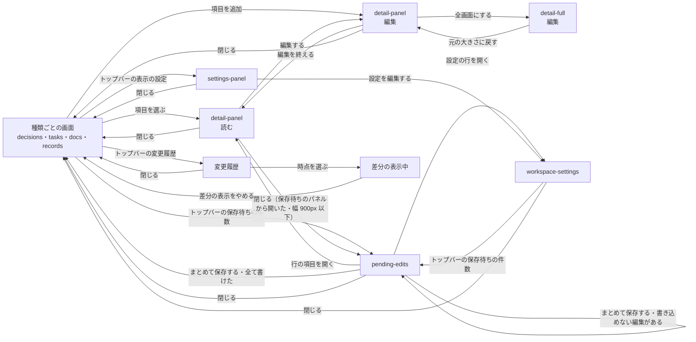

# プレビュー

## 現状

<!-- table: data -->

| 分類 | ページ / ファイル | 概要 | 補足 |
| --- | --- | --- | --- |
| ドキュメント | [設計書/インターフェース定義/プレビュー/プレビューを開く](https://github.com/shuhei1101/mindstella/blob/develop/dev/%E8%A8%AD%E8%A8%88%E6%9B%B8/%E3%82%A4%E3%83%B3%E3%82%BF%E3%83%BC%E3%83%95%E3%82%A7%E3%83%BC%E3%82%B9%E5%AE%9A%E7%BE%A9/%E3%83%97%E3%83%AC%E3%83%93%E3%83%A5%E3%83%BC/%E3%83%97%E3%83%AC%E3%83%93%E3%83%A5%E3%83%BC%E3%82%92%E9%96%8B%E3%81%8F.yaml) | 画面の開き方・記録の読み込み・送信 | 送るのはコメント・スレッド・表示の既定だけで、項目を書き換える送信は無い |
| ドキュメント | [設計書/画面設計/プレビュー/詳細パネル](https://github.com/shuhei1101/mindstella/blob/develop/dev/%E8%A8%AD%E8%A8%88%E6%9B%B8/%E7%94%BB%E9%9D%A2%E8%A8%AD%E8%A8%88/%E3%83%97%E3%83%AC%E3%83%93%E3%83%A5%E3%83%BC/%E8%A9%B3%E7%B4%B0%E3%83%91%E3%83%8D%E3%83%AB.yaml) | 項目 1 件の中身 | 読むだけ。編集の操作が無い |
| ドキュメント | [設計書/画面設計/プレビュー/詳細の全画面](https://github.com/shuhei1101/mindstella/blob/develop/dev/%E8%A8%AD%E8%A8%88%E6%9B%B8/%E7%94%BB%E9%9D%A2%E8%A8%AD%E8%A8%88/%E3%83%97%E3%83%AC%E3%83%93%E3%83%A5%E3%83%BC/%E8%A9%B3%E7%B4%B0%E3%81%AE%E5%85%A8%E7%94%BB%E9%9D%A2.yaml) | 詳細パネルの中身を大きく出す | 詳細パネルと同じく読むだけ |
| ドキュメント | [設計書/画面設計/プレビュー/検討事項](https://github.com/shuhei1101/mindstella/blob/develop/dev/%E8%A8%AD%E8%A8%88%E6%9B%B8/%E7%94%BB%E9%9D%A2%E8%A8%AD%E8%A8%88/%E3%83%97%E3%83%AC%E3%83%93%E3%83%A5%E3%83%BC/%E6%A4%9C%E8%A8%8E%E4%BA%8B%E9%A0%85.yaml)・[タスク](https://github.com/shuhei1101/mindstella/blob/develop/dev/%E8%A8%AD%E8%A8%88%E6%9B%B8/%E7%94%BB%E9%9D%A2%E8%A8%AD%E8%A8%88/%E3%83%97%E3%83%AC%E3%83%93%E3%83%A5%E3%83%BC/%E3%82%BF%E3%82%B9%E3%82%AF.yaml)・[資料](https://github.com/shuhei1101/mindstella/blob/develop/dev/%E8%A8%AD%E8%A8%88%E6%9B%B8/%E7%94%BB%E9%9D%A2%E8%A8%AD%E8%A8%88/%E3%83%97%E3%83%AC%E3%83%93%E3%83%A5%E3%83%BC/%E8%B3%87%E6%96%99.yaml)・[記録の表](https://github.com/shuhei1101/mindstella/blob/develop/dev/%E8%A8%AD%E8%A8%88%E6%9B%B8/%E7%94%BB%E9%9D%A2%E8%A8%AD%E8%A8%88/%E3%83%97%E3%83%AC%E3%83%93%E3%83%A5%E3%83%BC/%E8%A8%98%E9%8C%B2%E3%81%AE%E8%A1%A8.yaml) | 種類ごとの一覧 | 項目を足す操作が無い。差分の印・コメントの印は付くが、保存待ちの編集の印は無い |
| ドキュメント | [設計書/画面設計/プレビュー/変更履歴](https://github.com/shuhei1101/mindstella/blob/develop/dev/%E8%A8%AD%E8%A8%88%E6%9B%B8/%E7%94%BB%E9%9D%A2%E8%A8%AD%E8%A8%88/%E3%83%97%E3%83%AC%E3%83%93%E3%83%A5%E3%83%BC/%E5%A4%89%E6%9B%B4%E5%B1%A5%E6%AD%B4.yaml) | 差分の表示で比べる時点を選ぶ | 差分の表示中に編集を止める決まりが要る |
| ドキュメント | [設計書/部品設計/プレビュー/表](https://github.com/shuhei1101/mindstella/blob/develop/dev/%E8%A8%AD%E8%A8%88%E6%9B%B8/%E9%83%A8%E5%93%81%E8%A8%AD%E8%A8%88/%E3%83%97%E3%83%AC%E3%83%93%E3%83%A5%E3%83%BC/%E8%A1%A8.ts.yaml)・[トップバー](https://github.com/shuhei1101/mindstella/blob/develop/dev/%E8%A8%AD%E8%A8%88%E6%9B%B8/%E9%83%A8%E5%93%81%E8%A8%AD%E8%A8%88/%E3%83%97%E3%83%AC%E3%83%93%E3%83%A5%E3%83%BC/%E3%83%88%E3%83%83%E3%83%97%E3%83%90%E3%83%BC.ts.yaml) | 一覧の表と上端の帯 | 保存待ちの編集の件数・保存の入口が無い |
| ドキュメント | [設計書/モジュール構成/プレビュー/画面と部品.ts](https://github.com/shuhei1101/mindstella/blob/develop/dev/%E8%A8%AD%E8%A8%88%E6%9B%B8/%E3%83%A2%E3%82%B8%E3%83%A5%E3%83%BC%E3%83%AB%E6%A7%8B%E6%88%90/%E3%83%97%E3%83%AC%E3%83%93%E3%83%A5%E3%83%BC/%E7%94%BB%E9%9D%A2%E3%81%A8%E9%83%A8%E5%93%81.ts.yaml)・[基盤.ts](https://github.com/shuhei1101/mindstella/blob/develop/dev/%E8%A8%AD%E8%A8%88%E6%9B%B8/%E3%83%A2%E3%82%B8%E3%83%A5%E3%83%BC%E3%83%AB%E6%A7%8B%E6%88%90/%E3%83%97%E3%83%AC%E3%83%93%E3%83%A5%E3%83%BC/%E5%9F%BA%E7%9B%A4.ts.yaml)・[入口.ts](https://github.com/shuhei1101/mindstella/blob/develop/dev/%E8%A8%AD%E8%A8%88%E6%9B%B8/%E3%83%A2%E3%82%B8%E3%83%A5%E3%83%BC%E3%83%AB%E6%A7%8B%E6%88%90/%E3%83%97%E3%83%AC%E3%83%93%E3%83%A5%E3%83%BC/%E5%85%A5%E5%8F%A3.ts.yaml) | 画面・部品・サーバーとのやり取り・起動 | 編集の状態・保存待ちの編集の API が無い |
| ドキュメント | [設計書/デザイン方針.md](https://github.com/shuhei1101/mindstella/blob/develop/dev/%E8%A8%AD%E8%A8%88%E6%9B%B8/%E3%83%87%E3%82%B6%E3%82%A4%E3%83%B3%E6%96%B9%E9%87%9D.md) | 画面全体のデザインの方向性 | 変えない |
| 実装 | [plugins/mindstella/skills/mindmap/preview/screens/detail.ts](https://github.com/shuhei1101/mindstella/blob/develop/plugins/mindstella/skills/mindmap/preview/screens/detail.ts) | 詳細パネル | 読むだけの描画 |
| 実装 | [plugins/mindstella/skills/mindmap/preview/core/api.ts](https://github.com/shuhei1101/mindstella/blob/develop/plugins/mindstella/skills/mindmap/preview/core/api.ts) | サーバーとのやり取り | 記録の取得・書き換えの知らせ・コメント・スレッド・表示の既定 |
| 実装 | [plugins/mindstella/skills/mindmap/preview/app.ts](https://github.com/shuhei1101/mindstella/blob/develop/plugins/mindstella/skills/mindmap/preview/app.ts) | 起動・画面の振り分け | 配る書き出しかサーバーからの配信かで送信を出し分ける |

<!-- /table -->

## 変更方針

<!-- table: data -->

| 対象 | 方針 | 補足 |
| --- | --- | --- |
| 編集機能 | 詳細パネル・詳細の全画面から、項目のキー・本文・案・状態を書き換える入力に移れるようにする。参照のキー（`parent`・`depends_on` など）は ID を選ぶ入力にし、タグは語彙から選ぶ | 置き方は画面一覧の detail-panel の補足 |
| 設定の編集 | 設定（題名・プレイブック・フェーズ・ゴール・対象・カテゴリー・タグの語彙など）を書き換える入口を置く | 置く画面は画面一覧の workspace-settings の補足 |
| 作成機能 | 種類ごとの画面から、その種類の項目を足す入力を開けるようにする | ID は保存の時点でサーバーが振る |
| 削除機能 | 詳細から項目を消す編集を溜められるようにし、取り下げ・対象外・中止は状態の書き換えとして溜める | 指されている項目は保存で書き込めない編集として示す |
| 状態表示 | 保存待ちの編集がある項目・キー・案にバッジを付け、一覧（マップ・ボード・カード・表）の項目にも付ける。上端に保存待ちの件数と保存の入口を出す | バッジは破線の枠に重ねた紙の印と「保存待ち」（削除は「保存で削除」、書き込めない編集は赤の実線と「書き込めない」） |
| 一括操作 | 保存待ちの編集を並べ、1 件ずつ取り消し、まとめて保存する | 保存は 1 回の送信で、書き込めない編集があれば何も書かない |
| エラー表示 | 書き込めない編集を、編集の横に理由とともに出す | |
| 差分の表示との関係 | 差分の表示中は編集の操作とバッジの入口を出さず、外すと出す | |
| 配る書き出し | 配る書き出しでは編集の操作を出さない | 今の送信の出し分けと同じ判定を使う |
| アクセシビリティ | 入力に読み上げの名前を付け、キーボードだけで編集・取り消し・保存ができる | 左のパネルに一部だけ覆われた押せる要素は、子をたどって `inert` にせず押せるまま残す（`core/dom.ts` の `inertBehind`） |
| レスポンシブ対応 | 幅 320px でも編集の入力と保存の入口が横にはみ出さない | |

<!-- /table -->

### 画面一覧

<!-- table: data -->

| 種別 | 画面 | 概要 | アクション | 判定の根拠 | 補足 |
| --- | --- | --- | --- | --- | --- |
| 変更 | [detail-panel](https://github.com/shuhei1101/mindstella/blob/develop/dev/mock/pages/detail-panel/index.md) | 項目 1 件の中身を読み、編集に切り替えてキー・本文・案・状態を書き換える。足す項目の入力もここで開く | 編集する 編集を終える キー・本文を書き換える 案を追加・変更・削除 採用する案を切り替える 取り下げる・対象外・中止にする 項目を削除 全画面にする | 一覧を見ながら 1 件を直すため、画面の横に出すパネルで編集する。追加は編集と同じ置き方にする | 編集は見出しの帯の「編集する」で、詳細パネルの中の読む表示と切り替える。入力欄を離れたとき（選ぶ・チェックは選んだとき）にそのキーの編集を保存待ちに溜める。保存待ちの編集があるキー・案にバッジを付ける。差分の表示中と配る書き出しでは編集の操作を出さない |
| 変更 | [detail-full](https://github.com/shuhei1101/mindstella/blob/develop/dev/mock/pages/detail-full/index.md) | 詳細パネルの編集を大きく出す | 詳細パネルと同じ 元の大きさに戻す | 詳細パネルの中身を大きく出す今の置き方のまま、長い本文の編集に使う | - |
| 変更 | [decisions](https://github.com/shuhei1101/mindstella/blob/develop/dev/mock/pages/decisions/index.md)・[tasks](https://github.com/shuhei1101/mindstella/blob/develop/dev/mock/pages/tasks/index.md)・[docs](https://github.com/shuhei1101/mindstella/blob/develop/dev/mock/pages/docs/index.md)・[records](https://github.com/shuhei1101/mindstella/blob/develop/dev/mock/pages/records/index.md) | 種類ごとの一覧に、項目を足す入口と保存待ちのバッジを出す | 項目を追加 項目を選ぶ | 足すのは見ている種類の項目のため、その種類の画面に入口を置く | records は開いているタブの種類（調査・用語集・メモ・会話ログ）を追加する |
| 新規 | `workspace-settings` | 設定（題名・プレイブック・フェーズ・ゴール・対象・カテゴリー・タグの語彙など）の書き換え | 設定のキーを書き換える 閉じる | どの判定にも当たらず、入力が区画に分かれるため別の画面にする | 表示の設定のパネルの下端の「設定を編集する」から開く。対象・カテゴリー・関連する場所は 1 行ずつの表にし、狭い幅は表の中で横に送る。書き換えは保存待ちに溜める |
| 新規 | `pending-edits` | 保存待ちの編集を並べ、1 件ずつ取り消し、まとめて保存する | 行の項目を開く 1 件を取り消す まとめて保存する 閉じる | 一覧から 1 件を選んで中身を見る関係のため、左のパネルに並べ、選んだ項目を右の詳細パネルで開く（コメントの一覧と同じ置き方） | コメントの一覧・表示の設定とは片方だけを開く。書き込めない編集は行に理由を出す。削除を含むときは、保存のボタンの文言に削除の件数を出す（例:「まとめて保存する（1 件を削除）」） |
| 変更 | [settings-panel](https://github.com/shuhei1101/mindstella/blob/develop/dev/mock/pages/settings-panel/index.md) | 表示の設定のパネルの下端に、設定の画面を開く入口を出す | 設定を編集する | 今の左のパネルのまま入口だけを足す | - |
| 変更 | [components/topbar](https://github.com/shuhei1101/mindstella/blob/develop/dev/mock/components/topbar/index.html) | 保存待ちの件数と保存の入口を出す | 保存待ちを開く | - | 件数のボタンだけを置き、保存は保存待ちのパネルを開いて行う。差分の表示中と配る書き出しでは出さない |
| 新規 | `components/pending-mark` | 保存待ちの編集がある項目・キー・案のバッジ | - | - | マップ・ボード・カード・表と詳細パネルで同じ部品を使う。差分の印（+ ● −）と見分けられる形にする |

<!-- /table -->

モック作成で決めた論点は、全て推奨の案になった（[確認ログ](./確認ログ.md)）。

### 画面遷移

差分の表示中に移ると、開いていた保存待ちのパネルを閉じ、詳細パネルは読む表示に戻す。
保存待ちの編集は差分の表示中も残り、差分の表示をやめるとバッジと件数を出し直す。

## テスト結果

### 単体

| ファイル | メソッド | 変更種別 | 結果 | 補足 |
| --- | --- | --- | --- | --- |
| [tests/unit/preview/test_api.py](https://github.com/shuhei1101/mindstella/blob/develop/tests/unit/preview/test_api.py) | 全実行 | 変更 | ✅ | 44 テスト pass `テスト結果/20261022213809_61a4bef_単体テスト.log` |
| [tests/unit/preview/test_app.py](https://github.com/shuhei1101/mindstella/blob/develop/tests/unit/preview/test_app.py) | 全実行 | 実行のみ | ✅ | 50 テスト pass |
| [tests/unit/preview/test_body_diff_layout_switch.py](https://github.com/shuhei1101/mindstella/blob/develop/tests/unit/preview/test_body_diff_layout_switch.py) | 全実行 | 実行のみ | ✅ | 3 テスト pass |
| [tests/unit/preview/test_comment_mark.py](https://github.com/shuhei1101/mindstella/blob/develop/tests/unit/preview/test_comment_mark.py) | 全実行 | 実行のみ | ✅ | 5 テスト pass |
| [tests/unit/preview/test_comments_panel.py](https://github.com/shuhei1101/mindstella/blob/develop/tests/unit/preview/test_comments_panel.py) | 全実行 | 実行のみ | ✅ | 56 テスト pass |
| [tests/unit/preview/test_decisions.py](https://github.com/shuhei1101/mindstella/blob/develop/tests/unit/preview/test_decisions.py) | 全実行 | 実行のみ | ✅ | 13 テスト pass |
| [tests/unit/preview/test_detail.py](https://github.com/shuhei1101/mindstella/blob/develop/tests/unit/preview/test_detail.py) | 全実行 | 実行のみ | ✅ | 66 テスト pass |
| `tests/unit/preview/test_detail_edit.py` | 全実行 | 新規 | ✅ | 6 テスト pass `テスト結果/20261022213809_61a4bef_単体テスト.log` |
| [tests/unit/preview/test_diff.py](https://github.com/shuhei1101/mindstella/blob/develop/tests/unit/preview/test_diff.py) | 全実行 | 実行のみ | ✅ | 56 テスト pass |
| [tests/unit/preview/test_diff_minimap.py](https://github.com/shuhei1101/mindstella/blob/develop/tests/unit/preview/test_diff_minimap.py) | 全実行 | 実行のみ | ✅ | 16 テスト pass |
| [tests/unit/preview/test_docs.py](https://github.com/shuhei1101/mindstella/blob/develop/tests/unit/preview/test_docs.py) | 全実行 | 実行のみ | ✅ | 3 テスト pass |
| [tests/unit/preview/test_dom.py](https://github.com/shuhei1101/mindstella/blob/develop/tests/unit/preview/test_dom.py) | 全実行 | 実行のみ | ✅ | 30 テスト pass |
| `tests/unit/preview/test_edits.py` | 全実行 | 新規 | ✅ | 7 テスト pass `テスト結果/20261022213809_61a4bef_単体テスト.log` |
| [tests/unit/preview/test_graph.py](https://github.com/shuhei1101/mindstella/blob/develop/tests/unit/preview/test_graph.py) | 全実行 | 実行のみ | ✅ | 2 テスト pass |
| [tests/unit/preview/test_libs.py](https://github.com/shuhei1101/mindstella/blob/develop/tests/unit/preview/test_libs.py) | 全実行 | 実行のみ | ✅ | 93 テスト pass |
| [tests/unit/preview/test_lock.py](https://github.com/shuhei1101/mindstella/blob/develop/tests/unit/preview/test_lock.py) | 全実行 | 実行のみ | ✅ | 16 テスト pass |
| [tests/unit/preview/test_looks.py](https://github.com/shuhei1101/mindstella/blob/develop/tests/unit/preview/test_looks.py) | 全実行 | 実行のみ | ✅ | 14 テスト pass |
| [tests/unit/preview/test_overview.py](https://github.com/shuhei1101/mindstella/blob/develop/tests/unit/preview/test_overview.py) | 全実行 | 実行のみ | ✅ | 2 テスト pass |
| `tests/unit/preview/test_pending_edits.py` | 全実行 | 新規 | ✅ | 12 テスト pass `テスト結果/20261022213809_61a4bef_単体テスト.log` |
| `tests/unit/preview/test_pending_mark.py` | 全実行 | 新規 | ✅ | 4 テスト pass `テスト結果/20261022213809_61a4bef_単体テスト.log` |
| [tests/unit/preview/test_records.py](https://github.com/shuhei1101/mindstella/blob/develop/tests/unit/preview/test_records.py) | 全実行 | 実行のみ | ✅ | 21 テスト pass |
| [tests/unit/preview/test_reply_form.py](https://github.com/shuhei1101/mindstella/blob/develop/tests/unit/preview/test_reply_form.py) | 全実行 | 実行のみ | ✅ | 11 テスト pass |
| [tests/unit/preview/test_router.py](https://github.com/shuhei1101/mindstella/blob/develop/tests/unit/preview/test_router.py) | 全実行 | 実行のみ | ✅ | 23 テスト pass |
| [tests/unit/preview/test_selection_comment.py](https://github.com/shuhei1101/mindstella/blob/develop/tests/unit/preview/test_selection_comment.py) | 全実行 | 実行のみ | ✅ | 4 テスト pass |
| [tests/unit/preview/test_send_form.py](https://github.com/shuhei1101/mindstella/blob/develop/tests/unit/preview/test_send_form.py) | 全実行 | 実行のみ | ✅ | 12 テスト pass |
| [tests/unit/preview/test_settings.py](https://github.com/shuhei1101/mindstella/blob/develop/tests/unit/preview/test_settings.py) | 全実行 | 実行のみ | ✅ | 1 テスト pass |
| [tests/unit/preview/test_settings_confirm.py](https://github.com/shuhei1101/mindstella/blob/develop/tests/unit/preview/test_settings_confirm.py) | 全実行 | 実行のみ | ✅ | 3 テスト pass |
| [tests/unit/preview/test_settings_panel.py](https://github.com/shuhei1101/mindstella/blob/develop/tests/unit/preview/test_settings_panel.py) | 全実行 | 実行のみ | ✅ | 7 テスト pass |
| [tests/unit/preview/test_side_by_side_body_diff.py](https://github.com/shuhei1101/mindstella/blob/develop/tests/unit/preview/test_side_by_side_body_diff.py) | 全実行 | 実行のみ | ✅ | 5 テスト pass |
| [tests/unit/preview/test_table.py](https://github.com/shuhei1101/mindstella/blob/develop/tests/unit/preview/test_table.py) | 全実行 | 実行のみ | ✅ | 30 テスト pass |
| [tests/unit/preview/test_tasks.py](https://github.com/shuhei1101/mindstella/blob/develop/tests/unit/preview/test_tasks.py) | 全実行 | 実行のみ | ✅ | 3 テスト pass |
| [tests/unit/preview/test_term_tip.py](https://github.com/shuhei1101/mindstella/blob/develop/tests/unit/preview/test_term_tip.py) | 全実行 | 実行のみ | ✅ | 7 テスト pass |
| [tests/unit/preview/test_thread_post.py](https://github.com/shuhei1101/mindstella/blob/develop/tests/unit/preview/test_thread_post.py) | 全実行 | 実行のみ | ✅ | 19 テスト pass |
| [tests/unit/preview/test_thread_row.py](https://github.com/shuhei1101/mindstella/blob/develop/tests/unit/preview/test_thread_row.py) | 全実行 | 実行のみ | ✅ | 20 テスト pass |
| `tests/unit/preview/test_workspace_settings.py` | 全実行 | 新規 | ✅ | 5 テスト pass `テスト結果/20261022213809_61a4bef_単体テスト.log` |

### 結合

| ファイル | メソッド | 変更種別 | 結果 | 補足 |
| --- | --- | --- | --- | --- |
| [tests/integration/preview/test_comments_screen.py](https://github.com/shuhei1101/mindstella/blob/develop/tests/integration/preview/test_comments_screen.py) | 全実行 | 実行のみ | ✅ | 27 テスト pass |
| [tests/integration/preview/test_decisions_screen.py](https://github.com/shuhei1101/mindstella/blob/develop/tests/integration/preview/test_decisions_screen.py) | 全実行 | 変更 | ✅ | 113 テスト pass `テスト結果/20261023025119_cda3ffc_結合テスト.log` |
| [tests/integration/preview/test_detail_full_screen.py](https://github.com/shuhei1101/mindstella/blob/develop/tests/integration/preview/test_detail_full_screen.py) | 全実行 | 変更 | ✅ | 52 テスト pass `テスト結果/20261023025119_cda3ffc_結合テスト.log` |
| [tests/integration/preview/test_detail_panel_screen.py](https://github.com/shuhei1101/mindstella/blob/develop/tests/integration/preview/test_detail_panel_screen.py) | 全実行 | 変更 | ✅ | 201 テスト pass `テスト結果/20261023025119_cda3ffc_結合テスト.log` |
| [tests/integration/preview/test_diagram_viewer_screen.py](https://github.com/shuhei1101/mindstella/blob/develop/tests/integration/preview/test_diagram_viewer_screen.py) | 全実行 | 実行のみ | ✅ | 18 テスト pass |
| [tests/integration/preview/test_docs_screen.py](https://github.com/shuhei1101/mindstella/blob/develop/tests/integration/preview/test_docs_screen.py) | 全実行 | 変更 | ✅ | 67 テスト pass `テスト結果/20261023025119_cda3ffc_結合テスト.log` |
| [tests/integration/preview/test_graph_screen.py](https://github.com/shuhei1101/mindstella/blob/develop/tests/integration/preview/test_graph_screen.py) | 全実行 | 変更 | ✅ | 56 テスト pass `テスト結果/20261023025119_cda3ffc_結合テスト.log` |
| [tests/integration/preview/test_history_screen.py](https://github.com/shuhei1101/mindstella/blob/develop/tests/integration/preview/test_history_screen.py) | 全実行 | 実行のみ | ✅ | 9 テスト pass |
| [tests/integration/preview/test_open_preview.py](https://github.com/shuhei1101/mindstella/blob/develop/tests/integration/preview/test_open_preview.py) | 全実行 | 変更 | ✅ | 42 テスト pass `テスト結果/20261023025119_cda3ffc_結合テスト.log` |
| [tests/integration/preview/test_overview_screen.py](https://github.com/shuhei1101/mindstella/blob/develop/tests/integration/preview/test_overview_screen.py) | 全実行 | 変更 | ✅ | 25 テスト pass `テスト結果/20261023025119_cda3ffc_結合テスト.log` |
| `tests/integration/preview/test_pending_panel_screen.py` | 全実行 | 新規 | ✅ | 14 テスト pass `テスト結果/20261023025119_cda3ffc_結合テスト.log` |
| [tests/integration/preview/test_records_screen.py](https://github.com/shuhei1101/mindstella/blob/develop/tests/integration/preview/test_records_screen.py) | 全実行 | 変更 | ✅ | 47 テスト pass `テスト結果/20261023025119_cda3ffc_結合テスト.log` |
| [tests/integration/preview/test_review_screen.py](https://github.com/shuhei1101/mindstella/blob/develop/tests/integration/preview/test_review_screen.py) | 全実行 | 実行のみ | ✅ | 43 テスト pass |
| [tests/integration/preview/test_search_screen.py](https://github.com/shuhei1101/mindstella/blob/develop/tests/integration/preview/test_search_screen.py) | 全実行 | 実行のみ | ✅ | 14 テスト pass |
| [tests/integration/preview/test_settings_confirm_screen.py](https://github.com/shuhei1101/mindstella/blob/develop/tests/integration/preview/test_settings_confirm_screen.py) | 全実行 | 実行のみ | ✅ | 8 テスト pass |
| [tests/integration/preview/test_settings_screen.py](https://github.com/shuhei1101/mindstella/blob/develop/tests/integration/preview/test_settings_screen.py) | 全実行 | 変更 | ✅ | 25 テスト pass `テスト結果/20261023025119_cda3ffc_結合テスト.log` |
| [tests/integration/preview/test_tasks_screen.py](https://github.com/shuhei1101/mindstella/blob/develop/tests/integration/preview/test_tasks_screen.py) | 全実行 | 変更 | ✅ | 51 テスト pass `テスト結果/20261023025119_cda3ffc_結合テスト.log` |
| [tests/integration/preview/test_thread_screen.py](https://github.com/shuhei1101/mindstella/blob/develop/tests/integration/preview/test_thread_screen.py) | 全実行 | 実行のみ | ✅ | 33 テスト pass |
| [tests/integration/preview/test_topbar_screen.py](https://github.com/shuhei1101/mindstella/blob/develop/tests/integration/preview/test_topbar_screen.py) | 全実行 | 実行のみ | ✅ | 42 テスト pass |
| `tests/integration/preview/test_workspace_settings_screen.py` | 全実行 | 新規 | ✅ | 11 テスト pass `テスト結果/20261023025119_cda3ffc_結合テスト.log` |
| [tests/integration/storybook/test_body_diff_layout_switch_stories.py](https://github.com/shuhei1101/mindstella/blob/develop/tests/integration/storybook/test_body_diff_layout_switch_stories.py) | 全実行 | 実行のみ | ✅ | 3 テスト pass |
| [tests/integration/storybook/test_body_format_badge_stories.py](https://github.com/shuhei1101/mindstella/blob/develop/tests/integration/storybook/test_body_format_badge_stories.py) | 全実行 | 実行のみ | ✅ | 3 テスト pass |
| [tests/integration/storybook/test_comment_mark_stories.py](https://github.com/shuhei1101/mindstella/blob/develop/tests/integration/storybook/test_comment_mark_stories.py) | 全実行 | 実行のみ | ✅ | 4 テスト pass |
| [tests/integration/storybook/test_diff_mark_stories.py](https://github.com/shuhei1101/mindstella/blob/develop/tests/integration/storybook/test_diff_mark_stories.py) | 全実行 | 実行のみ | ✅ | 4 テスト pass |
| [tests/integration/storybook/test_diff_minimap_stories.py](https://github.com/shuhei1101/mindstella/blob/develop/tests/integration/storybook/test_diff_minimap_stories.py) | 全実行 | 実行のみ | ✅ | 9 テスト pass |
| [tests/integration/storybook/test_filter_drawer_stories.py](https://github.com/shuhei1101/mindstella/blob/develop/tests/integration/storybook/test_filter_drawer_stories.py) | 全実行 | 実行のみ | ✅ | 8 テスト pass |
| [tests/integration/storybook/test_history_dialog_stories.py](https://github.com/shuhei1101/mindstella/blob/develop/tests/integration/storybook/test_history_dialog_stories.py) | 全実行 | 実行のみ | ✅ | 5 テスト pass |
| [tests/integration/storybook/test_html_body_diff_stories.py](https://github.com/shuhei1101/mindstella/blob/develop/tests/integration/storybook/test_html_body_diff_stories.py) | 全実行 | 実行のみ | ✅ | 7 テスト pass |
| [tests/integration/storybook/test_html_body_frame_stories.py](https://github.com/shuhei1101/mindstella/blob/develop/tests/integration/storybook/test_html_body_frame_stories.py) | 全実行 | 実行のみ | ✅ | 10 テスト pass |
| `tests/integration/storybook/test_pending_mark_stories.py` | 全実行 | 新規 | ✅ | 9 テスト pass `テスト結果/20261023025119_cda3ffc_結合テスト.log` |
| [tests/integration/storybook/test_removed_band_stories.py](https://github.com/shuhei1101/mindstella/blob/develop/tests/integration/storybook/test_removed_band_stories.py) | 全実行 | 実行のみ | ✅ | 3 テスト pass |
| [tests/integration/storybook/test_reply_form_stories.py](https://github.com/shuhei1101/mindstella/blob/develop/tests/integration/storybook/test_reply_form_stories.py) | 全実行 | 実行のみ | ✅ | 8 テスト pass |
| [tests/integration/storybook/test_selection_comment_stories.py](https://github.com/shuhei1101/mindstella/blob/develop/tests/integration/storybook/test_selection_comment_stories.py) | 全実行 | 実行のみ | ✅ | 5 テスト pass |
| [tests/integration/storybook/test_send_form_stories.py](https://github.com/shuhei1101/mindstella/blob/develop/tests/integration/storybook/test_send_form_stories.py) | 全実行 | 実行のみ | ✅ | 14 テスト pass |
| [tests/integration/storybook/test_settings_confirm_stories.py](https://github.com/shuhei1101/mindstella/blob/develop/tests/integration/storybook/test_settings_confirm_stories.py) | 全実行 | 実行のみ | ✅ | 6 テスト pass |
| [tests/integration/storybook/test_settings_panel_stories.py](https://github.com/shuhei1101/mindstella/blob/develop/tests/integration/storybook/test_settings_panel_stories.py) | 全実行 | 実行のみ | ✅ | 10 テスト pass |
| [tests/integration/storybook/test_side_by_side_body_diff_stories.py](https://github.com/shuhei1101/mindstella/blob/develop/tests/integration/storybook/test_side_by_side_body_diff_stories.py) | 全実行 | 実行のみ | ✅ | 4 テスト pass |
| [tests/integration/storybook/test_table_stories.py](https://github.com/shuhei1101/mindstella/blob/develop/tests/integration/storybook/test_table_stories.py) | 全実行 | 実行のみ | ✅ | 14 テスト pass |
| [tests/integration/storybook/test_term_tip_stories.py](https://github.com/shuhei1101/mindstella/blob/develop/tests/integration/storybook/test_term_tip_stories.py) | 全実行 | 実行のみ | ✅ | 10 テスト pass |
| [tests/integration/storybook/test_thread_post_stories.py](https://github.com/shuhei1101/mindstella/blob/develop/tests/integration/storybook/test_thread_post_stories.py) | 全実行 | 実行のみ | ✅ | 15 テスト pass |
| [tests/integration/storybook/test_thread_row_stories.py](https://github.com/shuhei1101/mindstella/blob/develop/tests/integration/storybook/test_thread_row_stories.py) | 全実行 | 実行のみ | ✅ | 14 テスト pass |
| [tests/integration/storybook/test_topbar_stories.py](https://github.com/shuhei1101/mindstella/blob/develop/tests/integration/storybook/test_topbar_stories.py) | 全実行 | 変更 | ✅ | 259 テスト pass `テスト結果/20261023025119_cda3ffc_結合テスト.log` |
| [tests/integration/storybook/test_view_switch_stories.py](https://github.com/shuhei1101/mindstella/blob/develop/tests/integration/storybook/test_view_switch_stories.py) | 全実行 | 実行のみ | ✅ | 4 テスト pass |
| [tests/integration/storybook/test_withdrawn_badge_stories.py](https://github.com/shuhei1101/mindstella/blob/develop/tests/integration/storybook/test_withdrawn_badge_stories.py) | 全実行 | 実行のみ | ✅ | 3 テスト pass |
