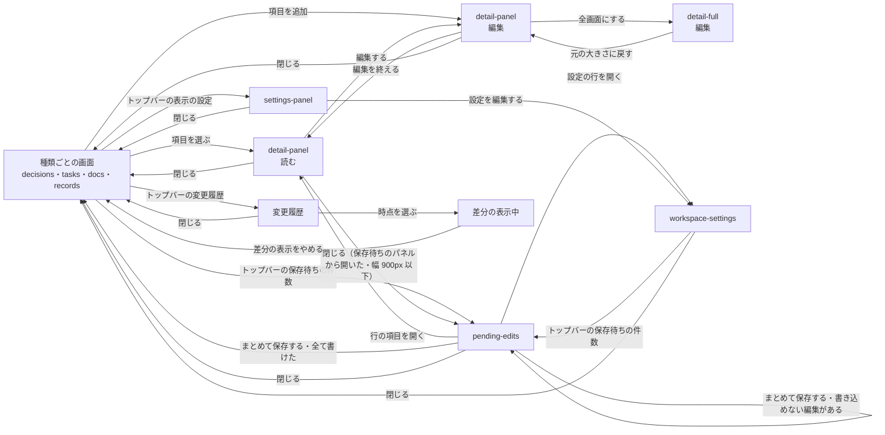

# プレビュー

## 現状

<!-- table: data -->

| 分類 | ページ / ファイル | 概要 | 補足 |
| --- | --- | --- | --- |
| ドキュメント | [設計書/インターフェース定義/プレビュー/プレビューを開く](https://github.com/shuhei1101/mindstella/blob/develop/dev/%E8%A8%AD%E8%A8%88%E6%9B%B8/%E3%82%A4%E3%83%B3%E3%82%BF%E3%83%BC%E3%83%95%E3%82%A7%E3%83%BC%E3%82%B9%E5%AE%9A%E7%BE%A9/%E3%83%97%E3%83%AC%E3%83%93%E3%83%A5%E3%83%BC/%E3%83%97%E3%83%AC%E3%83%93%E3%83%A5%E3%83%BC%E3%82%92%E9%96%8B%E3%81%8F.yaml) | 画面の開き方・記録の読み込み・送信 | 送るのはコメント・スレッド・表示の既定だけで、項目を書き換える送信は無い |
| ドキュメント | [設計書/画面設計/プレビュー/詳細パネル](https://github.com/shuhei1101/mindstella/blob/develop/dev/%E8%A8%AD%E8%A8%88%E6%9B%B8/%E7%94%BB%E9%9D%A2%E8%A8%AD%E8%A8%88/%E3%83%97%E3%83%AC%E3%83%93%E3%83%A5%E3%83%BC/%E8%A9%B3%E7%B4%B0%E3%83%91%E3%83%8D%E3%83%AB.yaml) | 項目 1 件の中身 | 読むだけ。編集の操作が無い |
| ドキュメント | [設計書/画面設計/プレビュー/詳細の全画面](https://github.com/shuhei1101/mindstella/blob/develop/dev/%E8%A8%AD%E8%A8%88%E6%9B%B8/%E7%94%BB%E9%9D%A2%E8%A8%AD%E8%A8%88/%E3%83%97%E3%83%AC%E3%83%93%E3%83%A5%E3%83%BC/%E8%A9%B3%E7%B4%B0%E3%81%AE%E5%85%A8%E7%94%BB%E9%9D%A2.yaml) | 詳細パネルの中身を大きく出す | 詳細パネルと同じく読むだけ |
| ドキュメント | [設計書/画面設計/プレビュー/検討事項](https://github.com/shuhei1101/mindstella/blob/develop/dev/%E8%A8%AD%E8%A8%88%E6%9B%B8/%E7%94%BB%E9%9D%A2%E8%A8%AD%E8%A8%88/%E3%83%97%E3%83%AC%E3%83%93%E3%83%A5%E3%83%BC/%E6%A4%9C%E8%A8%8E%E4%BA%8B%E9%A0%85.yaml)・[タスク](https://github.com/shuhei1101/mindstella/blob/develop/dev/%E8%A8%AD%E8%A8%88%E6%9B%B8/%E7%94%BB%E9%9D%A2%E8%A8%AD%E8%A8%88/%E3%83%97%E3%83%AC%E3%83%93%E3%83%A5%E3%83%BC/%E3%82%BF%E3%82%B9%E3%82%AF.yaml)・[資料](https://github.com/shuhei1101/mindstella/blob/develop/dev/%E8%A8%AD%E8%A8%88%E6%9B%B8/%E7%94%BB%E9%9D%A2%E8%A8%AD%E8%A8%88/%E3%83%97%E3%83%AC%E3%83%93%E3%83%A5%E3%83%BC/%E8%B3%87%E6%96%99.yaml)・[記録の表](https://github.com/shuhei1101/mindstella/blob/develop/dev/%E8%A8%AD%E8%A8%88%E6%9B%B8/%E7%94%BB%E9%9D%A2%E8%A8%AD%E8%A8%88/%E3%83%97%E3%83%AC%E3%83%93%E3%83%A5%E3%83%BC/%E8%A8%98%E9%8C%B2%E3%81%AE%E8%A1%A8.yaml) | 種類ごとの一覧 | 項目を足す操作が無い。差分の印・コメントの印は付くが、保存待ちの編集の印は無い |
| ドキュメント | [設計書/画面設計/プレビュー/変更履歴](https://github.com/shuhei1101/mindstella/blob/develop/dev/%E8%A8%AD%E8%A8%88%E6%9B%B8/%E7%94%BB%E9%9D%A2%E8%A8%AD%E8%A8%88/%E3%83%97%E3%83%AC%E3%83%93%E3%83%A5%E3%83%BC/%E5%A4%89%E6%9B%B4%E5%B1%A5%E6%AD%B4.yaml) | 差分の表示で比べる時点を選ぶ | 差分の表示中に編集を止める決まりが要る |
| ドキュメント | [設計書/部品設計/プレビュー/表](https://github.com/shuhei1101/mindstella/blob/develop/dev/%E8%A8%AD%E8%A8%88%E6%9B%B8/%E9%83%A8%E5%93%81%E8%A8%AD%E8%A8%88/%E3%83%97%E3%83%AC%E3%83%93%E3%83%A5%E3%83%BC/%E8%A1%A8.ts.yaml)・[トップバー](https://github.com/shuhei1101/mindstella/blob/develop/dev/%E8%A8%AD%E8%A8%88%E6%9B%B8/%E9%83%A8%E5%93%81%E8%A8%AD%E8%A8%88/%E3%83%97%E3%83%AC%E3%83%93%E3%83%A5%E3%83%BC/%E3%83%88%E3%83%83%E3%83%97%E3%83%90%E3%83%BC.ts.yaml) | 一覧の表と上端の帯 | 保存待ちの編集の件数・保存の入口が無い |
| ドキュメント | [設計書/モジュール構成/プレビュー/画面と部品.ts](https://github.com/shuhei1101/mindstella/blob/develop/dev/%E8%A8%AD%E8%A8%88%E6%9B%B8/%E3%83%A2%E3%82%B8%E3%83%A5%E3%83%BC%E3%83%AB%E6%A7%8B%E6%88%90/%E3%83%97%E3%83%AC%E3%83%93%E3%83%A5%E3%83%BC/%E7%94%BB%E9%9D%A2%E3%81%A8%E9%83%A8%E5%93%81.ts.yaml)・[基盤.ts](https://github.com/shuhei1101/mindstella/blob/develop/dev/%E8%A8%AD%E8%A8%88%E6%9B%B8/%E3%83%A2%E3%82%B8%E3%83%A5%E3%83%BC%E3%83%AB%E6%A7%8B%E6%88%90/%E3%83%97%E3%83%AC%E3%83%93%E3%83%A5%E3%83%BC/%E5%9F%BA%E7%9B%A4.ts.yaml)・[入口.ts](https://github.com/shuhei1101/mindstella/blob/develop/dev/%E8%A8%AD%E8%A8%88%E6%9B%B8/%E3%83%A2%E3%82%B8%E3%83%A5%E3%83%BC%E3%83%AB%E6%A7%8B%E6%88%90/%E3%83%97%E3%83%AC%E3%83%93%E3%83%A5%E3%83%BC/%E5%85%A5%E5%8F%A3.ts.yaml) | 画面・部品・サーバーとのやり取り・起動 | 編集の状態・保存待ちの編集の API が無い |
| ドキュメント | [設計書/デザイン方針.md](https://github.com/shuhei1101/mindstella/blob/develop/dev/%E8%A8%AD%E8%A8%88%E6%9B%B8/%E3%83%87%E3%82%B6%E3%82%A4%E3%83%B3%E6%96%B9%E9%87%9D.md) | 画面全体のデザインの方向性 | 変えない |
| 実装 | [plugins/mindstella/skills/mindmap/preview/screens/detail.ts](https://github.com/shuhei1101/mindstella/blob/develop/plugins/mindstella/skills/mindmap/preview/screens/detail.ts) | 詳細パネル | 読むだけの描画 |
| 実装 | [plugins/mindstella/skills/mindmap/preview/core/api.ts](https://github.com/shuhei1101/mindstella/blob/develop/plugins/mindstella/skills/mindmap/preview/core/api.ts) | サーバーとのやり取り | 記録の取得・書き換えの知らせ・コメント・スレッド・表示の既定 |
| 実装 | [plugins/mindstella/skills/mindmap/preview/app.ts](https://github.com/shuhei1101/mindstella/blob/develop/plugins/mindstella/skills/mindmap/preview/app.ts) | 起動・画面の振り分け | 配る書き出しかサーバーからの配信かで送信を出し分ける |

<!-- /table -->

## 変更方針

<!-- table: data -->

| 対象 | 方針 | 補足 |
| --- | --- | --- |
| 編集機能 | 詳細パネル・詳細の全画面から、項目のキー・本文・案・状態を書き換える入力に移れるようにする。参照のキー（`parent`・`depends_on` など）は ID を選ぶ入力にし、タグは語彙から選ぶ | 画面の置き方はモック作成で決める |
| 設定の編集 | 設定（題名・プレイブック・フェーズ・ゴール・対象・カテゴリー・タグの語彙など）を書き換える入口を置く | 置く画面はモック作成で決める |
| 作成機能 | 種類ごとの画面から、その種類の項目を足す入力を開けるようにする | ID は保存の時点でサーバーが振る |
| 削除機能 | 詳細から項目を消す編集を溜められるようにし、取り下げ・対象外・中止は状態の書き換えとして溜める | 指されている項目は保存で書き込めない編集として示す |
| 状態表示 | 保存待ちの編集がある項目・キー・案にバッジを付け、一覧（マップ・ボード・カード・表）の項目にも付ける。上端に保存待ちの件数と保存の入口を出す | バッジの形はモック作成で決める |
| 一括操作 | 保存待ちの編集を並べ、1 件ずつ取り消し、まとめて保存する | 保存は 1 回の送信で、書き込めない編集があれば何も書かない |
| エラー表示 | 書き込めない編集を、編集の横に理由とともに出す | |
| 差分の表示との関係 | 差分の表示中は編集の操作とバッジの入口を出さず、外すと出す | |
| 配る書き出し | 配る書き出しでは編集の操作を出さない | 今の送信の出し分けと同じ判定を使う |
| アクセシビリティ | 入力に読み上げの名前を付け、キーボードだけで編集・取り消し・保存ができる | 左のパネルに一部だけ覆われた押せる要素は、子をたどって `inert` にせず押せるまま残す（`core/dom.ts` の `inertBehind`） |
| レスポンシブ対応 | 幅 320px でも編集の入力と保存の入口が横にはみ出さない | |

<!-- /table -->

### 画面一覧

<!-- table: data -->

| 種別 | 画面 | 概要 | アクション | 判定の根拠 | 補足 |
| --- | --- | --- | --- | --- | --- |
| 変更 | [detail-panel](https://github.com/shuhei1101/mindstella/blob/develop/dev/mock/pages/detail-panel/index.md) | 項目 1 件の中身を読み、編集に切り替えてキー・本文・案・状態を書き換える。足す項目の入力もここで開く | 編集する 編集を終える キー・本文を書き換える 案を追加・変更・削除 採用する案を切り替える 取り下げる・対象外・中止にする 項目を削除 全画面にする | 一覧を見ながら 1 件を直すため、画面の横に出すパネルで編集する。追加は編集と同じ置き方にする | `未確定`（編集の置き方。決める段: モック作成）。保存待ちの編集があるキー・案にバッジを付ける。差分の表示中と配る書き出しでは編集の操作を出さない |
| 変更 | [detail-full](https://github.com/shuhei1101/mindstella/blob/develop/dev/mock/pages/detail-full/index.md) | 詳細パネルの編集を大きく出す | 詳細パネルと同じ 元の大きさに戻す | 詳細パネルの中身を大きく出す今の置き方のまま、長い本文の編集に使う | - |
| 変更 | [decisions](https://github.com/shuhei1101/mindstella/blob/develop/dev/mock/pages/decisions/index.md)・[tasks](https://github.com/shuhei1101/mindstella/blob/develop/dev/mock/pages/tasks/index.md)・[docs](https://github.com/shuhei1101/mindstella/blob/develop/dev/mock/pages/docs/index.md)・[records](https://github.com/shuhei1101/mindstella/blob/develop/dev/mock/pages/records/index.md) | 種類ごとの一覧に、項目を足す入口と保存待ちのバッジを出す | 項目を追加 項目を選ぶ | 足すのは見ている種類の項目のため、その種類の画面に入口を置く | records は足す種類（調査・用語集・メモ・会話ログ）を選んでから開く |
| 新規 | `workspace-settings` | 設定（題名・プレイブック・フェーズ・ゴール・対象・カテゴリー・タグの語彙など）の書き換え | 設定のキーを書き換える 閉じる | どの判定にも当たらず、入力が区画に分かれるため別の画面にする | `未確定`（置き方と入口。決める段: モック作成）。書き換えは保存待ちに溜める |
| 新規 | `pending-edits` | 保存待ちの編集を並べ、1 件ずつ取り消し、まとめて保存する | 行の項目を開く 1 件を取り消す まとめて保存する 閉じる | 一覧から 1 件を選んで中身を見る関係のため、左のパネルに並べ、選んだ項目を右の詳細パネルで開く（コメントの一覧と同じ置き方） | コメントの一覧・表示の設定とは片方だけを開く。書き込めない編集は行に理由を出す。消す編集を含むときは、保存のボタンの文言に消す件数を出す（例:「まとめて保存する（1 件を削除）」）か、消す行を並びの先頭に分けて出す（どちらにするかと形はモック作成で決める） |
| 変更 | [settings-panel](https://github.com/shuhei1101/mindstella/blob/develop/dev/mock/pages/settings-panel/index.md) | 表示の設定のパネルの下端に、設定の画面を開く入口を出す | 設定を編集する | 今の左のパネルのまま入口だけを足す | `未確定`（設定の画面の入口。決める段: モック作成） |
| 変更 | [components/topbar](https://github.com/shuhei1101/mindstella/blob/develop/dev/mock/components/topbar/index.html) | 保存待ちの件数と保存の入口を出す | 保存待ちを開く | - | `未確定`（保存の入口。決める段: モック作成）。差分の表示中と配る書き出しでは出さない |
| 新規 | `components/pending-mark` | 保存待ちの編集がある項目・キー・案のバッジ | - | - | マップ・ボード・カード・表と詳細パネルで同じ部品を使う。差分の印（+ ● −）と見分けられる形にする |

<!-- /table -->

`未確定`: 編集の置き方（決める段: モック作成）

| 案 | 内容 | メリット | デメリット |
| --- | --- | --- | --- |
| A | 詳細パネル・詳細の全画面の中で、読む表示と編集を切り替える | 一覧を見ながら直せ、読んでいた位置から編集に移れる | パネルの幅で本文を書くと狭い（全画面で補う） |
| B | 編集を別の画面にする | 入力の区画を広く取れる | 一覧と元の中身が見えなくなり、参照のキーで ID を選ぶときに戻る往復が出る |

推奨: A

参照のキーやタグを選ぶとき、一覧の項目を見比べながら入力する。

`未確定`: 編集を保存待ちに溜める時点（決める段: モック作成）

| 案 | 内容 | メリット | デメリット |
| --- | --- | --- | --- |
| A | キーの入力を終えたとき（フォーカスを外したとき）に、そのキーの編集を溜める | 閉じても入力が消えず、閉じるときの確認が要らない | 書きかけの値も溜まる（保存待ちで取り消す） |
| B | 編集の「溜める」で、開いている項目の編集をまとめて溜める | 溜める単位が利用者に見える | 溜めずに閉じると入力が消えるため、閉じるときに確認を挟む |

推奨: A

詳細パネルは一覧の項目を選ぶたびに中身が替わり、そのたびに確認を挟むと操作が止まる。

`未確定`: 設定の画面の置き方と入口（決める段: モック作成）

| 案 | 内容 | メリット | デメリット |
| --- | --- | --- | --- |
| A | 別の画面にし、表示の設定のパネルの下端に開く入口を置く | どの幅でも同じ入口で、トップバーの要素が増えない | 表示の設定を開いてから操作が 1 つ増える |
| B | 別の画面にし、トップバーの題名から開く。幅 390px 以下は題名を隠すため、表示の設定のパネルに同じ入口を出す | 広い幅では 1 回で開ける | 入口が幅で 2 か所に分かれる。題名は押せる見た目を持たない |
| C | 別の画面にし、トップバーに設定のボタンを足す | 1 回で開ける | 幅 320px のトップバーはボタンを詰め切っており、詰め方の作り直しが要る |
| D | 表示の設定のパネルにタブで並べる | 入口が増えない | 端末だけの表示の上書きと、ワークスペースの設定の書き換えが同じパネルに混ざる |

推奨: A

表示の設定のパネルは「ワークスペースの既定にする」でワークスペースへ書く操作を既に持ち、入口が幅で変わらない。
中身は端末ごとの上書きと分けるため、別の画面にする。

`未確定`: トップバーの保存の入口（決める段: モック作成）

| 案 | 内容 | メリット | デメリット |
| --- | --- | --- | --- |
| A | 件数のボタンだけを置き、保存待ちのパネルを開いて保存する | 保存の前に消す項目を含む並びを必ず見る | 保存までの操作が 1 つ増える |
| B | 件数のボタンと保存のボタンを並べ、保存は上端から直接行う | 1 回の操作で保存できる | 消す項目を見ずに保存でき、書き込めない編集はパネルを開いて確かめ直す |

推奨: A

保存は削除を含めて画面から戻せないため、並びを見てから保存する。

### 画面遷移

差分の表示中に移ると、開いていた保存待ちのパネルを閉じ、詳細パネルは読む表示に戻す。
保存待ちの編集は差分の表示中も残り、差分の表示をやめるとバッジと件数を出し直す。
推奨の案（編集は詳細パネルの中で切り替え・設定は表示の設定のパネルから開く別の画面・保存はパネルから）で描いた。

## テスト結果

テスト作成・実装で記入する。
