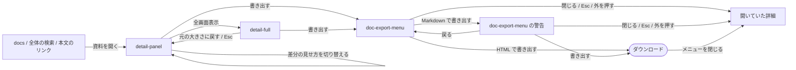

# プレビュー

## 現状

| 分類 | ページ / ファイル | 概要 | 補足 |
| --- | --- | --- | --- |
| ドキュメント | [設計書/モジュール構成/プレビュー/基盤.ts.yaml](https://github.com/shuhei1101/mindstella/blob/develop/dev/%E8%A8%AD%E8%A8%88%E6%9B%B8/%E3%83%A2%E3%82%B8%E3%83%A5%E3%83%BC%E3%83%AB%E6%A7%8B%E6%88%90/%E3%83%97%E3%83%AC%E3%83%93%E3%83%A5%E3%83%BC/%E5%9F%BA%E7%9B%A4.ts.yaml) | mdmark の読み込みと呼び出し（重なる機能のオフ）・用語・資料・調査のマーカーの一致・`html` のコードブロックの置き換え | 更新対象（埋め込んだ HTML と部品を mdmark で描く・一致を mdmark へ移す） |
| ドキュメント | [設計書/モジュール構成/プレビュー/画面と部品.ts.yaml](https://github.com/shuhei1101/mindstella/blob/develop/dev/%E8%A8%AD%E8%A8%88%E6%9B%B8/%E3%83%A2%E3%82%B8%E3%83%A5%E3%83%BC%E3%83%AB%E6%A7%8B%E6%88%90/%E3%83%97%E3%83%AC%E3%83%93%E3%83%A5%E3%83%BC/%E7%94%BB%E9%9D%A2%E3%81%A8%E9%83%A8%E5%93%81.ts.yaml) | 詳細パネル・詳細の全画面の本文の描画 | 更新対象（書き出しの操作） |
| ドキュメント | [設計書/モジュール構成/プレビュー/差分.ts.yaml](https://github.com/shuhei1101/mindstella/blob/develop/dev/%E8%A8%AD%E8%A8%88%E6%9B%B8/%E3%83%A2%E3%82%B8%E3%83%A5%E3%83%BC%E3%83%AB%E6%A7%8B%E6%88%90/%E3%83%97%E3%83%AC%E3%83%93%E3%83%A5%E3%83%BC/%E5%B7%AE%E5%88%86.ts.yaml) | 本文の差分の塊の分け方と描画 | 更新対象（埋め込んだ HTML の差分） |
| ドキュメント | [設計書/部品設計/プレビュー/HTMLの本文の枠.ts.yaml](https://github.com/shuhei1101/mindstella/blob/develop/dev/%E8%A8%AD%E8%A8%88%E6%9B%B8/%E9%83%A8%E5%93%81%E8%A8%AD%E8%A8%88/%E3%83%97%E3%83%AC%E3%83%93%E3%83%A5%E3%83%BC/HTML%E3%81%AE%E6%9C%AC%E6%96%87%E3%81%AE%E6%9E%A0.ts.yaml) | HTML の本文と `html` のコードブロックをスクリプトを動かさない枠に描く | 確認対象（`html` のコードブロックの描き方が替わる） |
| ドキュメント | [設計書/部品設計/プレビュー/HTMLの本文の差分.ts.yaml](https://github.com/shuhei1101/mindstella/blob/develop/dev/%E8%A8%AD%E8%A8%88%E6%9B%B8/%E9%83%A8%E5%93%81%E8%A8%AD%E8%A8%88/%E3%83%97%E3%83%AC%E3%83%93%E3%83%A5%E3%83%BC/HTML%E3%81%AE%E6%9C%AC%E6%96%87%E3%81%AE%E5%B7%AE%E5%88%86.ts.yaml) | 描いた結果と原文の差分の切り替え | 更新対象（埋め込んだ HTML にも当てる） |
| ドキュメント | [設計書/部品設計/プレビュー/Markdownの本文.ts.yaml](https://github.com/shuhei1101/mindstella/blob/develop/dev/%E8%A8%AD%E8%A8%88%E6%9B%B8/%E9%83%A8%E5%93%81%E8%A8%AD%E8%A8%88/%E3%83%97%E3%83%AC%E3%83%93%E3%83%A5%E3%83%BC/Markdown%E3%81%AE%E6%9C%AC%E6%96%87.ts.yaml) | 本文の Markdown の部品 | 更新対象 |
| ドキュメント | [設計書/部品設計/プレビュー/本文の印のツールチップ.ts.yaml](https://github.com/shuhei1101/mindstella/blob/develop/dev/%E8%A8%AD%E8%A8%88%E6%9B%B8/%E9%83%A8%E5%93%81%E8%A8%AD%E8%A8%88/%E3%83%97%E3%83%AC%E3%83%93%E3%83%A5%E3%83%BC/%E6%9C%AC%E6%96%87%E3%81%AE%E5%8D%B0%E3%81%AE%E3%83%84%E3%83%BC%E3%83%AB%E3%83%81%E3%83%83%E3%83%97.ts.yaml) | 用語・資料・調査のマーカーのツールチップ | 更新対象（mdmark の一致の結果に付ける） |
| ドキュメント | [設計書/画面設計/プレビュー/詳細パネル.yaml](https://github.com/shuhei1101/mindstella/blob/develop/dev/%E8%A8%AD%E8%A8%88%E6%9B%B8/%E7%94%BB%E9%9D%A2%E8%A8%AD%E8%A8%88/%E3%83%97%E3%83%AC%E3%83%93%E3%83%A5%E3%83%BC/%E8%A9%B3%E7%B4%B0%E3%83%91%E3%83%8D%E3%83%AB.yaml) | 詳細パネルの要素 | 更新対象（書き出しの操作） |
| ドキュメント | [設計書/画面設計/プレビュー/詳細の全画面.yaml](https://github.com/shuhei1101/mindstella/blob/develop/dev/%E8%A8%AD%E8%A8%88%E6%9B%B8/%E7%94%BB%E9%9D%A2%E8%A8%AD%E8%A8%88/%E3%83%97%E3%83%AC%E3%83%93%E3%83%A5%E3%83%BC/%E8%A9%B3%E7%B4%B0%E3%81%AE%E5%85%A8%E7%94%BB%E9%9D%A2.yaml) | 詳細の全画面の要素 | 更新対象（書き出しの操作） |
| ドキュメント | [設計書/インターフェース定義/プレビュー/プレビューを開く.yaml](https://github.com/shuhei1101/mindstella/blob/develop/dev/%E8%A8%AD%E8%A8%88%E6%9B%B8/%E3%82%A4%E3%83%B3%E3%82%BF%E3%83%BC%E3%83%95%E3%82%A7%E3%83%BC%E3%82%B9%E5%AE%9A%E7%BE%A9/%E3%83%97%E3%83%AC%E3%83%93%E3%83%A5%E3%83%BC/%E3%83%97%E3%83%AC%E3%83%93%E3%83%A5%E3%83%BC%E3%82%92%E9%96%8B%E3%81%8F.yaml) | mdmark の読み込みと知らせ | 更新対象（mdmark のバージョン） |
| ドキュメント | [設計書/外部ライブラリ/mdmark.yaml](https://github.com/shuhei1101/mindstella/blob/develop/dev/%E8%A8%AD%E8%A8%88%E6%9B%B8/%E5%A4%96%E9%83%A8%E3%83%A9%E3%82%A4%E3%83%96%E3%83%A9%E3%83%AA/mdmark.yaml) | 採用している mdmark v0.7.0 | 更新対象（mdmark#102 を含むバージョン・使う API と部品） |
| 実装 | [preview/core/libs.ts](https://github.com/shuhei1101/mindstella/blob/develop/plugins/mindstella/skills/mindmap/preview/core/libs.ts) | `MDMARK_FEATURES`（glossary ほかをオフ）・`renderMarkdown`・用語の一致の正規表現 | 更新対象 |
| 実装 | [preview/components/html-body-frame.ts](https://github.com/shuhei1101/mindstella/blob/develop/plugins/mindstella/skills/mindmap/preview/components/html-body-frame.ts) | スクリプトを動かさない枠（`sandbox="allow-same-origin"`） | 確認対象 |
| 実装 | [preview/components/html-body-diff.ts](https://github.com/shuhei1101/mindstella/blob/develop/plugins/mindstella/skills/mindmap/preview/components/html-body-diff.ts) | HTML の本文の差分 | 更新対象 |
| 実装 | [preview/components/term-tip.ts](https://github.com/shuhei1101/mindstella/blob/develop/plugins/mindstella/skills/mindmap/preview/components/term-tip.ts) | マーカーのツールチップ | 更新対象 |

## 変更方針

| 対象 | 方針 | 補足 |
| --- | --- | --- |
| 埋め込んだ HTML | mdmark の HTML の埋め込みの機能で、Markdown の資料の中の HTML を描いた結果のまま出す | 範囲（`.mdmark-html`）は行のマーカー（`data-line-start`）を持たない。範囲の中の選んだ箇所の求め方は画面設計で決める |
| 図・チャート | 埋め込んだ HTML の中の図・チャートを mdmark の部品で描き、チャートを拡大・縮小とドラッグで動かせる | - |
| 操作できる部品 | スライダー・グラフ・今の値をコピーするボタンを mdmark の部品で描き、動かした値を JSON でクリップボードへコピーする | - |
| 用語・エイリアスの一致 | 一致と一致の前の正規化（NFKC・英字の大文字小文字・前後の空白）を mdmark に受け持たせ、`core/libs.ts` の一致の正規表現を外す。マーカーとツールチップは、mdmark の一致の結果（`collectMatches` の位置と参照先）へ部品『本文の印のツールチップ』を付け、今の振る舞い（全ての出現に付ける・項目の ID を持ち押すと詳細を開く・種類ごとの見出し・1 つの語が複数の項目に一致・開いている項目自身と取り下げた資料・調査を除く）を保つ | 5 点とも mindstella 側で満たす（`## PoC 結果`） |
| HTML の中のツールチップとリンク | 埋め込んだ HTML の中の文にも、用語・資料・調査のマーカーとツールチップ、項目の ID のリンクを付ける | - |
| 差分 | 埋め込んだ HTML の変更を、既定はソースの行と文字の色分け、切り替えで描いた結果の前と後で出す。範囲にも部品『HTMLの本文の差分』を使い、既定の見せ方と変更前の描いた結果を部品の引数に加える。左右に並べる表示は部品の `SideRendered`・`SideRaw` に従う | 差分を mdmark へ寄せるのは #347 |
| 資料の書き出し | 詳細パネルと詳細の全画面に書き出しの操作を置き、Markdown か 1 枚の HTML を選ぶ。Markdown を選んだときは、埋め込んだ HTML が消えることと共通のスタイルが外れることを確かめてから書き出す | 1 枚の HTML はプレビューの画面で組み立てる。用語のツールチップは mdmark の用語の機能で描く |
| mdmark のバージョン | mdmark#102 を含むバージョンへ上げ、固定した jsDelivr の URL と `integrity` を替える | v0.8.0 がリリースされていなければ、実装の前に待つ |
| アクセシビリティ | 書き出しの操作と警告はキーボードで操作でき、部品の読み上げの名前は mdmark の部品の決まりに従う | - |
| 外部ライブラリ | 増やすライブラリはバージョンを固定し、配る書き出しが中に持つときはライセンスの表示に加える | `未確定`（コードの色付け） |

`未確定`: mdmark v0.8.0 のコードの色付け（決める段: モジュール構成設計）

mdmark v0.8.0 の `syntax` の機能は、コードブロックを描くときに highlight.js を jsDelivr から integrity なしで読む。

| 案 | 内容 | メリット | デメリット |
| --- | --- | --- | --- |
| A | プレビュー・配る書き出し・資料の書き出しの mdmark で `syntax` を止める | 外への読み込みが増えず、ネットにつながらない端末でも同じに描かれる | コードブロックに色が付かない |
| B | highlight.js をバージョンを固定して integrity で確かめて読み、書き出しは中に持たせる | コードブロックに色が付く | 外部ライブラリとライセンスの表示が 1 つ増え、書き出しが大きくなる |

推奨: A

今のプレビューもコードブロックに色を付けておらず、要件に色付けが無い。

### 画面一覧

| 種別 | 画面 | 概要 | アクション | 判定の根拠 | 補足 |
| --- | --- | --- | --- | --- | --- |
| 変更 | `detail-panel` | 資料の本文に埋め込んだ HTML・図・チャート・操作できる部品を描いて動かし、見出しに資料の書き出しの入口を置く | チャートを拡大・縮小する<br>拡大したチャートをドラッグで動かす<br>操作できる部品の値を動かす<br>今の値をコピーする<br>用語・資料・調査のマーカーに乗せる<br>項目の ID を押す<br>書き出す | 機能・情報の置き方: 部品の値を動かしながら本文を読み、コピーした値を下端のコメントの入力に貼るため、同じ画面に並べる | チャートの拡大・縮小と移動はその場で行い、図の拡大（`diagram-viewer`）は開かない。埋め込んだ HTML の中のマーカーと項目の ID のリンクは、本文の中と同じ動き（ツールチップを出す・押すとその項目へ移り履歴に積む）。書き出しの入口は、資料で本文が Markdown のときだけ出す |
| 変更 | `detail-full` | `detail-panel` と同じ本文の描画と書き出しの入口 | `detail-panel` と同じ | 構造と遷移: 詳細パネルの中身を大きく出す画面のため、同じ要素を並べる | - |
| 変更 | `detail-panel`（差分の表示） | 埋め込んだ HTML の変更を、既定は原文の行と文字の色分けで出し、変更前・変更後の描いた結果に切り替える | 原文の差分を見る<br>変更前の描いた結果を見る<br>変更後の描いた結果を見る | 機能・情報の置き方: 同じ変更の見せ方の切り替えのため、同じ画面の中で切り替える（セグメント） | 埋め込んだ HTML の範囲ごとに、部品『HTMLの本文の差分』で出す。部品の引数に既定の見せ方（範囲では原文の差分）と変更前の描いた結果の見せ方を加え、引数の既定は今の振る舞い（既定は描いた結果・変更前の描いた結果を出さない）にして、HTML の本文の差分は変えない。左右に並べる表示は部品の `SideRendered`・`SideRaw` に従う。切り替えは履歴に積まない。詳細の全画面も同じ |
| 新規 | `doc-export-menu` | 書き出しの入口から開き、書き出す形式を選ぶ。Markdown を選んだときは、埋め込んだ HTML が消えることと共通のスタイルが外れることを警告してから書き出す | Markdown で書き出す<br>HTML で書き出す<br>警告を読んで書き出す<br>警告から戻る<br>閉じる | 操作の置き場所: 入力が無く形式を選ぶだけのため、その場（入口のボタンから開くメニュー）で行う。モーダル: 詳細の全画面はモーダルのため、警告をモーダルにせずメニューの中で出す | 書き出しはプレビューの画面で組み立ててダウンロードさせ、画面は移らない。開閉は履歴に積まない。Esc とメニューの外を押すと閉じ、入口のボタンへフォーカスを戻す。警告の置き方と、配る書き出しで入口を出すかは `未確定` |

`未確定`: Markdown の書き出しの警告の置き方（決める段: モック作成）

| 案 | 内容 | メリット | デメリット |
| --- | --- | --- | --- |
| A | メニューの中で「Markdown で書き出す」を押すと、同じメニューの中身を警告と「書き出す」「戻る」に替える | 詳細パネルと詳細の全画面で同じ置き方になり、モーダルの上にモーダルを重ねない | メニューの幅に警告の文を収める |
| B | 確認のモーダルで警告を出す | 警告を読み落としにくい | 詳細の全画面ではモーダルの上にモーダルを開くことになり、外部規約『画面の分け方』のモーダルの決まりに外れる |

推奨: A

詳細パネルと詳細の全画面のどちらから書き出しても同じ操作で済み、規約の外れが無い。

`未確定`: 配る書き出しで資料の書き出しの入口を出すか（決める段: モジュール構成設計）

| 案 | 内容 | メリット | デメリット |
| --- | --- | --- | --- |
| A | 出す。配る書き出しが中に持つ mdmark の CSS と JavaScript から 1 枚の HTML を組み立てる | 配る書き出しを受け取った人も資料を 1 件ずつ書き出せる | 配る書き出しの中から mdmark の CSS と JavaScript の文字列を取り出す処理が増える |
| B | 出さない | 組み立ての元をプレビューの配信の 1 通りに絞れる | 配る書き出しを受け取った人は資料を書き出せない |

推奨: A

書き出しはサーバーを使わずに画面で組み立てるため、配る書き出しでも同じ操作が成り立つ。取り出しが成り立つかはモジュール構成設計で確かめ、成り立たなければ B にする。

### 画面遷移



`開いていた詳細` は、書き出しの入口を押した `detail-panel` か `detail-full`。

## PoC 結果

PoC PR: [#349](https://github.com/shuhei1101/mindstella/pull/349)（closed）。
全ての観点を mdmark の `release/v0.8.0` の commit `a8c3d80` の dist で、詳細パネルと書き出した 1 枚の HTML を Playwright で操作して測った（測った値は [result-a8c3d80-collect.json](https://github.com/shuhei1101/mindstella/blob/f1376c3fda12525bfa138c45ef69d9d210c14929/poc/mdmark-embed/result-a8c3d80-collect.json)、v0.7.0 の今のプレビューの基準は [result-v0.7.0-baseline.json](https://github.com/shuhei1101/mindstella/blob/f1376c3fda12525bfa138c45ef69d9d210c14929/poc/mdmark-embed/result-v0.7.0-baseline.json)）。

<!-- table: data -->

| 検証構成 | 成功条件 | 結果 | PoC PR | 補足 |
| --- | --- | --- | --- | --- |
| 埋め込んだ HTML | 範囲の HTML が要素で描かれ、前後のブロックが行のマーカーを保ち、範囲の外の `html` のコードブロックは HTML の本文の枠のまま | ✅ 要素 24・前後の行 3 と 41・範囲の外は枠 1 | [#349](https://github.com/shuhei1101/mindstella/pull/349)（closed） | 範囲の中の `<script>` は 0。範囲そのものは行のマーカーを持たない。JSON の `outsideHtmlFrames` の 0 は計測のセレクタ（`.html-block iframe`）の誤りで、範囲の外の枠は `lineMarks` の `IFRAME`（行 44）で判定した |
| チャート | ボタンとキーで倍率が変わり、拡大した後のドラッグで表示の位置が変わる | ✅ 92% → 115% → 144%・(166, 83) → (286, 163) | [#349](https://github.com/shuhei1101/mindstella/pull/349)（closed） | - |
| 操作できる部品 | 矢印キーで系列が描き直され、コピーで `{"{key}": {"name": ..., "value": ...}}` が入る | ✅ 値 1 → 2・`{"strength": {"name": "反応の強さ", "value": 2}}` | [#349](https://github.com/shuhei1101/mindstella/pull/349)（closed） | ボタンの文言は「今の値を写す」。JSON の `embedded.param` の false は計測のセレクタ（`figure[data-diagram='param']`）の誤りで、`param` の値で判定した |
| 用語: 出現 | 本文 3 か所と埋め込んだ HTML 1 か所の全てにマーカー | ✅ 4 か所 | [#349](https://github.com/shuhei1101/mindstella/pull/349)（closed） | mindstella で満たす。mdmark の描画は同じ語の 2 回目から付けない |
| 用語: 要素と ID | `data-id` / `data-ids` を持ち押すと詳細を開く。`A-1` の形の ID がリンクになる | ✅ `data-ids="G-1 R-1"`・ID のリンク 2 か所（本文・埋め込んだ HTML）・押すと `id=A-2` | [#349](https://github.com/shuhei1101/mindstella/pull/349)（closed） | mindstella で満たす（ID は今の正規表現のまま） |
| 用語: ツールチップ | 用語 → 資料 → 調査の見出しと件数、タイトルで詳細へ移る | ✅ 「用語 1」「調査 1」・押すと `id=G-1` | [#349](https://github.com/shuhei1101/mindstella/pull/349)（closed） | mindstella で満たす（部品『本文の印のツールチップ』は変えない） |
| 用語: 複数の一致 | 同じエイリアスの用語 2 件が並ぶ | ✅ 「用語 3」に G-1・G-2・G-3 | [#349](https://github.com/shuhei1101/mindstella/pull/349)（closed） | mindstella で満たす。mdmark は 1 語に 1 用語で、正規化の後に同じになる語（`response` と `Response`）は先の用語だけを返す |
| 用語: 除外 | 開いている項目自身と取り下げた資料・調査のエイリアスに付かない | ✅ 0 件 | [#349](https://github.com/shuhei1101/mindstella/pull/349)（closed） | mindstella で満たす（mdmark に渡さない） |
| 一致の正規化 | 全角半角・英字の大文字小文字・空白の違いで一致する | ✅ `ＲＥＳＰＯＮＳＥ`・`LATENCY`・`応答　時間` | [#349](https://github.com/shuhei1101/mindstella/pull/349)（closed） | mdmark で満たす |
| 書き出し | `file://` を通信を止めて開き、本文・チャート・用語のツールチップ・スライダー・コピーが動き、外への要求が 0 件 | ✅ 477,542 バイト・外への要求 0 件 | [#349](https://github.com/shuhei1101/mindstella/pull/349)（closed） | mdmark の `syntax` を止めたとき。止めないと highlight.js を 1 件読む |
| 資源 | ブラウザ全体の私用メモリの増え分とページの JavaScript のヒープを記録する | ✅ 94 MB・8.7 MB | [#349](https://github.com/shuhei1101/mindstella/pull/349)（closed） | v0.7.0 の今のプレビューは 93 MB・8.2 MB。測る前の空きは WSL 13,644 MB・Windows 約 8,600 MB・`get_capacity` 2 / 3 |

<!-- /table -->

成立。
要件.md の PoC 検証で決める 3 件は、推奨の A で確定した。
用語の 5 点は、一致と正規化を mdmark の `collectMatches`、マーカーとツールチップを mindstella が受け持って満たした。
設計で扱う mdmark との違いは次の 4 つ。

- `collectMatches` は `meaning` が空の用語を照合しない（語ごとの用語に `meaning` を入れて渡す）
- インラインコードを照合しない（中身がちょうど語のインラインコードは mindstella が付ける）
- 英字の語の直後が `-` でも一致する（`API-2` の `API`）。今の mindstella は一致させない
- 正規化の後に同じになる別の語は 1 つにまとまる（語そのものを文書として渡し、まとまる先へ項目の ID を寄せる）

v0.8.0 のタグが付いたら、タグの commit が `a8c3d80` と違うときだけ、変わった `src` が観点に当たる箇所を PoC PR の `tests/integration/preview/test_poc_mdmark_embed.py` で取り直す。取り直す前に、このテストの範囲の外の枠と部品（`div.mdmark-param`）のセレクタを修正する。

最小再現コードの要点（[core/libs.ts の markWordsWithMdmark](https://github.com/shuhei1101/mindstella/blob/f1376c3fda12525bfa138c45ef69d9d210c14929/plugins/mindstella/skills/mindmap/preview/core/libs.ts)）:

```ts
const words = [...byWord.keys()];
const terms = words.map((word, n) => ({ id: `W-${n}`, term: word, meaning: word }));
const docs = [{ id: "SELF", path: "self.md", title: "self" }, ...words.map((_, n) => ({ id: `S-${n}`, path: `w${n}.md`, title: `w${n}` }))];
const documents: Record<string, string> = { "self.md": source };
for (const [n, word] of words.entries()) documents[`w${n}.md`] = word;
const result = mdmark.collectMatches({ index: { docs, terms }, documents });
// 語そのものの一致で、正規化の後にまとまる先の用語へ項目の ID を寄せる
for (const [n, word] of words.entries()) {
  const whole = (result.byDocument[`S-${n}`] ?? []).find((m) => m.line === 1 && m.start === 0 && m.end === word.length);
  const key = whole?.id ?? `W-${n}`;
  merged.set(key, [...new Set([...(merged.get(key) ?? []), ...byWord.get(word)!])].sort((a, b) => rank(a) - rank(b)));
}
// 一致の行と文字の位置から元の語を取り、行のマーカーで区切った描いた本文の文字の中で、前の一致の後ろから探して印を付ける
const matches = (result.byDocument["SELF"] ?? []).map((m) => ({ line: m.line, word: lines[m.line - 1].slice(m.start, m.end), ids: merged.get(m.id) ?? [] }));
```

diff の見どころ: `core/libs.ts` の `markWordsWithMdmark`（一致の位置から描いた本文への対応付け）、[poc/mdmark-embed/export.js](https://github.com/shuhei1101/mindstella/blob/f1376c3fda12525bfa138c45ef69d9d210c14929/poc/mdmark-embed/export.js)（mdmark の JavaScript を `text/plain` で持たせ、Blob の URL から `import()` する 1 枚の HTML の組み立て）、`template.html` の mdmark の URL と `integrity`。

## テスト結果
