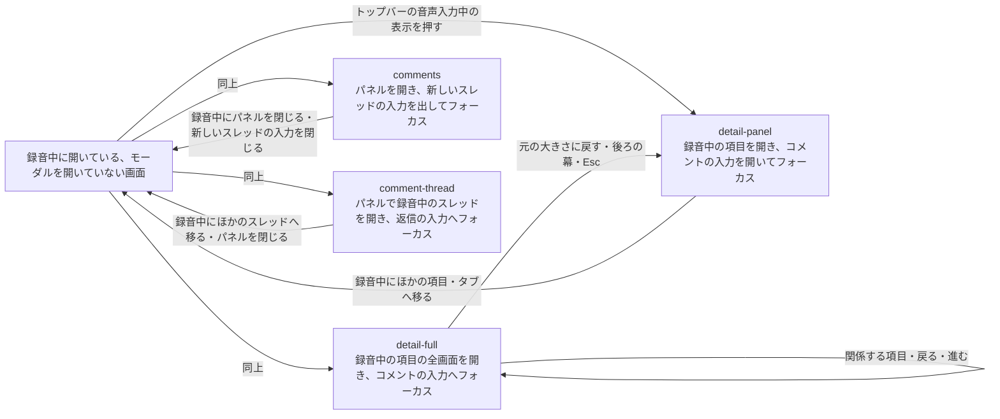

# プレビュー

## 現状

<!-- table: data -->

| 分類 | ページ / ファイル | 概要 | 補足 |
| --- | --- | --- | --- |
| ドキュメント | [docs/scenario/SC-489-45.yaml](https://github.com/shuhei1101/mindstella/blob/efe539e4d550ea0364230a9ecdde9a1715825fe5/docs/scenario/SC-489-45.yaml) | 単一ユースケース『音声でコメントする』 | 既定の `insert`、録音中の移動で録音を捨てる前提。更新対象 |
| ドキュメント | [docs/scenario/SC-489-36.yaml](https://github.com/shuhei1101/mindstella/blob/efe539e4d550ea0364230a9ecdde9a1715825fe5/docs/scenario/SC-489-36.yaml) | 単一ユースケース『設定の更新』 | 文字起こし後の挙動の値。追従 |
| ドキュメント | [docs/component/CMP-489-7.ts.yaml](https://github.com/shuhei1101/mindstella/blob/efe539e4d550ea0364230a9ecdde9a1715825fe5/docs/component/CMP-489-7.ts.yaml)・[CMP-489-8.tsx.yaml](https://github.com/shuhei1101/mindstella/blob/efe539e4d550ea0364230a9ecdde9a1715825fe5/docs/component/CMP-489-8.tsx.yaml)・[CMP-489-55.ts.yaml](https://github.com/shuhei1101/mindstella/blob/efe539e4d550ea0364230a9ecdde9a1715825fe5/docs/component/CMP-489-55.ts.yaml)・[CMP-489-56.tsx.yaml](https://github.com/shuhei1101/mindstella/blob/efe539e4d550ea0364230a9ecdde9a1715825fe5/docs/component/CMP-489-56.tsx.yaml) | 部品設計『コメントの入力』『返信の入力』（今の画面・React） | マイクのボタンの状態・確定の結果。更新対象 |
| ドキュメント | [docs/component/CMP-489-19.ts.yaml](https://github.com/shuhei1101/mindstella/blob/efe539e4d550ea0364230a9ecdde9a1715825fe5/docs/component/CMP-489-19.ts.yaml)・[CMP-489-20.tsx.yaml](https://github.com/shuhei1101/mindstella/blob/efe539e4d550ea0364230a9ecdde9a1715825fe5/docs/component/CMP-489-20.tsx.yaml) | 部品設計『トップバー』（今の画面・React） | 録音中の表示が無い。更新対象 |
| ドキュメント | [docs/screen/SCR-489-27.yaml](https://github.com/shuhei1101/mindstella/blob/efe539e4d550ea0364230a9ecdde9a1715825fe5/docs/screen/SCR-489-27.yaml)・[SCR-489-28.tsx.yaml](https://github.com/shuhei1101/mindstella/blob/efe539e4d550ea0364230a9ecdde9a1715825fe5/docs/screen/SCR-489-28.tsx.yaml) | 画面設計『設定の画面』 | 文字起こし後の挙動の選択肢と既定。更新対象 |
| ドキュメント | [docs/screen/SCR-489-1.yaml](https://github.com/shuhei1101/mindstella/blob/efe539e4d550ea0364230a9ecdde9a1715825fe5/docs/screen/SCR-489-1.yaml)・[SCR-489-3.yaml](https://github.com/shuhei1101/mindstella/blob/efe539e4d550ea0364230a9ecdde9a1715825fe5/docs/screen/SCR-489-3.yaml)・[SCR-489-29.yaml](https://github.com/shuhei1101/mindstella/blob/efe539e4d550ea0364230a9ecdde9a1715825fe5/docs/screen/SCR-489-29.yaml)・[SCR-489-31.yaml](https://github.com/shuhei1101/mindstella/blob/efe539e4d550ea0364230a9ecdde9a1715825fe5/docs/screen/SCR-489-31.yaml) と `.tsx` の対 | 画面設計『コメントの一覧』『スレッド』『詳細の全画面』『詳細パネル』 | 入力の結果・マイクのボタン。更新対象 |
| ドキュメント | [docs/interface/IF-489-70.yaml](https://github.com/shuhei1101/mindstella/blob/efe539e4d550ea0364230a9ecdde9a1715825fe5/docs/interface/IF-489-70.yaml)・[IF-489-71.yaml](https://github.com/shuhei1101/mindstella/blob/efe539e4d550ea0364230a9ecdde9a1715825fe5/docs/interface/IF-489-71.yaml) | インターフェース定義『SPAを開く』『プレビューを開く』 | マイクのボタンと文字起こし後の挙動の制約。更新対象 |
| ドキュメント | [docs/module/MOD-489-197.ts.yaml](https://github.com/shuhei1101/mindstella/blob/efe539e4d550ea0364230a9ecdde9a1715825fe5/docs/module/MOD-489-197.ts.yaml)・[MOD-489-124.ts.yaml](https://github.com/shuhei1101/mindstella/blob/efe539e4d550ea0364230a9ecdde9a1715825fe5/docs/module/MOD-489-124.ts.yaml)・[MOD-489-134.ts.yaml](https://github.com/shuhei1101/mindstella/blob/efe539e4d550ea0364230a9ecdde9a1715825fe5/docs/module/MOD-489-134.ts.yaml) | `voice.ts`（今の画面・React）と `use-voice-input.ts` | 録音を入力欄ごとに持つ。更新対象 |
| ドキュメント | [docs/module/MOD-489-214.ts.yaml](https://github.com/shuhei1101/mindstella/blob/efe539e4d550ea0364230a9ecdde9a1715825fe5/docs/module/MOD-489-214.ts.yaml)・[MOD-489-237.ts.yaml](https://github.com/shuhei1101/mindstella/blob/efe539e4d550ea0364230a9ecdde9a1715825fe5/docs/module/MOD-489-237.ts.yaml)・[MOD-489-83.tsx.yaml](https://github.com/shuhei1101/mindstella/blob/efe539e4d550ea0364230a9ecdde9a1715825fe5/docs/module/MOD-489-83.tsx.yaml)・[MOD-489-7.tsx.yaml](https://github.com/shuhei1101/mindstella/blob/efe539e4d550ea0364230a9ecdde9a1715825fe5/docs/module/MOD-489-7.tsx.yaml)・[MOD-489-223.ts.yaml](https://github.com/shuhei1101/mindstella/blob/efe539e4d550ea0364230a9ecdde9a1715825fe5/docs/module/MOD-489-223.ts.yaml)・[MOD-489-88.tsx.yaml](https://github.com/shuhei1101/mindstella/blob/efe539e4d550ea0364230a9ecdde9a1715825fe5/docs/module/MOD-489-88.tsx.yaml)・[MOD-489-171.ts.yaml](https://github.com/shuhei1101/mindstella/blob/efe539e4d550ea0364230a9ecdde9a1715825fe5/docs/module/MOD-489-171.ts.yaml)・[MOD-489-2.tsx.yaml](https://github.com/shuhei1101/mindstella/blob/efe539e4d550ea0364230a9ecdde9a1715825fe5/docs/module/MOD-489-2.tsx.yaml)・[MOD-489-220.ts.yaml](https://github.com/shuhei1101/mindstella/blob/efe539e4d550ea0364230a9ecdde9a1715825fe5/docs/module/MOD-489-220.ts.yaml)・[MOD-489-51.tsx.yaml](https://github.com/shuhei1101/mindstella/blob/efe539e4d550ea0364230a9ecdde9a1715825fe5/docs/module/MOD-489-51.tsx.yaml) | 入力の部品・トップバー・入口・外枠・設定の画面 | 更新対象 |
| 実装 | [plugins/mindstella/skills/mindmap/preview/core/voice.ts](https://github.com/shuhei1101/mindstella/blob/efe539e4d550ea0364230a9ecdde9a1715825fe5/plugins/mindstella/skills/mindmap/preview/core/voice.ts)・[frontend/src/shared/core/voice.ts](https://github.com/shuhei1101/mindstella/blob/efe539e4d550ea0364230a9ecdde9a1715825fe5/frontend/src/shared/core/voice.ts)・[frontend/src/shared/hooks/use-voice-input.ts](https://github.com/shuhei1101/mindstella/blob/efe539e4d550ea0364230a9ecdde9a1715825fe5/frontend/src/shared/hooks/use-voice-input.ts) | 録音・挿入・確定の結果の扱い | 更新対象 |
| 実装 | [plugins/mindstella/skills/mindmap/preview/components/send-form.ts](https://github.com/shuhei1101/mindstella/blob/efe539e4d550ea0364230a9ecdde9a1715825fe5/plugins/mindstella/skills/mindmap/preview/components/send-form.ts)・[reply-form.ts](https://github.com/shuhei1101/mindstella/blob/efe539e4d550ea0364230a9ecdde9a1715825fe5/plugins/mindstella/skills/mindmap/preview/components/reply-form.ts)・[frontend/src/shared/components/send-form.tsx](https://github.com/shuhei1101/mindstella/blob/efe539e4d550ea0364230a9ecdde9a1715825fe5/frontend/src/shared/components/send-form.tsx)・[frontend/src/features/comments/shared/reply-form.tsx](https://github.com/shuhei1101/mindstella/blob/efe539e4d550ea0364230a9ecdde9a1715825fe5/frontend/src/features/comments/shared/reply-form.tsx) | コメント・返信の入力 | 更新対象 |
| 実装 | [plugins/mindstella/skills/mindmap/preview/app.ts](https://github.com/shuhei1101/mindstella/blob/efe539e4d550ea0364230a9ecdde9a1715825fe5/plugins/mindstella/skills/mindmap/preview/app.ts)・[frontend/src/app/preview-shell.tsx](https://github.com/shuhei1101/mindstella/blob/efe539e4d550ea0364230a9ecdde9a1715825fe5/frontend/src/app/preview-shell.tsx)・[frontend/src/shared/components/topbar.tsx](https://github.com/shuhei1101/mindstella/blob/efe539e4d550ea0364230a9ecdde9a1715825fe5/frontend/src/shared/components/topbar.tsx) | 画面の切り替えとトップバー | 更新対象 |
| 実装 | [plugins/mindstella/skills/mindmap/preview/screens/workspace-settings.ts](https://github.com/shuhei1101/mindstella/blob/efe539e4d550ea0364230a9ecdde9a1715825fe5/plugins/mindstella/skills/mindmap/preview/screens/workspace-settings.ts)・[frontend/src/features/settings/workspace-settings/workspace-settings-screen.tsx](https://github.com/shuhei1101/mindstella/blob/efe539e4d550ea0364230a9ecdde9a1715825fe5/frontend/src/features/settings/workspace-settings/workspace-settings-screen.tsx) | 設定の画面の文字起こし後の挙動の選択 | 選択肢を足す。更新対象 |
| テスト | [tests/unit/preview/test_voice.py](https://github.com/shuhei1101/mindstella/blob/efe539e4d550ea0364230a9ecdde9a1715825fe5/tests/unit/preview/test_voice.py)・[frontend/src/shared/core/voice.test.ts](https://github.com/shuhei1101/mindstella/blob/efe539e4d550ea0364230a9ecdde9a1715825fe5/frontend/src/shared/core/voice.test.ts)・[frontend/src/shared/hooks/use-voice-input.test.ts](https://github.com/shuhei1101/mindstella/blob/efe539e4d550ea0364230a9ecdde9a1715825fe5/frontend/src/shared/hooks/use-voice-input.test.ts) ほか | 音声入力の単体テスト | 更新対象 |
| テスト | [tests/integration/preview/](https://github.com/shuhei1101/mindstella/blob/efe539e4d550ea0364230a9ecdde9a1715825fe5/tests/integration/preview/)・[tests/integration/storybook/](https://github.com/shuhei1101/mindstella/blob/efe539e4d550ea0364230a9ecdde9a1715825fe5/tests/integration/storybook/)・[tests/integration/storybook_react/](https://github.com/shuhei1101/mindstella/blob/efe539e4d550ea0364230a9ecdde9a1715825fe5/tests/integration/storybook_react/) | 音声入力・設定の画面の結合テストとストーリー | 更新対象 |

<!-- /table -->

## 変更方針

<!-- table: data -->

| 対象 | 方針 | 補足 |
| --- | --- | --- |
| 確定の結果 | 新しい値（既定）では、挿入した全文を「レビューに追加」と同じインターフェース『レビュー中のコメントの追加』で追加し、入力欄を空にする。追加に失敗したら全文を入力欄に残して理由を出す | `insert`・`send` は今の動作 |
| 録音の状態 | 録音中の状態（録音・波形・行き先・入力欄の識別）を入力欄の外の画面で 1 つの置き場所へ移し、画面の切り替えで入力欄が消えても録音を続ける | 今の画面・React とも |
| 録音中の入力欄に戻ったとき | 入力欄の場所に今の録音の波形と「キャンセル」「文字起こし」を出し直す | - |
| マイクのボタンの排他 | 録音・文字起こし中は、ほかの入力欄のマイクのボタンを無効にし、ホバー・フォーカスで理由を出す。テキストの入力は受け付ける | 今のマイクのボタンを押せないときの見た目に合わせる |
| トップバー | 録音・文字起こし中だけ音声入力中の表示をコメントのボタンの左隣に出し、押すと録音を始めた入力欄の画面を開いてその入力欄へフォーカスを移す | 失敗の色のマイクのアイコン・「音声入力中」・経過の時間。幅 1100px 以下はアイコンと時間、480px 以下はアイコンだけ（確認ログ） |
| 録音を捨てる条件 | キャンセルと、行き先の項目・スレッドが無くなったときだけにする | 今は入力欄が消えたら捨てる |
| 画面の消灯の抑止 | 録音の開始で `navigator.wakeLock.request("screen")` を取得し、文字起こしへ進む・キャンセル・失敗で解放する。`visibilitychange` で画面が見えたとき録音中なら取得し直す | 取得できないときは何も出さずに録音を続ける |
| 設定の画面 | 文字起こし後の挙動の選択肢に新しい値を足し、既定をその値にする | 選択肢は「レビュー中に追加する」（既定）・「入力欄へ挿入する」・「送信する」の順（確認ログ） |
| アクセシビリティ | トップバーの表示はボタンとして名前を持ち、キーボードで押せる | - |

<!-- /table -->

### 画面一覧

| 種別 | 画面 | 概要 | アクション | 判定の根拠 | 補足 |
| --- | --- | --- | --- | --- | --- |
| 変更 | `components/topbar` | 録音・文字起こし中だけ、音声入力中の表示を出す | 録音中の入力欄へ戻る | ほかの画面を見ながら話す（参照しながら操作する）ため、録音中の入力欄を開いたままにせず、モーダルを開いていない画面から押せるトップバーに戻る手段を置く。関連する場所へ移るのに上の画面へ戻らせない | コメントのボタンの左隣に出す（確認ログ） |
| 変更 | `detail-panel` | 項目の詳細パネルのコメントの入力 | 録音を始める 録音中にほかの項目・タブへ移る キャンセルする 文字起こしする（既定でレビュー中に追加する） | 既存の画面のまま、コメントの入力の振る舞いだけを変える | ほかの入力欄が録音中はマイクのボタンを無効にする |
| 変更 | `detail-full` | 項目の詳細の全画面のコメントの入力 | 詳細パネルと同じ | 同上 | 全画面の中で関係する項目・戻る・進むでほかの項目へ移っても、元の大きさに戻しても録音を続ける。全画面を開いている間はトップバーを押せないため、全画面の中からは戻る・進むか、元の大きさに戻してからトップバーで戻る |
| 変更 | `comments` | コメントの一覧のパネルの新しいスレッドの入力 | 詳細パネルと同じ | 同上 | パネルを閉じても、新しいスレッドの入力を閉じても録音を続ける |
| 変更 | `comment-thread` | スレッドの返信の入力 | 詳細パネルと同じ | 同上 | ほかのスレッドへ移っても録音を続ける |
| 変更 | `workspace-settings` | 設定の画面の「音声入力」の文字起こし後の挙動 | レビュー中に追加する値を選ぶ | 既存の選択肢に 1 つ足す（同じ画面の中の選択） | 「レビュー中に追加する」を先頭に置いて既定にする（確認ログ） |

### 画面遷移

戻る先は録音を始めた入力欄の画面にする。
詳細の全画面・全体の検索などのモーダルを開いている間はトップバーを押せないため、モーダルを閉じてから戻る。
開き方と履歴の扱いは、それぞれの画面を今のトップバー・タブ・一覧から開くときと同じにする。
録音中の入力欄が開いている画面では、トップバーの表示を押しても入力欄へフォーカスを移すだけにする。

詳細の全画面で始めた録音へ戻るときは、録音を始めた詳細の全画面を開き直す（確認ログ）。

## 設計書の確定コミット

| 工程 | 範囲 | 補足 |
| --- | --- | --- |
| 単一ユースケース設計 | `efe539e4..88854f44` | - |
| 単一ユースケース設計 | `88854f44..87350d5b` | レビューの指摘の修正 |
| インターフェース定義設計 | `87350d5b..6e2552bf` | IF-489-70・IF-489-71 の音声入力の制約 |
| インターフェース定義設計 | `6e2552bf..87babdbb` | レビューの指摘の修正（入力欄が画面に無い間に終わったときの扱い） |
| 部品設計 | `d3c05775..6656776f` | CMP-489-7・8・55・56（入力）と CMP-489-19・20（トップバー） |
| 画面設計 | `6656776f..d46cc6b4` | 入力を持つ 8 画面・トップバーを持つ 12 画面・設定の画面 |
| 部品設計 | `9337b2c5..e6455063` | レビューの任意の指摘の修正（文字起こし中のツールチップ） |
| モジュール構成設計 | `e6455063..eec93b5e` | 今の画面・React の音声入力と設定の画面、新しい MOD-489-254（voice-store） |
| モジュール構成設計 | `43b0dc4f..9b625b2e` | レビューの指摘の修正（帯の文） |
| モジュール構成設計 | `9a25625b..97041bea` | 実装のレビューの指摘の修正（MOD-489-254 の `finishVoice` の破棄と書きかけの保存の失敗） |

## 実装

| 項目 | 内容 |
| --- | --- |
| 足した・直したストーリー | 今の画面: `preview-topbar--voice-recording` / `preview-topbar--voice-transcribing` / `preview-topbar--voice-recording-narrow` / `preview-topbar--voice-discarded` / `preview-topbar--voice-failed` / `preview-sendform--voice-reviewed` / `preview-sendform--voice-review-failed` / `preview-sendform--voice-busy` / `preview-replyform--voice-reviewed` / `preview-replyform--voice-review-failed` / `preview-replyform--voice-busy` React: `shared-topbar--voice-recording` / `shared-topbar--voice-transcribing` / `shared-topbar--voice-recording-narrow` / `shared-topbar--voice-discarded` / `shared-topbar--voice-failed` / `shared-sendform--voice-reviewed` / `shared-sendform--voice-review-failed` / `shared-sendform--voice-busy` / `comments-replyform--voice-reviewed` / `comments-replyform--voice-review-failed` / `comments-replyform--voice-busy` |

## テスト結果

### 単体

| ファイル | メソッド | 変更種別 | 結果 | 補足 |
| --- | --- | --- | --- | --- |
| `tests/unit/` | 全実行 | 実行のみ | ✅ | 2167 テスト pass・1 skipped（今の画面の `test_voice.py`・`test_send_form.py`・`test_workspace_settings.py` は単体テスト作成で変更済み） `テスト結果/20261114151617_0ac0a57d_単体テスト.log` |
| `frontend/src/` | 全実行 | 実行のみ | ✅ | 283 テスト pass（新規の `voice-store.test.ts` を含む）。全件実行では負荷で `workspace-settings-screen.test.tsx` の worker の起動が時間切れになり、個別に流し直して 4 テスト pass `テスト結果/20261114151617_0ac0a57d_単体テスト.log` |
| `frontend/src/app/preview-shell.test.tsx` | `preview_shell_when_voice_target_removed` | 変更 | ✅ | 書き換えの知らせ（`FakeEventSource`）は `renderRoute` が描く範囲に購読が無く届かないため、記録の読み直しを `queryClient.invalidateQueries` で起こして確かめる形に直した（`renderRoute` が `queryClient` も返す）。モジュール構成『preview-shell』の条件の文言も合わせた |
| `frontend/src/shared/stores/voice-store.test.ts` | `finish_voice_when_unmounted`・`finish_voice_when_discarded` | 変更 | ✅ | レビューの指摘（書きかけの保存の失敗・文字起こし中の破棄）の修正に合わせて足した。React の側は 284 テスト pass `テスト結果/20261114154537_98d830ba_単体テスト.log` |

### lint

`テスト結果/20261114143738_0ac0a57d_lint.log`・`テスト結果/20261114154537_98d830ba_lint.log`（どちらも違反なし）

### 結合

| ファイル | メソッド | 変更種別 | 結果 | 補足 |
| --- | --- | --- | --- | --- |
| `tests/integration/storybook/test_topbar_stories.py`・`tests/integration/storybook_react/test_topbar_stories.py` | `test_voice_recording`・`test_voice_recording_when_medium`・`test_voice_transcribing`・`test_voice_recording_narrow`・`test_voice_discarded`・`test_voice_failed` | 新規 | ✅ | 部品設計『トップバー』の音声入力の状態 `テスト結果/20261114205303_56eb3652_結合テスト.log` |
| `tests/integration/storybook/test_send_form_stories.py`・`tests/integration/storybook_react/test_send_form_stories.py`・`tests/integration/storybook/test_reply_form_stories.py`・`tests/integration/storybook_react/test_reply_form_stories.py` | `test_voice_reviewed`・`test_voice_review_failed`・`test_voice_busy` | 新規 | ✅ | 入力の新しい状態 `テスト結果/20261114205303_56eb3652_結合テスト.log` |
| `tests/integration/preview/test_detail_panel_screen.py`・`tests/integration/preview/test_spa_detail_panel_screen.py` | `test_voice_input_reviewed_after_moving` | 新規 | ✅ | 録音中に移ってもトップバーから戻り、既定の挙動でレビュー中に溜める `テスト結果/20261114205303_56eb3652_結合テスト.log` |
| `tests/integration/preview/test_detail_panel_screen.py`・`tests/integration/preview/test_spa_detail_panel_screen.py` | `test_voice_input_recording` | 変更 | ✅ | 既定が review になったため、挿入を確かめるこのテストは設定で `transcription.action: insert` を渡す `テスト結果/20261114205303_56eb3652_結合テスト.log` |
| `tests/integration/preview/test_workspace_settings_screen.py`・`tests/integration/preview/test_spa_workspace_settings_screen.py` | `test_transcription` | 変更 | ✅ | 既定の選択を「レビュー中に追加する」・選択肢の順とヒントの文に合わせた。候補の確認は読み込みを待つ形にした `テスト結果/20261114205303_56eb3652_結合テスト.log` |
| 上の 2 ファイルと `test_detail_panel_screen.py`・`test_spa_detail_panel_screen.py` | `-k "voice or transcription"` のほかのテスト | 実行のみ | ✅ | 端末の負荷（load average 17）で `test_spa_detail_panel_screen.py::test_voice_input` が常駐サーバー・文字起こしの可否の待ちで時間切れになったため、再実行の結果もログに記載 `テスト結果/20261114205303_56eb3652_結合テスト.log` |

ドキュメント修正（`docs/guide/` の 3 ページ）は利用者向けの使い方の文章だけで、規約『V字モデル』の対応表で対応する単体・結合テストが無いため、テストを回していない。
