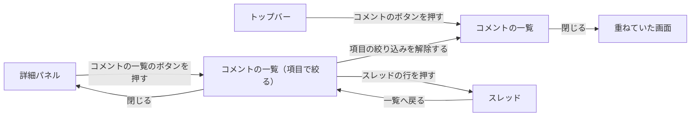

# プレビュー

## 現状

<!-- table: {"kind": "data"} -->

| 分類 | ページ / ファイル | 概要 | 補足 |
| --- | --- | --- | --- |
| ドキュメント | [docs/scenario/SC-489-5.yaml](https://github.com/shuhei1101/mindstella/blob/044bbcb105764280fb1f7c5a8f8b8f23bd1ca50e/docs/scenario/SC-489-5.yaml) | 単一 UC『スレッドで話す』。コメントの一覧でスレッドを開いて読む | 項目で絞って開く流れが無い。更新対象 |
| ドキュメント | [docs/scenario/SC-489-46.yaml](https://github.com/shuhei1101/mindstella/blob/044bbcb105764280fb1f7c5a8f8b8f23bd1ca50e/docs/scenario/SC-489-46.yaml) | 単一 UC『項目の詳細を読む』 | 詳細パネルからその項目のコメントの一覧を開く操作が無い。更新対象 |
| ドキュメント | [docs/scenario/SC-489-47.yaml](https://github.com/shuhei1101/mindstella/blob/044bbcb105764280fb1f7c5a8f8b8f23bd1ca50e/docs/scenario/SC-489-47.yaml) | 単一 UC『項目へコメントする』 | 追加したコメントの確認の方法の記載を確認する |
| ドキュメント | [docs/interface/IF-489-70.yaml](https://github.com/shuhei1101/mindstella/blob/044bbcb105764280fb1f7c5a8f8b8f23bd1ca50e/docs/interface/IF-489-70.yaml) | インターフェース定義『SPAを開く』。search params の `panel`・`thread`・`review`・`tstatus`・`ttag` を持つ | 項目の絞り込みの値が無い。更新対象 |
| ドキュメント | [docs/screen/SCR-489-1.yaml](https://github.com/shuhei1101/mindstella/blob/044bbcb105764280fb1f7c5a8f8b8f23bd1ca50e/docs/screen/SCR-489-1.yaml)・[SCR-489-2.tsx.yaml](https://github.com/shuhei1101/mindstella/blob/044bbcb105764280fb1f7c5a8f8b8f23bd1ca50e/docs/screen/SCR-489-2.tsx.yaml) | 画面設計『コメントの一覧』（今の画面・React）。状態の絞り込みとタグの絞り込みを持つ | 項目の絞り込みが無い。更新対象 |
| ドキュメント | [docs/screen/SCR-489-31.yaml](https://github.com/shuhei1101/mindstella/blob/044bbcb105764280fb1f7c5a8f8b8f23bd1ca50e/docs/screen/SCR-489-31.yaml)・[SCR-489-32.tsx.yaml](https://github.com/shuhei1101/mindstella/blob/044bbcb105764280fb1f7c5a8f8b8f23bd1ca50e/docs/screen/SCR-489-32.tsx.yaml) | 画面設計『詳細パネル』（今の画面・React）。見出しに戻る・進む・編集する・エクスポート・全画面表示・閉じるを持つ | コメントの一覧のボタンが無い。更新対象 |
| ドキュメント | [docs/module/MOD-489-218.ts.yaml](https://github.com/shuhei1101/mindstella/blob/044bbcb105764280fb1f7c5a8f8b8f23bd1ca50e/docs/module/MOD-489-218.ts.yaml)・[MOD-489-206.ts.yaml](https://github.com/shuhei1101/mindstella/blob/044bbcb105764280fb1f7c5a8f8b8f23bd1ca50e/docs/module/MOD-489-206.ts.yaml)・[MOD-489-171.ts.yaml](https://github.com/shuhei1101/mindstella/blob/044bbcb105764280fb1f7c5a8f8b8f23bd1ca50e/docs/module/MOD-489-171.ts.yaml) | モジュール構成『comments.ts』『detail.ts』『app.ts』（今の画面） | `visibleThreads`・`threadCounts`・`pendingThreads` が状態とタグだけを引数に持つ。更新対象 |
| ドキュメント | [docs/module/MOD-489-5.tsx.yaml](https://github.com/shuhei1101/mindstella/blob/044bbcb105764280fb1f7c5a8f8b8f23bd1ca50e/docs/module/MOD-489-5.tsx.yaml)・[MOD-489-32.tsx.yaml](https://github.com/shuhei1101/mindstella/blob/044bbcb105764280fb1f7c5a8f8b8f23bd1ca50e/docs/module/MOD-489-32.tsx.yaml)・[MOD-489-120.ts.yaml](https://github.com/shuhei1101/mindstella/blob/044bbcb105764280fb1f7c5a8f8b8f23bd1ca50e/docs/module/MOD-489-120.ts.yaml) | モジュール構成『comments-panel』『detail-panel』『preview-search』（React） | 更新対象 |
| ドキュメント | [docs/module/MOD-489-104.ts.yaml](https://github.com/shuhei1101/mindstella/blob/044bbcb105764280fb1f7c5a8f8b8f23bd1ca50e/docs/module/MOD-489-104.ts.yaml) | モジュール構成『comments』（React。`frontend/src/shared/core/comments.ts`） | `visibleThreads`・`threadCounts`・`pendingThreads` が状態とタグだけを引数に持つ。更新対象 |
| ドキュメント | [docs/guide/プレビューを見る.md](https://github.com/shuhei1101/mindstella/blob/044bbcb105764280fb1f7c5a8f8b8f23bd1ca50e/docs/guide/%E3%83%97%E3%83%AC%E3%83%93%E3%83%A5%E3%83%BC%E3%82%92%E8%A6%8B%E3%82%8B.md) | 公開ドキュメント。コメントの一覧と詳細パネルの使い方 | 更新対象 |
| 実装 | [plugins/mindstella/skills/mindmap/preview/screens/comments.ts](https://github.com/shuhei1101/mindstella/blob/044bbcb105764280fb1f7c5a8f8b8f23bd1ca50e/plugins/mindstella/skills/mindmap/preview/screens/comments.ts)・[screens/detail.ts](https://github.com/shuhei1101/mindstella/blob/044bbcb105764280fb1f7c5a8f8b8f23bd1ca50e/plugins/mindstella/skills/mindmap/preview/screens/detail.ts)・[app.ts](https://github.com/shuhei1101/mindstella/blob/044bbcb105764280fb1f7c5a8f8b8f23bd1ca50e/plugins/mindstella/skills/mindmap/preview/app.ts) | 今の画面のコメントの一覧・詳細パネル・画面の振り分け | 更新対象 |
| 実装 | [frontend/src/features/comments/comments-panel/comments-panel.tsx](https://github.com/shuhei1101/mindstella/blob/044bbcb105764280fb1f7c5a8f8b8f23bd1ca50e/frontend/src/features/comments/comments-panel/comments-panel.tsx)・[frontend/src/features/detail/detail-panel/detail-panel.tsx](https://github.com/shuhei1101/mindstella/blob/044bbcb105764280fb1f7c5a8f8b8f23bd1ca50e/frontend/src/features/detail/detail-panel/detail-panel.tsx)・[frontend/src/shared/core/preview-search.ts](https://github.com/shuhei1101/mindstella/blob/044bbcb105764280fb1f7c5a8f8b8f23bd1ca50e/frontend/src/shared/core/preview-search.ts) | React のコメントの一覧・詳細パネル・search params の Zod スキーマ | 更新対象 |
| テスト | [tests/integration/preview/test_comments_screen.py](https://github.com/shuhei1101/mindstella/blob/044bbcb105764280fb1f7c5a8f8b8f23bd1ca50e/tests/integration/preview/test_comments_screen.py)・[test_spa_comments_screen.py](https://github.com/shuhei1101/mindstella/blob/044bbcb105764280fb1f7c5a8f8b8f23bd1ca50e/tests/integration/preview/test_spa_comments_screen.py)・[test_detail_panel_screen.py](https://github.com/shuhei1101/mindstella/blob/044bbcb105764280fb1f7c5a8f8b8f23bd1ca50e/tests/integration/preview/test_detail_panel_screen.py)・[test_spa_detail_panel_screen.py](https://github.com/shuhei1101/mindstella/blob/044bbcb105764280fb1f7c5a8f8b8f23bd1ca50e/tests/integration/preview/test_spa_detail_panel_screen.py) | 画面の結合テスト | 更新対象 |
| テスト | [frontend/src/features/comments/comments-panel/comments-panel.test.tsx](https://github.com/shuhei1101/mindstella/blob/044bbcb105764280fb1f7c5a8f8b8f23bd1ca50e/frontend/src/features/comments/comments-panel/comments-panel.test.tsx)・[frontend/src/shared/core/preview-search.test.ts](https://github.com/shuhei1101/mindstella/blob/044bbcb105764280fb1f7c5a8f8b8f23bd1ca50e/frontend/src/shared/core/preview-search.test.ts) | React の単体テスト | 更新対象 |

<!-- /table -->

## 変更方針

<!-- table: {"kind": "data"} -->

| 対象 | 方針 | 補足 |
| --- | --- | --- |
| 単一 UC | 『スレッドで話す』に項目で絞ったスレッドの一覧を読む流れを、『項目の詳細を読む』に詳細パネルのボタンからその項目で絞ったコメントの一覧を開く操作を記載する | 項目に関係するコメントの範囲と、別の項目へ移ったときの絞り込みは[要件](./要件.md)のとおり |
| 画面一覧・画面遷移 | 詳細パネルからコメントの一覧を開く遷移を追加する | 画面の追加・削除は無い |
| モック | コメントの一覧の項目の絞り込みのチップと、詳細パネルの見出しのボタンの見た目をモックで示し、利用者と合意する | チップの文言・ボタンの位置とアイコン |
| インターフェース定義 | 『SPAを開く』の search params に、絞っている項目の ID を持つ値を追加する。記録に無い ID は除外して開く | 値の名前は `tstatus`・`ttag` にそろえる |
| 画面設計 | コメントの一覧（今の画面・React）に項目の絞り込みのチップを、詳細パネル（今の画面・React）の見出しにコメントの一覧のボタンを追加する。状態の絞り込みの件数・空の状態の文言を項目の絞り込みと組み合わせる | - |
| モジュール構成 | 今の画面の `visibleThreads`・`threadCounts`・`pendingThreads` と React の同じ処理に絞る項目の引数を追加し、詳細パネルのボタンから項目の絞り込みを指定してコメントの一覧を開く | - |
| 公開ドキュメント | 『プレビューを見る』のコメントの一覧と詳細パネルの節に、項目で絞る操作を記載する | - |
| 単体テスト | 項目での絞り込みと状態・タグの組み合わせ、search params の読み書きを確認する | 今の画面と React の両方 |
| 結合テスト | 詳細パネルのボタンから、その項目で絞ったコメントの一覧が開き、状態の切り替えと絞り込みの解除ができることを確認する | 今の画面と React の両方 |

<!-- /table -->

### 画面一覧

| 種別 | 画面 | 概要 | アクション | 判定の根拠 | 補足 |
| --- | --- | --- | --- | --- | --- |
| 変更 | `comments`（コメントの一覧。今の画面・React） | スレッドを状態・タグ・項目で絞って並べる左のパネル | 項目の絞り込みを解除する<br>項目で絞ったまま状態（オープン・クローズ・すべて）を切り替える<br>項目で絞ったままタグで絞る<br>スレッドを開く | 項目での絞り込みは同じ一覧の絞り込みのため、パネルの中で表示を切り替える（新規の画面・ドロワーにしない） | 絞り込みのチップは ID・タイトル・× で、件数は状態の絞り込みが出す（[モック](../../mock/pages/comments/609/index.md)） |
| 変更 | `detail-panel`（詳細パネル。今の画面・React） | 項目 1 件の中身を本文の右に出すパネル | コメントの一覧を開く（開いている項目で絞る） | 開いている項目のコメントを、詳細パネルを下までスクロールせずに参照するため、同じ画面に左のコメントの一覧を重ねる。重なりは今の決まりのとおりにする（幅 901px 以上でピン止めしていない間は詳細パネルをグレーアウトの下に配置して `inert` にし、幅 900px 以下はコメントの一覧を前に出す）。閉じると詳細パネルへ戻る | ボタンはコメントのアイコンだけで、編集する・エクスポートと前後の移動の間に置く（[モック](../../mock/pages/detail-panel/609/a-icon/index.html)）。別の項目へ移ったときの絞り込みは押したときの項目のまま保つ（[要件](./要件.md)） |

### 画面遷移



## 設計書の確定コミット

| 工程 | 範囲 | 補足 |
| --- | --- | --- |
| 単一ユースケース設計 | `0e648a99..4bc92dc0` | - |
| 単一ユースケース設計 | `4ed09ddb..4922dce4` | レビューの指摘の修正 |
| インターフェース定義設計 | `bb79576a..d4ba2773` | - |
| 画面設計 | `2f4743be..96b2f843` | - |
| 画面設計 | `16f30e13..7a4a4c37` | レビューの指摘の修正 |
| モジュール構成設計 | `5d46fb0d..35889514` | - |
| モジュール構成設計 | `dea7807a..b8c1e589` | レビューの指摘の修正 |
| モジュール構成設計 | `38f54093` | 単体テスト作成・実装のレビューの指摘（一覧を閉じるときに項目の絞り込みを外す）の修正 |
| 画面設計・モジュール構成設計 | `a4e658fc` | 単体テスト作成・実装のレビューの指摘（項目で絞っている間の新しいスレッド）の修正。確認ログの決定のとおり |

## テスト結果

### ドキュメント修正

`docs/guide/プレビューを見る.md` は利用者向けの説明だけで、関係する単体・結合テストが無いため実行しない（テストは単体テスト作成・結合テスト作成の工程で記載する）。

### 単体テスト

| 段 | 結果 | ログ |
| --- | --- | --- |
| 単体テスト作成（実装の前） | 追加したテストが実装の無いことで fail（今の画面 10・React 10） | [20261119174108_b5b2cab6_単体テスト.log](./テスト結果/20261119174108_b5b2cab6_単体テスト.log) |
| 実装の後 | 全 pass（`pytest tests/unit/preview` 932・`npx vitest run` 329） | [20261119180045_54127e14_単体テスト.log](./テスト結果/20261119180045_54127e14_単体テスト.log) |
| lint（実装の後） | 違反なし | [20261119180045_54127e14_lint.log](./テスト結果/20261119180045_54127e14_lint.log) |
| レビュー指摘の修正の後（一覧を閉じるときに項目の絞り込みを外す） | 全 pass（`pytest tests/unit/preview` 932。React は変えていない） | [20261119181523_38f54093_単体テスト.log](./テスト結果/20261119181523_38f54093_単体テスト.log) |
| lint（レビュー指摘の修正の後） | 違反なし | [20261119181523_38f54093_lint.log](./テスト結果/20261119181523_38f54093_lint.log) |
| 新しいスレッドの扱いの反映の後 | 全 pass（`pytest tests/unit/preview` 933・`npx vitest run` 330）。単体テストを 2 件追加した（`test_thread_list_view_when_target_composing`・`comments_panel_when_target_new_thread`） | [20261119183337_f8b47399_単体テスト.log](./テスト結果/20261119183337_f8b47399_単体テスト.log) |
| lint（新しいスレッドの扱いの反映の後） | 違反なし | [20261119183337_f8b47399_lint.log](./テスト結果/20261119183337_f8b47399_lint.log) |
| develop（#608・#591）の取り込みの後 | 全 pass（`pytest tests/unit/preview` 920・`npx vitest run` 352。件数は develop のテストの増減を含む） | [20261119185423_d54da54a_単体テスト.log](./テスト結果/20261119185423_d54da54a_単体テスト.log) |
| lint（取り込みの後） | 違反なし | [20261119185423_d54da54a_lint.log](./テスト結果/20261119185423_d54da54a_lint.log) |

### 結合テストの実行範囲

`judge_integration_scope`（`TL-4`・`tests/integration/preview`）は全てのファイルを R7（どの一覧・対応表にも無い）と判定した。R7 の行は、変更したファイルを使う既存の結合テストのうち変更した振る舞いに当たるテスト関数と、結合テスト作成の工程で作るテストだけにした（ファイルの全てにはしない）。

<!-- table: {"kind": "data"} -->

| 変更したファイル | 結果 | 実行する結合テスト | 結合テストが無い入口 |
| --- | --- | --- | --- |
| `docs/guide/プレビューを見る.md` | R7（文書。プレビューの実行に影響しない） | なし | - |
| `docs/interface/IF-489-70.yaml` | R7（文書。プレビューの実行に影響しない） | なし | - |
| `docs/mock/pages/comments/609/index.md` | R7（文書。プレビューの実行に影響しない） | なし | - |
| `docs/mock/pages/comments/index.md` | R7（文書。プレビューの実行に影響しない） | なし | - |
| `docs/mock/pages/detail-panel/609/a-icon/index.html` | R7（文書。プレビューの実行に影響しない） | なし | - |
| `docs/mock/pages/detail-panel/609/b-count/index.html` | R7（文書。プレビューの実行に影響しない） | なし | - |
| `docs/mock/pages/detail-panel/609/index.md` | R7（文書。プレビューの実行に影響しない） | なし | - |
| `docs/mock/pages/detail-panel/index.md` | R7（文書。プレビューの実行に影響しない） | なし | - |
| `docs/mock/refs/609/assets/app.js` | R7（文書。プレビューの実行に影響しない） | なし | - |
| `docs/mock/refs/609/assets/mock.js` | R7（文書。プレビューの実行に影響しない） | なし | - |
| `docs/mock/refs/609/assets/style.css` | R7（文書。プレビューの実行に影響しない） | なし | - |
| `docs/mock/refs/609/index.md` | R7（文書。プレビューの実行に影響しない） | なし | - |
| `docs/mock/refs/index.md` | R7（文書。プレビューの実行に影響しない） | なし | - |
| `docs/module/MOD-489-104.ts.yaml` | R7（文書。プレビューの実行に影響しない） | なし | - |
| `docs/module/MOD-489-120.ts.yaml` | R7（文書。プレビューの実行に影響しない） | なし | - |
| `docs/module/MOD-489-129.ts.yaml` | R7（文書。プレビューの実行に影響しない） | なし | - |
| `docs/module/MOD-489-171.ts.yaml` | R7（文書。プレビューの実行に影響しない） | なし | - |
| `docs/module/MOD-489-206.ts.yaml` | R7（文書。プレビューの実行に影響しない） | なし | - |
| `docs/module/MOD-489-218.ts.yaml` | R7（文書。プレビューの実行に影響しない） | なし | - |
| `docs/module/MOD-489-32.tsx.yaml` | R7（文書。プレビューの実行に影響しない） | なし | - |
| `docs/module/MOD-489-5.tsx.yaml` | R7（文書。プレビューの実行に影響しない） | なし | - |
| `docs/pr/609/README.md` | R7（文書。プレビューの実行に影響しない） | なし | - |
| `docs/pr/609/タスク一覧.yaml` | R7（文書。プレビューの実行に影響しない） | なし | - |
| `docs/pr/609/テスト結果/20261119174108_b5b2cab6_単体テスト.log` | R7（文書。プレビューの実行に影響しない） | なし | - |
| `docs/pr/609/テスト結果/20261119174302_b5b2cab6_lint.log` | R7（文書。プレビューの実行に影響しない） | なし | - |
| `docs/pr/609/テスト結果/20261119180045_54127e14_lint.log` | R7（文書。プレビューの実行に影響しない） | なし | - |
| `docs/pr/609/テスト結果/20261119180045_54127e14_単体テスト.log` | R7（文書。プレビューの実行に影響しない） | なし | - |
| `docs/pr/609/テスト結果/20261119181523_38f54093_lint.log` | R7（文書。プレビューの実行に影響しない） | なし | - |
| `docs/pr/609/テスト結果/20261119181523_38f54093_単体テスト.log` | R7（文書。プレビューの実行に影響しない） | なし | - |
| `docs/pr/609/テスト結果/20261119183337_f8b47399_lint.log` | R7（文書。プレビューの実行に影響しない） | なし | - |
| `docs/pr/609/テスト結果/20261119183337_f8b47399_単体テスト.log` | R7（文書。プレビューの実行に影響しない） | なし | - |
| `docs/pr/609/テスト結果/20261119185423_d54da54a_lint.log` | R7（文書。プレビューの実行に影響しない） | なし | - |
| `docs/pr/609/テスト結果/20261119185423_d54da54a_単体テスト.log` | R7（文書。プレビューの実行に影響しない） | なし | - |
| `docs/pr/609/プレビュー.md` | R7（文書。プレビューの実行に影響しない） | なし | - |
| `docs/pr/609/確認ログ.yaml` | R7（文書。プレビューの実行に影響しない） | なし | - |
| `docs/pr/609/要件.md` | R7（文書。プレビューの実行に影響しない） | なし | - |
| `docs/pr/609/要件.yaml` | R7（文書。プレビューの実行に影響しない） | なし | - |
| `docs/scenario/SC-489-46.yaml` | R7（文書。プレビューの実行に影響しない） | なし | - |
| `docs/scenario/SC-489-47.yaml` | R7（文書。プレビューの実行に影響しない） | なし | - |
| `docs/scenario/SC-489-5.yaml` | R7（文書。プレビューの実行に影響しない） | なし | - |
| `docs/screen/SCR-489-1.yaml` | R7（文書。プレビューの実行に影響しない） | なし | - |
| `docs/screen/SCR-489-2.tsx.yaml` | R7（文書。プレビューの実行に影響しない） | なし | - |
| `docs/screen/SCR-489-31.yaml` | R7（文書。プレビューの実行に影響しない） | なし | - |
| `docs/screen/SCR-489-32.tsx.yaml` | R7（文書。プレビューの実行に影響しない） | なし | - |
| `frontend/src/features/comments/comments-panel/comments-panel.test.tsx` | R7（単体テスト。結合テストの実行に影響しない） | なし | - |
| `frontend/src/features/comments/comments-panel/comments-panel.tsx` | R7（変更したファイルを使う結合テストを調べた） | `tests/integration/preview/test_spa_comments_screen.py` の `test_status_filter`・`test_tag_filter` と、作る `test_target_filter` | - |
| `frontend/src/features/detail/detail-panel/components/detail-header.tsx` | R7（変更したファイルを使う結合テストを調べた） | `tests/integration/preview/test_spa_detail_panel_screen.py` の `test_head_title_visible`（見出しにボタンが増え、タイトルの幅が変わる）と、作る `test_comments_button` | - |
| `frontend/src/features/detail/detail-panel/detail-panel.test.tsx` | R7（単体テスト。結合テストの実行に影響しない） | なし | - |
| `frontend/src/shared/core/comments.test.ts` | R7（単体テスト。結合テストの実行に影響しない） | なし | - |
| `frontend/src/shared/core/comments.ts` | R7（変更したファイルを使う結合テストを調べた） | `tests/integration/preview/test_spa_comments_screen.py` の `test_status_filter`・`test_tag_filter` と、作る `test_target_filter` | - |
| `frontend/src/shared/core/preview-search.test.ts` | R7（単体テスト。結合テストの実行に影響しない） | なし | - |
| `frontend/src/shared/core/preview-search.ts` | R7（変更したファイルを使う結合テストを調べた） | `tests/integration/preview/test_spa_open.py` の `test_normal_when_search_invalid`（`ttarget` を外す値を足す）と、作る `test_normal_when_comment_target_filtered` | - |
| `frontend/src/shared/hooks/use-preview-search.ts` | R7（変更したファイルを使う結合テストを調べた） | `tests/integration/preview/test_spa_open.py` の作る `test_normal_when_comment_target_filtered` | - |
| `plugins/mindstella/skills/mindmap/preview/app.js` | R7（生成物。生成元の `app.ts` と同じ） | 生成元の行と同じ | - |
| `plugins/mindstella/skills/mindmap/preview/app.ts` | R7（変更したファイルを使う結合テストを調べた） | `tests/integration/preview/test_comments_screen.py` の作る `test_target_filter`・`tests/integration/preview/test_detail_panel_screen.py` の作る `test_comments_button`（トップバーと詳細パネルのボタンから一覧を開くつなぎ） | - |
| `plugins/mindstella/skills/mindmap/preview/screens/comments.js` | R7（生成物。生成元の `screens/comments.ts` と同じ） | 生成元の行と同じ | - |
| `plugins/mindstella/skills/mindmap/preview/screens/comments.ts` | R7（変更したファイルを使う結合テストを調べた） | `tests/integration/preview/test_comments_screen.py` の `test_filter`・`test_tag_filter`・`test_tag_filter_when_pressed_again`・`test_empty_when_tag`（状態・タグの絞り込みと件数・空の文言を描く関数を変えた）と、作る `test_target_filter` | - |
| `plugins/mindstella/skills/mindmap/preview/screens/detail.js` | R7（生成物。生成元の `screens/detail.ts` と同じ） | 生成元の行と同じ | - |
| `plugins/mindstella/skills/mindmap/preview/screens/detail.ts` | R7（変更したファイルを使う結合テストを調べた） | `tests/integration/preview/test_detail_panel_screen.py` の `test_head_title_on_scroll`（見出しにボタンが増え、タイトルの幅が変わる）と、作る `test_comments_button` | - |
| `plugins/mindstella/skills/mindmap/preview/spa/assets/index-VbTzpxWL.js` | R7（生成物。`index-DOLJOuYZ.js` へ改名。React の `frontend/src/` の変更から作る） | React の変更の行と同じ | - |
| `plugins/mindstella/skills/mindmap/preview/spa/index.html` | R7（生成物。React の `frontend/src/` の変更から作る） | React の変更の行と同じ | - |
| `plugins/mindstella/skills/mindmap/preview/style.css` | R7（変更したファイルを使う結合テストを調べた） | `tests/integration/preview/test_comments_screen.py` の作る `test_target_filter`（チップの見た目だけを足した） | - |
| `tests/unit/preview/test_comments_panel.py` | R7（単体テスト。結合テストの実行に影響しない） | なし | - |
| `tests/unit/preview/test_detail.py` | R7（単体テスト。結合テストの実行に影響しない） | なし | - |

<!-- /table -->

実行するコマンド（`run_one`）:

```bash
pytest tests/integration/preview/test_comments_screen.py::test_filter tests/integration/preview/test_comments_screen.py::test_tag_filter tests/integration/preview/test_comments_screen.py::test_tag_filter_when_pressed_again tests/integration/preview/test_comments_screen.py::test_empty_when_tag tests/integration/preview/test_comments_screen.py::test_target_filter tests/integration/preview/test_detail_panel_screen.py::test_head_title_on_scroll tests/integration/preview/test_detail_panel_screen.py::test_comments_button tests/integration/preview/test_spa_comments_screen.py::test_status_filter tests/integration/preview/test_spa_comments_screen.py::test_tag_filter tests/integration/preview/test_spa_comments_screen.py::test_target_filter tests/integration/preview/test_spa_detail_panel_screen.py::test_head_title_visible tests/integration/preview/test_spa_detail_panel_screen.py::test_comments_button tests/integration/preview/test_spa_open.py::test_normal_when_search_invalid tests/integration/preview/test_spa_open.py::test_normal_when_comment_target_filtered
```
