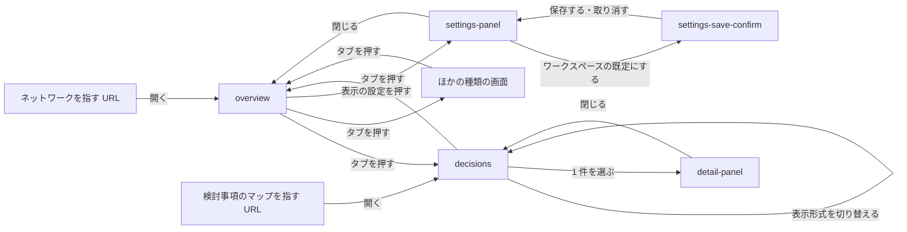

# プレビュー

## 現状

<!-- table: {"kind": "data"} -->

| 分類 | ページ / ファイル | 概要 | 補足 |
| --- | --- | --- | --- |
| ドキュメント | [docs/scenario/SC-489-7.yaml](https://github.com/shuhei1101/mindstella/blob/78097637b4ff2db9149191afcf05cd7181d4212f/docs/scenario/SC-489-7.yaml) | ネットワークを辿る | 削除する |
| ドキュメント | [docs/scenario/SC-489-24.yaml](https://github.com/shuhei1101/mindstella/blob/78097637b4ff2db9149191afcf05cd7181d4212f/docs/scenario/SC-489-24.yaml) | 検討事項をマップで辿る | 削除する |
| ドキュメント | [docs/screen/SCR-489-7.yaml](https://github.com/shuhei1101/mindstella/blob/78097637b4ff2db9149191afcf05cd7181d4212f/docs/screen/SCR-489-7.yaml) | ネットワーク（今の画面） | 削除する |
| ドキュメント | [docs/screen/SCR-489-35.tsx.yaml](https://github.com/shuhei1101/mindstella/blob/78097637b4ff2db9149191afcf05cd7181d4212f/docs/screen/SCR-489-35.tsx.yaml) | ネットワーク（React） | 削除する |
| ドキュメント | [docs/screen/SCR-489-19.yaml](https://github.com/shuhei1101/mindstella/blob/78097637b4ff2db9149191afcf05cd7181d4212f/docs/screen/SCR-489-19.yaml)・[SCR-489-20.tsx.yaml](https://github.com/shuhei1101/mindstella/blob/78097637b4ff2db9149191afcf05cd7181d4212f/docs/screen/SCR-489-20.tsx.yaml) | 検討事項 | 表示形式のマップを削除する |
| ドキュメント | [docs/screen/SCR-489-23.yaml](https://github.com/shuhei1101/mindstella/blob/78097637b4ff2db9149191afcf05cd7181d4212f/docs/screen/SCR-489-23.yaml)・[SCR-489-24.tsx.yaml](https://github.com/shuhei1101/mindstella/blob/78097637b4ff2db9149191afcf05cd7181d4212f/docs/screen/SCR-489-24.tsx.yaml) | 表示の設定 | 見た目を削除する |
| ドキュメント | [docs/screen/SCR-489-17.yaml](https://github.com/shuhei1101/mindstella/blob/78097637b4ff2db9149191afcf05cd7181d4212f/docs/screen/SCR-489-17.yaml)・[SCR-489-18.tsx.yaml](https://github.com/shuhei1101/mindstella/blob/78097637b4ff2db9149191afcf05cd7181d4212f/docs/screen/SCR-489-18.tsx.yaml)・[SCR-489-22.tsx.yaml](https://github.com/shuhei1101/mindstella/blob/78097637b4ff2db9149191afcf05cd7181d4212f/docs/screen/SCR-489-22.tsx.yaml) | 既定の保存の確かめ・概要 | 見た目・ネットワークの記載を削除する |
| ドキュメント | [docs/component/](https://github.com/shuhei1101/mindstella/tree/78097637b4ff2db9149191afcf05cd7181d4212f/docs/component) | トップバー（CMP-489-19・20）・表示の設定（CMP-489-49・50）・既定の保存の確かめ（CMP-489-33・34）・スレッドの書き込み（CMP-489-11・12）・絞り込み（CMP-489-45・46）・本文の折りたたみ（CMP-489-41・42）・コメントの印（CMP-489-9・10）・資料のエクスポートのメニュー（CMP-489-53・54）・保存待ちの印（CMP-489-21・22）・差分の印（CMP-489-31・32）・消した項目の帯（CMP-489-43・44）・表示形式の切り替え（CMP-489-51・52） | ネットワークのタブ・見た目・マップの記載を削除する |
| ドキュメント | [docs/interface/IF-489-70.yaml](https://github.com/shuhei1101/mindstella/blob/78097637b4ff2db9149191afcf05cd7181d4212f/docs/interface/IF-489-70.yaml)・[IF-489-71.yaml](https://github.com/shuhei1101/mindstella/blob/78097637b4ff2db9149191afcf05cd7181d4212f/docs/interface/IF-489-71.yaml) | SPAを開く・プレビューを開く | URL のハッシュの `view` から `graph` と検討事項の `map` を削除し、指されたときの開く画面を定める。描画のライブラリから elkjs を削除する |
| ドキュメント | [docs/module/](https://github.com/shuhei1101/mindstella/tree/78097637b4ff2db9149191afcf05cd7181d4212f/docs/module) | graph.ts（MOD-489-213）・looks.ts（MOD-489-216）・lock.ts（MOD-489-200）・decision-map（MOD-489-16）・map-layout（MOD-489-19）・graph-screen・graph-canvas・graph-renderer・graph-model・looks・graph-store・look-select（MOD-489-244〜250） | 削除する |
| ドキュメント | [docs/module/](https://github.com/shuhei1101/mindstella/tree/78097637b4ff2db9149191afcf05cd7181d4212f/docs/module) | app.ts（MOD-489-171）・libs.ts（MOD-489-198）・router.ts（MOD-489-195）・records.ts（MOD-489-194）・api.ts（MOD-489-196）・decisions.ts（MOD-489-212）・detail.ts（MOD-489-206）・table.ts（MOD-489-209）・settings-panel.ts（MOD-489-204）・preview-shell（MOD-489-2）・decisions-store（MOD-489-253）・display（MOD-489-106）・prefs-store（MOD-489-140）・preview-search（MOD-489-120）・overview-screen（MOD-489-43）・libraries（MOD-489-58）・use-save-display-default（MOD-489-49）・React（MOD-489-170）・基盤（MOD-489-172）・画面と部品（MOD-489-174） | ネットワーク・マップ・見た目・ロック・elkjs の記載を削除する |
| ドキュメント | [docs/library/LIB-489-5.yaml](https://github.com/shuhei1101/mindstella/blob/78097637b4ff2db9149191afcf05cd7181d4212f/docs/library/LIB-489-5.yaml) | elkjs | ほかで使用していなければ削除する |
| ドキュメント | [docs/architecture/ARCH-489-1.yaml](https://github.com/shuhei1101/mindstella/blob/78097637b4ff2db9149191afcf05cd7181d4212f/docs/architecture/ARCH-489-1.yaml)・[docs/nonfunctional/NFR-489-1.yaml](https://github.com/shuhei1101/mindstella/blob/78097637b4ff2db9149191afcf05cd7181d4212f/docs/nonfunctional/NFR-489-1.yaml) | アーキテクチャ図・非機能要件 | jsDelivr から取るライブラリの elkjs と、ネットワークの描画の決定値を削除する |
| ドキュメント | [docs/mock/](https://github.com/shuhei1101/mindstella/tree/78097637b4ff2db9149191afcf05cd7181d4212f/docs/mock) | `pages/graph/`・`components/map-lock/`・`components/network-label/`・`components/look-pick/`・`components/topbar/`・`components/settings-panel/` | ネットワーク・マップ・見た目だけのモックを削除し、部品のモックを修正する |
| 実装 | [plugins/mindstella/skills/mindmap/preview/](https://github.com/shuhei1101/mindstella/tree/78097637b4ff2db9149191afcf05cd7181d4212f/plugins/mindstella/skills/mindmap/preview) | 今の画面 | `graph/`・`core/lock.ts` を削除し、`app.ts`・`core/router.ts`・`core/libs.ts`・`core/dom.ts`・`screens/decisions.ts`・`components/topbar.ts`・`components/settings-panel.ts`・`components/settings-confirm.ts`・`components/doc-export-menu.ts`・`components/filter-drawer.ts`・`template.html`・`style.css`・`tokens.css` と生成した `.js` を修正する |
| 実装 | [frontend/src/](https://github.com/shuhei1101/mindstella/tree/78097637b4ff2db9149191afcf05cd7181d4212f/frontend/src) | React の画面 | `features/graph/`・`decision-map.tsx`・`map-layout.ts`・`shared/core/lock.ts` を削除し、`preview-shell.tsx`・`decisions-screen.tsx`・`decisions/store.ts`・`topbar.tsx`・`settings-panel.tsx`・`settings-confirm*.tsx`・`display.ts`・`prefs-store.ts`・`display-notice-store.ts`・`libraries.ts`・`records.ts`・`icon.tsx`・`tokens.css` と OpenAPI から生成した API の定義を修正する。アイコン `graph` は資料のカードの種類「図」で使用するため残す |
| 実装 | [package.json](https://github.com/shuhei1101/mindstella/blob/78097637b4ff2db9149191afcf05cd7181d4212f/package.json) | 依存 | elkjs を削除する |

<!-- /table -->

## 変更方針

<!-- table: {"kind": "data"} -->

| 対象 | 方針 | 補足 |
| --- | --- | --- |
| ネットワークの画面 | 今の画面と React の画面から、画面・描画・見た目・状態のコードとストーリー・テストを削除する | - |
| 検討事項の表示形式 | 切り替えをボード（既定）と表の 2 つにし、マップの描画・配置の計算・状態を削除する | - |
| タブの帯 | 右端のネットワークを削除する | - |
| 詳細パネル | 変えない | 詳細パネルはネットワークへ移る操作を持たない。詳細を開いたままネットワークへ移る導線は、タブの帯のネットワークの削除で無くなる |
| 起点のロック | ロックの状態と操作を削除する | 詳細パネル・全体の検索など、ほかの画面が使用していないことを実装で確認する |
| 表示の設定 | 見た目の選択を削除し、表示する種類だけを持つ。端末の保存領域の見た目のキーは参照せずに無視する | 画面に表示する「表示する種類」の文言は変えない |
| URL のハッシュ | `tab=graph` は概要を、検討事項の `view=map` はボードを開く | 今の画面・React の画面とも、知らない値を既定へ戻す今の振る舞いに乗せる |
| 描画のライブラリ | elkjs を読み込み・配る書き出しの同梱・`package.json` から削除する | mermaid の `flowchart-elk` の図が elkjs を必要としないことを、実装で確認する。必要なら elkjs を残し、ライブラリの設計書の用途だけを書き換える |
| 依存の削除のテスト | 資料の本文の mermaid の図が描けることを、既存の結合テストで確認する | - |

<!-- /table -->

### 画面一覧

| 種別 | 画面 | 概要 | アクション | 判定の根拠 | 補足 |
| --- | --- | --- | --- | --- | --- |
| 削除 | `graph`（ネットワーク） | 全種類の項目を星として関連でつないだ 3D の画面 | - | - | 画面ごと削除する |
| 変更 | `decisions`（検討事項） | 検討事項の一覧 | 表示形式を切り替える（ボード・表） 絞り込む 1 件を選んで詳細パネルを開く | 同じ内容の見せ方の切り替えのため、同じ画面の中で表示を切り替える（今の置き方のまま） | 表示形式からマップを除く |
| 変更 | `components/topbar`（トップバー） | タブの帯と全体の検索・表示の設定の入口 | タブで画面を切り替える 全体の検索を開く 表示の設定を開く | - | タブの帯の右端のネットワークを除く |
| 変更 | `settings-panel`（表示の設定） | この端末だけの表示の上書き | 表示する種類を選ぶ 既定に戻す ワークスペースの既定にする | - | 「この端末で変えている項目」からネットワークの見た目を除く |
| 変更 | `settings-save-confirm`（既定の保存の確かめ） | ワークスペースの既定にする前の確かめ | 保存する 取り消す | - | 保存する値から見た目を除き、表示する種類だけにする |

### 画面遷移

<!-- map: {"title": "画面遷移"} -->

<!-- /map -->

ネットワークを指す URL（`tab=graph`）は概要を、検討事項のマップを指す URL（`view=map`）は検討事項のボードを開く。

## 設計書の確定コミット

| 工程 | 範囲 | 補足 |
| --- | --- | --- |
| 複合ユースケース設計 | `78097637..f6e8ca4c` | - |
| 単一ユースケース設計 | `577f0719..82ee07ba` | - |
| インターフェース定義設計 | `e1bf3f71..f46a5307` | - |
| 部品設計 | `f46a5307..1f7929bc` | 部品のモック（view-switch・filter-drawer・columns-button・diff-marks・removed-mark・body-diff-layout・html-body-frame・review-body-fold）に残っていたマップ・ネットワークの記述も削除 |
| 画面設計 | `023aad9a..b72d07f8` | - |

## テスト結果

なし（テスト作成・実装で記入する）
