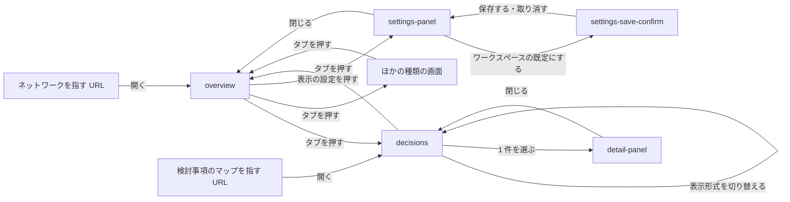

# プレビュー

## 現状

<!-- table: {"kind": "data"} -->

| 分類 | ページ / ファイル | 概要 | 補足 |
| --- | --- | --- | --- |
| ドキュメント | [docs/scenario/SC-489-7.yaml](https://github.com/shuhei1101/mindstella/blob/78097637b4ff2db9149191afcf05cd7181d4212f/docs/scenario/SC-489-7.yaml) | ネットワークを辿る | 削除する |
| ドキュメント | [docs/scenario/SC-489-24.yaml](https://github.com/shuhei1101/mindstella/blob/78097637b4ff2db9149191afcf05cd7181d4212f/docs/scenario/SC-489-24.yaml) | 検討事項をマップで辿る | 削除する |
| ドキュメント | [docs/screen/SCR-489-7.yaml](https://github.com/shuhei1101/mindstella/blob/78097637b4ff2db9149191afcf05cd7181d4212f/docs/screen/SCR-489-7.yaml) | ネットワーク（今の画面） | 削除する |
| ドキュメント | [docs/screen/SCR-489-35.tsx.yaml](https://github.com/shuhei1101/mindstella/blob/78097637b4ff2db9149191afcf05cd7181d4212f/docs/screen/SCR-489-35.tsx.yaml) | ネットワーク（React） | 削除する |
| ドキュメント | [docs/screen/SCR-489-19.yaml](https://github.com/shuhei1101/mindstella/blob/78097637b4ff2db9149191afcf05cd7181d4212f/docs/screen/SCR-489-19.yaml)・[SCR-489-20.tsx.yaml](https://github.com/shuhei1101/mindstella/blob/78097637b4ff2db9149191afcf05cd7181d4212f/docs/screen/SCR-489-20.tsx.yaml) | 検討事項 | 表示形式のマップを削除する |
| ドキュメント | [docs/screen/SCR-489-23.yaml](https://github.com/shuhei1101/mindstella/blob/78097637b4ff2db9149191afcf05cd7181d4212f/docs/screen/SCR-489-23.yaml)・[SCR-489-24.tsx.yaml](https://github.com/shuhei1101/mindstella/blob/78097637b4ff2db9149191afcf05cd7181d4212f/docs/screen/SCR-489-24.tsx.yaml) | 表示の設定 | 見た目を削除する |
| ドキュメント | [docs/screen/SCR-489-17.yaml](https://github.com/shuhei1101/mindstella/blob/78097637b4ff2db9149191afcf05cd7181d4212f/docs/screen/SCR-489-17.yaml)・[SCR-489-18.tsx.yaml](https://github.com/shuhei1101/mindstella/blob/78097637b4ff2db9149191afcf05cd7181d4212f/docs/screen/SCR-489-18.tsx.yaml)・[SCR-489-22.tsx.yaml](https://github.com/shuhei1101/mindstella/blob/78097637b4ff2db9149191afcf05cd7181d4212f/docs/screen/SCR-489-22.tsx.yaml) | 既定の保存の確かめ・概要 | 見た目・ネットワークの記載を削除する |
| ドキュメント | [docs/component/](https://github.com/shuhei1101/mindstella/tree/78097637b4ff2db9149191afcf05cd7181d4212f/docs/component) | トップバー（CMP-489-19・20）・表示の設定（CMP-489-49・50）・既定の保存の確かめ（CMP-489-33・34）・スレッドの書き込み（CMP-489-11・12）・絞り込み（CMP-489-45・46）・本文の折りたたみ（CMP-489-41・42）・コメントの印（CMP-489-9・10）・資料のエクスポートのメニュー（CMP-489-53・54）・保存待ちの印（CMP-489-21・22）・差分の印（CMP-489-31・32）・消した項目の帯（CMP-489-43・44）・表示形式の切り替え（CMP-489-51・52） | ネットワークのタブ・見た目・マップの記載を削除する |
| ドキュメント | [docs/interface/IF-489-70.yaml](https://github.com/shuhei1101/mindstella/blob/78097637b4ff2db9149191afcf05cd7181d4212f/docs/interface/IF-489-70.yaml)・[IF-489-71.yaml](https://github.com/shuhei1101/mindstella/blob/78097637b4ff2db9149191afcf05cd7181d4212f/docs/interface/IF-489-71.yaml) | SPAを開く・プレビューを開く | URL のハッシュの `view` から `graph` と検討事項の `map` を削除し、指されたときの開く画面を定める。描画のライブラリから elkjs を削除する |
| ドキュメント | [docs/module/](https://github.com/shuhei1101/mindstella/tree/78097637b4ff2db9149191afcf05cd7181d4212f/docs/module) | graph.ts（MOD-489-213）・looks.ts（MOD-489-216）・lock.ts（MOD-489-200）・decision-map（MOD-489-16）・map-layout（MOD-489-19）・graph-screen・graph-canvas・graph-renderer・graph-model・looks・graph-store・look-select（MOD-489-244〜250） | 削除する |
| ドキュメント | [docs/module/](https://github.com/shuhei1101/mindstella/tree/78097637b4ff2db9149191afcf05cd7181d4212f/docs/module) | app.ts（MOD-489-171）・libs.ts（MOD-489-198）・router.ts（MOD-489-195）・records.ts（MOD-489-194）・api.ts（MOD-489-196）・decisions.ts（MOD-489-212）・detail.ts（MOD-489-206）・table.ts（MOD-489-209）・settings-panel.ts（MOD-489-204）・preview-shell（MOD-489-2）・decisions-store（MOD-489-253）・display（MOD-489-106）・prefs-store（MOD-489-140）・preview-search（MOD-489-120）・overview-screen（MOD-489-43）・libraries（MOD-489-58）・use-save-display-default（MOD-489-49）・React（MOD-489-170）・基盤（MOD-489-172）・画面と部品（MOD-489-174） | ネットワーク・マップ・見た目・ロック・elkjs の記載を削除する |
| ドキュメント | [docs/library/LIB-489-5.yaml](https://github.com/shuhei1101/mindstella/blob/78097637b4ff2db9149191afcf05cd7181d4212f/docs/library/LIB-489-5.yaml) | elkjs | ほかで使用していなければ削除する |
| ドキュメント | [docs/architecture/ARCH-489-1.yaml](https://github.com/shuhei1101/mindstella/blob/78097637b4ff2db9149191afcf05cd7181d4212f/docs/architecture/ARCH-489-1.yaml)・[docs/nonfunctional/NFR-489-1.yaml](https://github.com/shuhei1101/mindstella/blob/78097637b4ff2db9149191afcf05cd7181d4212f/docs/nonfunctional/NFR-489-1.yaml) | アーキテクチャ図・非機能要件 | jsDelivr から取るライブラリの elkjs と、ネットワークの描画の決定値を削除する |
| ドキュメント | [docs/mock/](https://github.com/shuhei1101/mindstella/tree/78097637b4ff2db9149191afcf05cd7181d4212f/docs/mock) | `pages/graph/`・`components/map-lock/`・`components/network-label/`・`components/look-pick/`・`components/topbar/`・`components/settings-panel/` | ネットワーク・マップ・見た目だけのモックを削除し、部品のモックを修正する |
| 実装 | [plugins/mindstella/skills/mindmap/preview/](https://github.com/shuhei1101/mindstella/tree/78097637b4ff2db9149191afcf05cd7181d4212f/plugins/mindstella/skills/mindmap/preview) | 今の画面 | `graph/`・`core/lock.ts` を削除し、`app.ts`・`core/router.ts`・`core/libs.ts`・`core/dom.ts`・`screens/decisions.ts`・`components/topbar.ts`・`components/settings-panel.ts`・`components/settings-confirm.ts`・`components/doc-export-menu.ts`・`components/filter-drawer.ts`・`template.html`・`style.css`・`tokens.css` と生成した `.js` を修正する |
| 実装 | [frontend/src/](https://github.com/shuhei1101/mindstella/tree/78097637b4ff2db9149191afcf05cd7181d4212f/frontend/src) | React の画面 | `features/graph/`・`decision-map.tsx`・`map-layout.ts`・`shared/core/lock.ts` を削除し、`preview-shell.tsx`・`decisions-screen.tsx`・`decisions/store.ts`・`topbar.tsx`・`settings-panel.tsx`・`settings-confirm*.tsx`・`display.ts`・`prefs-store.ts`・`display-notice-store.ts`・`libraries.ts`・`records.ts`・`icon.tsx`・`tokens.css` と OpenAPI から生成した API の定義を修正する。アイコン `graph` は資料のカードの種類「図」で使用するため残す |
| 実装 | [package.json](https://github.com/shuhei1101/mindstella/blob/78097637b4ff2db9149191afcf05cd7181d4212f/package.json) | 依存 | elkjs を削除する |

<!-- /table -->

## 変更方針

<!-- table: {"kind": "data"} -->

| 対象 | 方針 | 補足 |
| --- | --- | --- |
| ネットワークの画面 | 今の画面と React の画面から、画面・描画・見た目・状態のコードとストーリー・テストを削除する | - |
| 検討事項の表示形式 | 切り替えをボード（既定）と表の 2 つにし、マップの描画・配置の計算・状態を削除する | - |
| タブの帯 | 右端のネットワークを削除する | - |
| 詳細パネル | 変えない | 詳細パネルはネットワークへ移る操作を持たない。詳細を開いたままネットワークへ移る導線は、タブの帯のネットワークの削除で無くなる |
| 起点のロック | ロックの状態と操作を削除する | 詳細パネル・全体の検索など、ほかの画面が使用していないことを実装で確認する |
| 表示の設定 | 見た目の選択を削除し、表示する種類だけを持つ。端末の保存領域の見た目のキーは参照せずに無視する | 画面に表示する「表示する種類」の文言は変えない |
| URL のハッシュ | `tab=graph` は概要を、検討事項の `view=map` はボードを開く | 今の画面・React の画面とも、知らない値を既定へ戻す今の振る舞いに乗せる |
| 描画のライブラリ | elkjs を読み込み・配る書き出しの同梱・`package.json` から削除する | mermaid の `flowchart-elk` の図が elkjs を必要としないことを、実装で確認する。必要なら elkjs を残し、ライブラリの設計書の用途だけを書き換える |
| 依存の削除のテスト | 資料の本文の mermaid の図が描けることを、既存の結合テストで確認する | - |

<!-- /table -->

### 画面一覧

| 種別 | 画面 | 概要 | アクション | 判定の根拠 | 補足 |
| --- | --- | --- | --- | --- | --- |
| 削除 | `graph`（ネットワーク） | 全種類の項目を星として関連でつないだ 3D の画面 | - | - | 画面ごと削除する |
| 変更 | `decisions`（検討事項） | 検討事項の一覧 | 表示形式を切り替える（ボード・表） 絞り込む 1 件を選んで詳細パネルを開く | 同じ内容の見せ方の切り替えのため、同じ画面の中で表示を切り替える（今の置き方のまま） | 表示形式からマップを除く |
| 変更 | `components/topbar`（トップバー） | タブの帯と全体の検索・表示の設定の入口 | タブで画面を切り替える 全体の検索を開く 表示の設定を開く | - | タブの帯の右端のネットワークを除く |
| 変更 | `settings-panel`（表示の設定） | この端末だけの表示の上書き | 表示する種類を選ぶ 既定に戻す ワークスペースの既定にする | - | 「この端末で変えている項目」からネットワークの見た目を除く |
| 変更 | `settings-save-confirm`（既定の保存の確かめ） | ワークスペースの既定にする前の確かめ | 保存する 取り消す | - | 保存する値から見た目を除き、表示する種類だけにする |

### 画面遷移

<!-- map: {"title": "画面遷移"} -->

<!-- /map -->

ネットワークを指す URL（`tab=graph`）は概要を、検討事項のマップを指す URL（`view=map`）は検討事項のボードを開く。

## 設計書の確定コミット

| 工程 | 範囲 | 補足 |
| --- | --- | --- |
| 複合ユースケース設計 | `78097637..f6e8ca4c` | - |
| 単一ユースケース設計 | `577f0719..82ee07ba` | - |
| インターフェース定義設計 | `e1bf3f71..f46a5307` | - |
| 部品設計 | `f46a5307..1f7929bc` | 部品のモック（view-switch・filter-drawer・columns-button・diff-marks・removed-mark・body-diff-layout・html-body-frame・review-body-fold）に残っていたマップ・ネットワークの記述も削除 |
| 画面設計 | `023aad9a..b72d07f8` | - |
| モジュール構成設計 | `40caa00d..763244e1` | 表示の設定のモックの見本から見た目の値を除いた修正（972ea565）を含む |
| モジュール構成設計（レビュー指摘の反映） | `249e95b3..17cd0e4b` | 目次の要約と、アーキテクチャ図・非機能要件・外部ライブラリ（elkjs の削除）・テスト手順・インターフェース定義の `refs` |

## 実装

| 項目 | 内容 |
| --- | --- |
| 設計書の直し | 削除した `core/lock.ts` が持っていた `isTyping` を `core/dom.ts`（MOD-489-199）へ、削除した `graph/graph.ts` が持っていた `KIND_COLOR_VAR` を `components/filter-drawer.ts`（MOD-489-233）へ移した。今の画面のストーリーの型検査（`.storybook/tsconfig.json`）は、依存の型の誤りで止まらないよう `skipLibCheck` を持つ（LIB-489-27） |
| 足した・直したストーリー（今の画面） | `preview-viewswitch--decisions` / `preview-topbar--overview` / `preview-topbar--long-title` / `preview-topbar--kinds-hidden` / `preview-settingspanel--*`（14 件） / `preview-settingssaveconfirm--kinds-changed` / `preview-settingssaveconfirm--busy` / `preview-settingssaveconfirm--error-read-only` / `preview-settingssaveconfirm--error-offline` / `preview-settingssaveconfirm--narrow` / `preview-filterdrawer--default` / `preview-threadpost--pending-folded` / `preview-threadpost--pending-opened` / `preview-threadpost--long-ai-post` / `preview-reviewbodyfold--folded-lines` / `preview-reviewbodyfold--opened`。削除: `preview-topbar--graph` / `preview-filterdrawer--keyword-hits` / `preview-settingssaveconfirm--both-changed` / `preview-settingssaveconfirm--one-unchanged` |
| 足した・直したストーリー（React） | `shared-viewswitch--decisions` / `shared-topbar--overview` / `shared-topbar--long-title` / `shared-topbar--kinds-hidden` / `shared-topbar--settings-open` / `settings-settingspanel--*`（14 件） / `settings-settingsconfirm--kinds-changed` / `settings-settingsconfirm--busy` / `settings-settingsconfirm--error-read-only` / `settings-settingsconfirm--error-offline` / `settings-settingsconfirm--narrow` / `shared-filterdrawer--default` / `comments-threadpost--pending-folded` / `comments-threadpost--pending-opened` / `comments-threadpost--long-ai-post` / `shared-reviewbodyfold--folded-lines` / `shared-reviewbodyfold--opened`。削除: `shared-topbar--graph` / `shared-filterdrawer--keyword-hits` / `settings-settingsconfirm--both-changed` / `settings-settingsconfirm--one-unchanged` / ネットワークの画面のストーリー |

どのストーリーも `iframe.html?id={id}` で開き、Storybook のエラー表示が出ずに描かれることを確かめた。

## テスト結果

ドキュメント修正（[8006421d](https://github.com/shuhei1101/mindstella/commit/8006421d)）は公開ドキュメントとデザイン方針の文章だけの変更で、規約『V字モデル』の対応表で対応する単体・結合テストが無いため、テストを実行していない。

### 単体

単体テスト（フロント）を全件実行した（[cde8fd36](https://github.com/shuhei1101/mindstella/commit/cde8fd36)。`pytest tests/unit` に `tests/unit/preview` を含む）。

| ファイル | メソッド | 変更種別 | 結果 | 補足 |
| --- | --- | --- | --- | --- |
| `tests/unit/preview/`（test_api・test_app・test_decisions・test_detail・test_dom・test_router・test_settings・test_settings_confirm・test_settings_panel・test_table・conftest） | 全実行 | 変更 | ✅ | `pytest tests/unit` が 2579 pass・1 skip `テスト結果/20261120154157_cde8fd36_単体テスト.log` |
| `tests/unit/preview/test_graph.py`・`test_lock.py`・`test_looks.py` | - | 削除 | - | 削除した `graph/graph.ts`・`graph/looks.ts`・`core/lock.ts` のテスト |
| `frontend/src/`（preview-shell・overview-screen・settings-confirm・settings-panel・settings-confirm-dialog・use-save-display-default・libraries・display・preview-search・display-notice-store・prefs-store の `*.test.ts(x)`） | 全実行 | 変更 | ✅ | `npx vitest run` が 75 ファイル・328 テスト pass `テスト結果/20261120154157_cde8fd36_単体テスト.log` |
| `frontend/src/features/graph/` の 8 ファイル・`decision-map.test.tsx`・`map-layout.test.ts`・`decisions/store.test.tsx` | - | 削除 | - | 削除したネットワークの画面・検討事項のマップのテスト |

lint（`ruff check`・`npm run typecheck`・`npm run lint`）は違反なし（`テスト結果/20261120154157_cde8fd36_lint.log`）。

### 結合テストの実行範囲

結合テスト（フロント、TL-4）の層は、実行に影響しないパスの一覧・全件にするパスの一覧・フォルダの対応表を持たないため、変更したファイルは、結合テストのファイルが R2（そのファイルを実行）、ほかは R7（関係すると分かった結合テストだけ）になる。

| 変更したファイル | 結果 | 実行する結合テスト | 結合テストが無いエントリーポイント |
| --- | --- | --- | --- |
| `.storybook/tsconfig.json` | R7 | -（依存と型検査の設定で、lint と単体テストが確かめる） | - |
| `docs/architecture/ARCH-489-1.yaml` | R7 | -（文書だけで、結合テストが参照しない） | - |
| `docs/component/CMP-489-10.tsx.yaml` | R7 | -（文書だけで、結合テストが参照しない） | - |
| `docs/component/CMP-489-11.ts.yaml` | R7 | -（文書だけで、結合テストが参照しない） | - |
| `docs/component/CMP-489-12.tsx.yaml` | R7 | -（文書だけで、結合テストが参照しない） | - |
| `docs/component/CMP-489-19.ts.yaml` | R7 | -（文書だけで、結合テストが参照しない） | - |
| `docs/component/CMP-489-20.tsx.yaml` | R7 | -（文書だけで、結合テストが参照しない） | - |
| `docs/component/CMP-489-21.ts.yaml` | R7 | -（文書だけで、結合テストが参照しない） | - |
| `docs/component/CMP-489-22.tsx.yaml` | R7 | -（文書だけで、結合テストが参照しない） | - |
| `docs/component/CMP-489-31.ts.yaml` | R7 | -（文書だけで、結合テストが参照しない） | - |
| `docs/component/CMP-489-32.tsx.yaml` | R7 | -（文書だけで、結合テストが参照しない） | - |
| `docs/component/CMP-489-33.ts.yaml` | R7 | -（文書だけで、結合テストが参照しない） | - |
| `docs/component/CMP-489-34.tsx.yaml` | R7 | -（文書だけで、結合テストが参照しない） | - |
| `docs/component/CMP-489-41.ts.yaml` | R7 | -（文書だけで、結合テストが参照しない） | - |
| `docs/component/CMP-489-42.tsx.yaml` | R7 | -（文書だけで、結合テストが参照しない） | - |
| `docs/component/CMP-489-43.ts.yaml` | R7 | -（文書だけで、結合テストが参照しない） | - |
| `docs/component/CMP-489-44.tsx.yaml` | R7 | -（文書だけで、結合テストが参照しない） | - |
| `docs/component/CMP-489-45.ts.yaml` | R7 | -（文書だけで、結合テストが参照しない） | - |
| `docs/component/CMP-489-46.tsx.yaml` | R7 | -（文書だけで、結合テストが参照しない） | - |
| `docs/component/CMP-489-49.ts.yaml` | R7 | -（文書だけで、結合テストが参照しない） | - |
| `docs/component/CMP-489-50.tsx.yaml` | R7 | -（文書だけで、結合テストが参照しない） | - |
| `docs/component/CMP-489-51.ts.yaml` | R7 | -（文書だけで、結合テストが参照しない） | - |
| `docs/component/CMP-489-52.tsx.yaml` | R7 | -（文書だけで、結合テストが参照しない） | - |
| `docs/component/CMP-489-9.ts.yaml` | R7 | -（文書だけで、結合テストが参照しない） | - |
| `docs/component/README.md` | R7 | -（文書だけで、結合テストが参照しない） | - |
| `docs/component/index.yaml` | R7 | -（文書だけで、結合テストが参照しない） | - |
| `docs/design-policy.mark.md` | R7 | -（文書だけで、結合テストが参照しない） | - |
| `docs/er/ER-489-1.yaml` | R7 | -（文書だけで、結合テストが参照しない） | - |
| `docs/guide/コアコンセプト-ワークスペース.md` | R7 | -（文書だけで、結合テストが参照しない） | - |
| `docs/guide/コマンド.mark.md` | R7 | -（文書だけで、結合テストが参照しない） | - |
| `docs/guide/セットアップ手順-ワークスペースを今の版へ移し替える.mark.md` | R7 | -（文書だけで、結合テストが参照しない） | - |
| `docs/guide/プレビューを見る.mark.md` | R7 | -（文書だけで、結合テストが参照しない） | - |
| `docs/guide/ワークスペースの書式.mark.md` | R7 | -（文書だけで、結合テストが参照しない） | - |
| `docs/guide/動作環境.mark.md` | R7 | -（文書だけで、結合テストが参照しない） | - |
| `docs/interface/IF-489-17.yaml` | R7 | -（文書だけで、結合テストが参照しない） | - |
| `docs/interface/IF-489-51.yaml` | R7 | -（文書だけで、結合テストが参照しない） | - |
| `docs/interface/IF-489-52.yaml` | R7 | -（文書だけで、結合テストが参照しない） | - |
| `docs/interface/IF-489-53.yaml` | R7 | -（文書だけで、結合テストが参照しない） | - |
| `docs/interface/IF-489-54.yaml` | R7 | -（文書だけで、結合テストが参照しない） | - |
| `docs/interface/IF-489-55.yaml` | R7 | -（文書だけで、結合テストが参照しない） | - |
| `docs/interface/IF-489-57.yaml` | R7 | -（文書だけで、結合テストが参照しない） | - |
| `docs/interface/IF-489-70.yaml` | R7 | -（文書だけで、結合テストが参照しない） | - |
| `docs/interface/IF-489-71.yaml` | R7 | -（文書だけで、結合テストが参照しない） | - |
| `docs/library/LIB-489-27.yaml` | R7 | -（文書だけで、結合テストが参照しない） | - |
| `docs/library/LIB-489-5.yaml` | R7 | -（文書だけで、結合テストが参照しない） | - |
| `docs/library/README.md` | R7 | -（文書だけで、結合テストが参照しない） | - |
| `docs/library/index.yaml` | R7 | -（文書だけで、結合テストが参照しない） | - |
| `docs/mock/components/body-diff-layout/index.html` | R7 | -（文書だけで、結合テストが参照しない） | - |
| `docs/mock/components/columns-button/index.html` | R7 | -（文書だけで、結合テストが参照しない） | - |
| `docs/mock/components/comment-mark/index.html` | R7 | -（文書だけで、結合テストが参照しない） | - |
| `docs/mock/components/diff-marks/index.html` | R7 | -（文書だけで、結合テストが参照しない） | - |
| `docs/mock/components/filter-drawer/index.html` | R7 | -（文書だけで、結合テストが参照しない） | - |
| `docs/mock/components/html-body-frame/index.html` | R7 | -（文書だけで、結合テストが参照しない） | - |
| `docs/mock/components/index.md` | R7 | -（文書だけで、結合テストが参照しない） | - |
| `docs/mock/components/look-pick/index.html` | R7 | -（文書だけで、結合テストが参照しない） | - |
| `docs/mock/components/map-lock/index.html` | R7 | -（文書だけで、結合テストが参照しない） | - |
| `docs/mock/components/network-label/index.html` | R7 | -（文書だけで、結合テストが参照しない） | - |
| `docs/mock/components/pending-mark/index.html` | R7 | -（文書だけで、結合テストが参照しない） | - |
| `docs/mock/components/removed-mark/index.html` | R7 | -（文書だけで、結合テストが参照しない） | - |
| `docs/mock/components/review-body-fold/index.html` | R7 | -（文書だけで、結合テストが参照しない） | - |
| `docs/mock/components/settings-panel/index.html` | R7 | -（文書だけで、結合テストが参照しない） | - |
| `docs/mock/components/topbar/index.html` | R7 | -（文書だけで、結合テストが参照しない） | - |
| `docs/mock/components/topbar/pending.html` | R7 | -（文書だけで、結合テストが参照しない） | - |
| `docs/mock/components/topbar/stale.html` | R7 | -（文書だけで、結合テストが参照しない） | - |
| `docs/mock/components/topbar/voice-offline.html` | R7 | -（文書だけで、結合テストが参照しない） | - |
| `docs/mock/components/topbar/voice.html` | R7 | -（文書だけで、結合テストが参照しない） | - |
| `docs/mock/components/view-switch/index.html` | R7 | -（文書だけで、結合テストが参照しない） | - |
| `docs/mock/pages/decisions/542/index.md` | R7 | -（文書だけで、結合テストが参照しない） | - |
| `docs/mock/pages/decisions/542/standard/index.html` | R7 | -（文書だけで、結合テストが参照しない） | - |
| `docs/mock/pages/decisions/index.md` | R7 | -（文書だけで、結合テストが参照しない） | - |
| `docs/mock/pages/graph/121/index.md` | R7 | -（文書だけで、結合テストが参照しない） | - |
| `docs/mock/pages/graph/121/standard/index.html` | R7 | -（文書だけで、結合テストが参照しない） | - |
| `docs/mock/pages/graph/123/index.md` | R7 | -（文書だけで、結合テストが参照しない） | - |
| `docs/mock/pages/graph/123/standard/index.html` | R7 | -（文書だけで、結合テストが参照しない） | - |
| `docs/mock/pages/graph/126/index.md` | R7 | -（文書だけで、結合テストが参照しない） | - |
| `docs/mock/pages/graph/126/standard/index.html` | R7 | -（文書だけで、結合テストが参照しない） | - |
| `docs/mock/pages/graph/21/index.md` | R7 | -（文書だけで、結合テストが参照しない） | - |
| `docs/mock/pages/graph/21/standard/index.html` | R7 | -（文書だけで、結合テストが参照しない） | - |
| `docs/mock/pages/graph/38/b-check/index.html` | R7 | -（文書だけで、結合テストが参照しない） | - |
| `docs/mock/pages/graph/38/index.md` | R7 | -（文書だけで、結合テストが参照しない） | - |
| `docs/mock/pages/graph/52/index.md` | R7 | -（文書だけで、結合テストが参照しない） | - |
| `docs/mock/pages/graph/52/standard/index.html` | R7 | -（文書だけで、結合テストが参照しない） | - |
| `docs/mock/pages/graph/89/index.md` | R7 | -（文書だけで、結合テストが参照しない） | - |
| `docs/mock/pages/graph/89/standard/index.html` | R7 | -（文書だけで、結合テストが参照しない） | - |
| `docs/mock/pages/graph/index.md` | R7 | -（文書だけで、結合テストが参照しない） | - |
| `docs/mock/pages/index.md` | R7 | -（文書だけで、結合テストが参照しない） | - |
| `docs/mock/pages/settings-panel/542/index.md` | R7 | -（文書だけで、結合テストが参照しない） | - |
| `docs/mock/pages/settings-panel/542/standard/index.html` | R7 | -（文書だけで、結合テストが参照しない） | - |
| `docs/mock/pages/settings-panel/index.md` | R7 | -（文書だけで、結合テストが参照しない） | - |
| `docs/mock/refs/121/index.md` | R7 | -（文書だけで、結合テストが参照しない） | - |
| `docs/mock/refs/123/index.md` | R7 | -（文書だけで、結合テストが参照しない） | - |
| `docs/mock/refs/126/index.md` | R7 | -（文書だけで、結合テストが参照しない） | - |
| `docs/mock/refs/21/index.md` | R7 | -（文書だけで、結合テストが参照しない） | - |
| `docs/mock/refs/38/index.md` | R7 | -（文書だけで、結合テストが参照しない） | - |
| `docs/mock/refs/52/index.md` | R7 | -（文書だけで、結合テストが参照しない） | - |
| `docs/mock/refs/542/assets/app.js` | R7 | -（文書だけで、結合テストが参照しない） | - |
| `docs/mock/refs/542/assets/mock.js` | R7 | -（文書だけで、結合テストが参照しない） | - |
| `docs/mock/refs/542/assets/settings.js` | R7 | -（文書だけで、結合テストが参照しない） | - |
| `docs/mock/refs/542/assets/style.css` | R7 | -（文書だけで、結合テストが参照しない） | - |
| `docs/mock/refs/542/index.md` | R7 | -（文書だけで、結合テストが参照しない） | - |
| `docs/mock/refs/89/index.md` | R7 | -（文書だけで、結合テストが参照しない） | - |
| `docs/mock/refs/index.md` | R7 | -（文書だけで、結合テストが参照しない） | - |
| `docs/module/MOD-489-106.ts.yaml` | R7 | -（文書だけで、結合テストが参照しない） | - |
| `docs/module/MOD-489-116.ts.yaml` | R7 | -（文書だけで、結合テストが参照しない） | - |
| `docs/module/MOD-489-120.ts.yaml` | R7 | -（文書だけで、結合テストが参照しない） | - |
| `docs/module/MOD-489-140.ts.yaml` | R7 | -（文書だけで、結合テストが参照しない） | - |
| `docs/module/MOD-489-15.tsx.yaml` | R7 | -（文書だけで、結合テストが参照しない） | - |
| `docs/module/MOD-489-152.py.yaml` | R7 | -（文書だけで、結合テストが参照しない） | - |
| `docs/module/MOD-489-16.tsx.yaml` | R7 | -（文書だけで、結合テストが参照しない） | - |
| `docs/module/MOD-489-164.yaml` | R7 | -（文書だけで、結合テストが参照しない） | - |
| `docs/module/MOD-489-166.py.yaml` | R7 | -（文書だけで、結合テストが参照しない） | - |
| `docs/module/MOD-489-169.py.yaml` | R7 | -（文書だけで、結合テストが参照しない） | - |
| `docs/module/MOD-489-17.tsx.yaml` | R7 | -（文書だけで、結合テストが参照しない） | - |
| `docs/module/MOD-489-170.yaml` | R7 | -（文書だけで、結合テストが参照しない） | - |
| `docs/module/MOD-489-171.ts.yaml` | R7 | -（文書だけで、結合テストが参照しない） | - |
| `docs/module/MOD-489-172.yaml` | R7 | -（文書だけで、結合テストが参照しない） | - |
| `docs/module/MOD-489-174.yaml` | R7 | -（文書だけで、結合テストが参照しない） | - |
| `docs/module/MOD-489-18.tsx.yaml` | R7 | -（文書だけで、結合テストが参照しない） | - |
| `docs/module/MOD-489-189.py.yaml` | R7 | -（文書だけで、結合テストが参照しない） | - |
| `docs/module/MOD-489-19.ts.yaml` | R7 | -（文書だけで、結合テストが参照しない） | - |
| `docs/module/MOD-489-190.py.yaml` | R7 | -（文書だけで、結合テストが参照しない） | - |
| `docs/module/MOD-489-194.ts.yaml` | R7 | -（文書だけで、結合テストが参照しない） | - |
| `docs/module/MOD-489-195.ts.yaml` | R7 | -（文書だけで、結合テストが参照しない） | - |
| `docs/module/MOD-489-196.ts.yaml` | R7 | -（文書だけで、結合テストが参照しない） | - |
| `docs/module/MOD-489-198.ts.yaml` | R7 | -（文書だけで、結合テストが参照しない） | - |
| `docs/module/MOD-489-199.ts.yaml` | R7 | -（文書だけで、結合テストが参照しない） | - |
| `docs/module/MOD-489-2.tsx.yaml` | R7 | -（文書だけで、結合テストが参照しない） | - |
| `docs/module/MOD-489-200.ts.yaml` | R7 | -（文書だけで、結合テストが参照しない） | - |
| `docs/module/MOD-489-204.ts.yaml` | R7 | -（文書だけで、結合テストが参照しない） | - |
| `docs/module/MOD-489-206.ts.yaml` | R7 | -（文書だけで、結合テストが参照しない） | - |
| `docs/module/MOD-489-209.ts.yaml` | R7 | -（文書だけで、結合テストが参照しない） | - |
| `docs/module/MOD-489-210.ts.yaml` | R7 | -（文書だけで、結合テストが参照しない） | - |
| `docs/module/MOD-489-212.ts.yaml` | R7 | -（文書だけで、結合テストが参照しない） | - |
| `docs/module/MOD-489-213.ts.yaml` | R7 | -（文書だけで、結合テストが参照しない） | - |
| `docs/module/MOD-489-215.ts.yaml` | R7 | -（文書だけで、結合テストが参照しない） | - |
| `docs/module/MOD-489-216.ts.yaml` | R7 | -（文書だけで、結合テストが参照しない） | - |
| `docs/module/MOD-489-229.ts.yaml` | R7 | -（文書だけで、結合テストが参照しない） | - |
| `docs/module/MOD-489-231.ts.yaml` | R7 | -（文書だけで、結合テストが参照しない） | - |
| `docs/module/MOD-489-233.ts.yaml` | R7 | -（文書だけで、結合テストが参照しない） | - |
| `docs/module/MOD-489-244.tsx.yaml` | R7 | -（文書だけで、結合テストが参照しない） | - |
| `docs/module/MOD-489-245.tsx.yaml` | R7 | -（文書だけで、結合テストが参照しない） | - |
| `docs/module/MOD-489-246.ts.yaml` | R7 | -（文書だけで、結合テストが参照しない） | - |
| `docs/module/MOD-489-247.ts.yaml` | R7 | -（文書だけで、結合テストが参照しない） | - |
| `docs/module/MOD-489-248.ts.yaml` | R7 | -（文書だけで、結合テストが参照しない） | - |
| `docs/module/MOD-489-249.ts.yaml` | R7 | -（文書だけで、結合テストが参照しない） | - |
| `docs/module/MOD-489-250.tsx.yaml` | R7 | -（文書だけで、結合テストが参照しない） | - |
| `docs/module/MOD-489-253.ts.yaml` | R7 | -（文書だけで、結合テストが参照しない） | - |
| `docs/module/MOD-489-43.tsx.yaml` | R7 | -（文書だけで、結合テストが参照しない） | - |
| `docs/module/MOD-489-49.ts.yaml` | R7 | -（文書だけで、結合テストが参照しない） | - |
| `docs/module/MOD-489-58.ts.yaml` | R7 | -（文書だけで、結合テストが参照しない） | - |
| `docs/module/MOD-542-1.py.yaml` | R7 | -（文書だけで、結合テストが参照しない） | - |
| `docs/module/README.md` | R7 | -（文書だけで、結合テストが参照しない） | - |
| `docs/module/index.yaml` | R7 | -（文書だけで、結合テストが参照しない） | - |
| `docs/nonfunctional/NFR-489-1.yaml` | R7 | -（文書だけで、結合テストが参照しない） | - |
| `docs/pr/632/README.mark.md` | R7 | -（文書だけで、結合テストが参照しない） | - |
| `docs/pr/632/サーバー.mark.md` | R7 | -（文書だけで、結合テストが参照しない） | - |
| `docs/pr/632/タスク一覧.yaml` | R7 | -（文書だけで、結合テストが参照しない） | - |
| `docs/pr/632/テスト結果/20261120151211_d31f0b35_lint.log` | R7 | -（文書だけで、結合テストが参照しない） | - |
| `docs/pr/632/テスト結果/20261120154157_cde8fd36_lint.log` | R7 | -（文書だけで、結合テストが参照しない） | - |
| `docs/pr/632/テスト結果/20261120154157_cde8fd36_単体テスト.log` | R7 | -（文書だけで、結合テストが参照しない） | - |
| `docs/pr/632/テスト結果/20261120161125_d31f0b35_単体テスト.log` | R7 | -（文書だけで、結合テストが参照しない） | - |
| `docs/pr/632/テスト結果/20261120171029_9fc534a0_lint.log` | R7 | -（文書だけで、結合テストが参照しない） | - |
| `docs/pr/632/テスト結果/20261120171029_9fc534a0_結合テスト.log` | R7 | -（文書だけで、結合テストが参照しない） | - |
| `docs/pr/632/プレビュー.mark.md` | R7 | -（文書だけで、結合テストが参照しない） | - |
| `docs/pr/632/確認ログ.yaml` | R7 | -（文書だけで、結合テストが参照しない） | - |
| `docs/pr/632/要件.mark.md` | R7 | -（文書だけで、結合テストが参照しない） | - |
| `docs/pr/632/要件.yaml` | R7 | -（文書だけで、結合テストが参照しない） | - |
| `docs/scenario/README.md` | R7 | -（文書だけで、結合テストが参照しない） | - |
| `docs/scenario/SC-489-11.yaml` | R7 | -（文書だけで、結合テストが参照しない） | - |
| `docs/scenario/SC-489-12.yaml` | R7 | -（文書だけで、結合テストが参照しない） | - |
| `docs/scenario/SC-489-15.yaml` | R7 | -（文書だけで、結合テストが参照しない） | - |
| `docs/scenario/SC-489-24.yaml` | R7 | -（文書だけで、結合テストが参照しない） | - |
| `docs/scenario/SC-489-31.yaml` | R7 | -（文書だけで、結合テストが参照しない） | - |
| `docs/scenario/SC-489-35.yaml` | R7 | -（文書だけで、結合テストが参照しない） | - |
| `docs/scenario/SC-489-36.yaml` | R7 | -（文書だけで、結合テストが参照しない） | - |
| `docs/scenario/SC-489-47.yaml` | R7 | -（文書だけで、結合テストが参照しない） | - |
| `docs/scenario/SC-489-48.yaml` | R7 | -（文書だけで、結合テストが参照しない） | - |
| `docs/scenario/SC-489-50.yaml` | R7 | -（文書だけで、結合テストが参照しない） | - |
| `docs/scenario/SC-489-51.yaml` | R7 | -（文書だけで、結合テストが参照しない） | - |
| `docs/scenario/SC-489-7.yaml` | R7 | -（文書だけで、結合テストが参照しない） | - |
| `docs/scenario/index.yaml` | R7 | -（文書だけで、結合テストが参照しない） | - |
| `docs/screen/README.md` | R7 | -（文書だけで、結合テストが参照しない） | - |
| `docs/screen/SCR-489-17.yaml` | R7 | -（文書だけで、結合テストが参照しない） | - |
| `docs/screen/SCR-489-18.tsx.yaml` | R7 | -（文書だけで、結合テストが参照しない） | - |
| `docs/screen/SCR-489-19.yaml` | R7 | -（文書だけで、結合テストが参照しない） | - |
| `docs/screen/SCR-489-20.tsx.yaml` | R7 | -（文書だけで、結合テストが参照しない） | - |
| `docs/screen/SCR-489-22.tsx.yaml` | R7 | -（文書だけで、結合テストが参照しない） | - |
| `docs/screen/SCR-489-23.yaml` | R7 | -（文書だけで、結合テストが参照しない） | - |
| `docs/screen/SCR-489-24.tsx.yaml` | R7 | -（文書だけで、結合テストが参照しない） | - |
| `docs/screen/SCR-489-31.yaml` | R7 | -（文書だけで、結合テストが参照しない） | - |
| `docs/screen/SCR-489-32.tsx.yaml` | R7 | -（文書だけで、結合テストが参照しない） | - |
| `docs/screen/SCR-489-35.tsx.yaml` | R7 | -（文書だけで、結合テストが参照しない） | - |
| `docs/screen/SCR-489-7.yaml` | R7 | -（文書だけで、結合テストが参照しない） | - |
| `docs/screen/index.yaml` | R7 | -（文書だけで、結合テストが参照しない） | - |
| `docs/test-procedure/TP-489-1.yaml` | R7 | -（文書だけで、結合テストが参照しない） | - |
| `frontend/files.yml` | R7 | -（文書の管理の YAML） | - |
| `frontend/openapi.yaml` | R7 | `tests/integration/preview/test_spa_display_settings_screen.py`・`tests/integration/preview/test_spa_settings_confirm_screen.py` | - |
| `frontend/src/app/preview-shell.test.tsx` | R7 | -（単体テスト） | - |
| `frontend/src/app/preview-shell.tsx` | R7 | `tests/integration/preview/test_spa_open.py`・`tests/integration/preview/test_spa_overview_screen.py` | - |
| `frontend/src/features/comments/shared/thread-post.stories.tsx` | R7 | `tests/integration/storybook_react/test_thread_post_stories.py` | - |
| `frontend/src/features/decisions/decisions/components/decision-map.test.tsx` | R7 | -（単体テスト） | - |
| `frontend/src/features/decisions/decisions/components/decision-map.tsx` | R7 | `tests/integration/preview/test_spa_decisions_screen.py`・`tests/integration/preview/test_spa_detail_panel_screen.py` | - |
| `frontend/src/features/decisions/decisions/components/decision-outline.tsx` | R7 | `tests/integration/preview/test_spa_decisions_screen.py`・`tests/integration/preview/test_spa_detail_panel_screen.py` | - |
| `frontend/src/features/decisions/decisions/decisions-screen.tsx` | R7 | `tests/integration/preview/test_spa_decisions_screen.py`・`tests/integration/preview/test_spa_detail_panel_screen.py` | - |
| `frontend/src/features/decisions/decisions/map-layout.test.ts` | R7 | -（単体テスト） | - |
| `frontend/src/features/decisions/decisions/map-layout.ts` | R7 | `tests/integration/preview/test_spa_decisions_screen.py`・`tests/integration/preview/test_spa_detail_panel_screen.py` | - |
| `frontend/src/features/decisions/decisions/store.test.tsx` | R7 | -（単体テスト） | - |
| `frontend/src/features/decisions/decisions/store.ts` | R7 | `tests/integration/preview/test_spa_decisions_screen.py`・`tests/integration/preview/test_spa_detail_panel_screen.py` | - |
| `frontend/src/features/graph/graph/components/graph-canvas.test.tsx` | R7 | -（単体テスト） | - |
| `frontend/src/features/graph/graph/components/graph-canvas.tsx` | R7 | -（削除。対応する `tests/integration/preview/test_spa_graph_screen.py` は結合テスト作成で削除し、実行しない） | - |
| `frontend/src/features/graph/graph/components/look-select.test.tsx` | R7 | -（単体テスト） | - |
| `frontend/src/features/graph/graph/components/look-select.tsx` | R7 | -（削除。対応する `tests/integration/preview/test_spa_graph_screen.py` は結合テスト作成で削除し、実行しない） | - |
| `frontend/src/features/graph/graph/graph-model.test.ts` | R7 | -（単体テスト） | - |
| `frontend/src/features/graph/graph/graph-model.ts` | R7 | -（削除。対応する `tests/integration/preview/test_spa_graph_screen.py` は結合テスト作成で削除し、実行しない） | - |
| `frontend/src/features/graph/graph/graph-renderer.test.ts` | R7 | -（単体テスト） | - |
| `frontend/src/features/graph/graph/graph-renderer.ts` | R7 | -（削除。対応する `tests/integration/preview/test_spa_graph_screen.py` は結合テスト作成で削除し、実行しない） | - |
| `frontend/src/features/graph/graph/graph-screen.stories.tsx` | R7 | -（削除。対応する `tests/integration/preview/test_spa_graph_screen.py` は結合テスト作成で削除し、実行しない） | - |
| `frontend/src/features/graph/graph/graph-screen.test.tsx` | R7 | -（単体テスト） | - |
| `frontend/src/features/graph/graph/graph-screen.tsx` | R7 | -（削除。対応する `tests/integration/preview/test_spa_graph_screen.py` は結合テスト作成で削除し、実行しない） | - |
| `frontend/src/features/graph/graph/looks.test.ts` | R7 | -（単体テスト） | - |
| `frontend/src/features/graph/graph/looks.ts` | R7 | -（削除。対応する `tests/integration/preview/test_spa_graph_screen.py` は結合テスト作成で削除し、実行しない） | - |
| `frontend/src/features/graph/graph/store.test.tsx` | R7 | -（単体テスト） | - |
| `frontend/src/features/graph/graph/store.ts` | R7 | -（削除。対応する `tests/integration/preview/test_spa_graph_screen.py` は結合テスト作成で削除し、実行しない） | - |
| `frontend/src/features/overview/overview/overview-screen.test.tsx` | R7 | -（単体テスト） | - |
| `frontend/src/features/settings/display-settings/components/settings-confirm.stories.tsx` | R7 | `tests/integration/storybook_react/test_settings_confirm_stories.py` | - |
| `frontend/src/features/settings/display-settings/components/settings-confirm.test.tsx` | R7 | -（単体テスト） | - |
| `frontend/src/features/settings/display-settings/components/settings-confirm.tsx` | R7 | `tests/integration/preview/test_spa_display_settings_screen.py`・`tests/integration/preview/test_spa_settings_confirm_screen.py` | - |
| `frontend/src/features/settings/display-settings/components/settings-panel.stories.tsx` | R7 | `tests/integration/storybook_react/test_settings_panel_stories.py` | - |
| `frontend/src/features/settings/display-settings/components/settings-panel.test.tsx` | R7 | -（単体テスト） | - |
| `frontend/src/features/settings/display-settings/components/settings-panel.tsx` | R7 | `tests/integration/preview/test_spa_display_settings_screen.py`・`tests/integration/preview/test_spa_settings_confirm_screen.py` | - |
| `frontend/src/features/settings/display-settings/display-settings-panel.tsx` | R7 | `tests/integration/preview/test_spa_display_settings_screen.py`・`tests/integration/preview/test_spa_settings_confirm_screen.py` | - |
| `frontend/src/features/settings/display-settings/settings-confirm-dialog.test.tsx` | R7 | -（単体テスト） | - |
| `frontend/src/features/settings/display-settings/settings-confirm-dialog.tsx` | R7 | `tests/integration/preview/test_spa_display_settings_screen.py`・`tests/integration/preview/test_spa_settings_confirm_screen.py` | - |
| `frontend/src/features/settings/display-settings/use-save-display-default.test.tsx` | R7 | -（単体テスト） | - |
| `frontend/src/shared/adapters/libraries.test.ts` | R7 | -（単体テスト） | - |
| `frontend/src/shared/adapters/libraries.ts` | R7 | `tests/integration/preview/test_spa_open.py`・`tests/integration/preview/test_spa_overview_screen.py` | - |
| `frontend/src/shared/api/generated/model/displayInput.ts` | R7 | `tests/integration/preview/test_spa_display_settings_screen.py`・`tests/integration/preview/test_spa_settings_confirm_screen.py` | - |
| `frontend/src/shared/api/generated/model/displayReplyDisplay.ts` | R7 | `tests/integration/preview/test_spa_display_settings_screen.py`・`tests/integration/preview/test_spa_settings_confirm_screen.py` | - |
| `frontend/src/shared/api/generated/model/index.ts` | R7 | `tests/integration/preview/test_spa_display_settings_screen.py`・`tests/integration/preview/test_spa_settings_confirm_screen.py` | - |
| `frontend/src/shared/api/generated/model/networkLook.ts` | R7 | `tests/integration/preview/test_spa_display_settings_screen.py`・`tests/integration/preview/test_spa_settings_confirm_screen.py` | - |
| `frontend/src/shared/api/generated/model/settingsDisplay.ts` | R7 | `tests/integration/preview/test_spa_display_settings_screen.py`・`tests/integration/preview/test_spa_settings_confirm_screen.py` | - |
| `frontend/src/shared/api/generated/preview.faker.ts` | R7 | `tests/integration/preview/test_spa_display_settings_screen.py`・`tests/integration/preview/test_spa_settings_confirm_screen.py` | - |
| `frontend/src/shared/api/generated/preview.msw.ts` | R7 | `tests/integration/preview/test_spa_display_settings_screen.py`・`tests/integration/preview/test_spa_settings_confirm_screen.py` | - |
| `frontend/src/shared/api/generated/preview.zod.ts` | R7 | `tests/integration/preview/test_spa_display_settings_screen.py`・`tests/integration/preview/test_spa_settings_confirm_screen.py` | - |
| `frontend/src/shared/components/filter-drawer.stories.tsx` | R7 | `tests/integration/storybook_react/test_filter_drawer_stories.py` | - |
| `frontend/src/shared/components/filter-drawer.tsx` | R7 | `tests/integration/preview/test_spa_decisions_screen.py`・`tests/integration/preview/test_spa_detail_panel_screen.py` | - |
| `frontend/src/shared/components/icon.tsx` | R7 | `tests/integration/preview/test_spa_decisions_screen.py`・`tests/integration/preview/test_spa_detail_panel_screen.py` | - |
| `frontend/src/shared/components/list-screen.tsx` | R7 | `tests/integration/preview/test_spa_decisions_screen.py`・`tests/integration/preview/test_spa_detail_panel_screen.py` | - |
| `frontend/src/shared/components/review-body-fold.stories.tsx` | R7 | `tests/integration/storybook_react/test_review_body_fold_stories.py` | - |
| `frontend/src/shared/components/topbar.stories.tsx` | R7 | `tests/integration/storybook_react/test_topbar_stories.py` | - |
| `frontend/src/shared/components/topbar.tsx` | R7 | `tests/integration/preview/test_spa_overview_screen.py` | - |
| `frontend/src/shared/components/view-switch.stories.tsx` | R7 | `tests/integration/storybook_react/test_view_switch_stories.py` | - |
| `frontend/src/shared/components/view-switch.tsx` | R7 | `tests/integration/preview/test_spa_decisions_screen.py`・`tests/integration/preview/test_spa_detail_panel_screen.py` | - |
| `frontend/src/shared/core/display.test.ts` | R7 | -（単体テスト） | - |
| `frontend/src/shared/core/display.ts` | R7 | `tests/integration/preview/test_spa_display_settings_screen.py`・`tests/integration/preview/test_spa_settings_confirm_screen.py` | - |
| `frontend/src/shared/core/list-rows.ts` | R7 | `tests/integration/preview/test_spa_decisions_screen.py`・`tests/integration/preview/test_spa_detail_panel_screen.py` | - |
| `frontend/src/shared/core/lock.ts` | R7 | -（削除。対応する `tests/integration/preview/test_spa_graph_screen.py` は結合テスト作成で削除し、実行しない） | - |
| `frontend/src/shared/core/preview-search.test.ts` | R7 | -（単体テスト） | - |
| `frontend/src/shared/core/preview-search.ts` | R7 | `tests/integration/preview/test_spa_open.py`・`tests/integration/preview/test_spa_overview_screen.py` | - |
| `frontend/src/shared/core/records.ts` | R7 | `tests/integration/preview/test_spa_display_settings_screen.py`・`tests/integration/preview/test_spa_settings_confirm_screen.py` | - |
| `frontend/src/shared/stores/display-notice-store.test.ts` | R7 | -（単体テスト） | - |
| `frontend/src/shared/stores/display-notice-store.ts` | R7 | `tests/integration/preview/test_spa_display_settings_screen.py`・`tests/integration/preview/test_spa_settings_confirm_screen.py` | - |
| `frontend/src/shared/stores/prefs-store.test.ts` | R7 | -（単体テスト） | - |
| `frontend/src/shared/stores/prefs-store.ts` | R7 | `tests/integration/preview/test_spa_display_settings_screen.py`・`tests/integration/preview/test_spa_settings_confirm_screen.py` | - |
| `frontend/src/shared/styles/tokens.css` | R7 | `tests/integration/preview/test_spa_decisions_screen.py`・`tests/integration/preview/test_spa_detail_panel_screen.py` | - |
| `package-lock.json` | R7 | -（依存と型検査の設定で、lint と単体テストが確かめる） | - |
| `package.json` | R7 | -（依存と型検査の設定で、lint と単体テストが確かめる） | - |
| `plugins/mindstella/files.yml` | R7 | -（文書の管理の YAML） | - |
| `plugins/mindstella/skills/mindmap/migrations/v0.14.0/scripts/remove_network_look.py` | R7 | -（計画書『サーバー』の表に記載） | - |
| `plugins/mindstella/skills/mindmap/migrations/v0.14.0/steps.yaml` | R7 | -（計画書『サーバー』の表に記載） | - |
| `plugins/mindstella/skills/mindmap/preview/app.js` | R7 | `tests/integration/preview/test_open_preview.py`・`tests/integration/preview/test_search_screen.py` | - |
| `plugins/mindstella/skills/mindmap/preview/app.ts` | R7 | `tests/integration/preview/test_open_preview.py`・`tests/integration/preview/test_search_screen.py` | - |
| `plugins/mindstella/skills/mindmap/preview/components/filter-drawer.js` | R7 | `tests/integration/preview/test_decisions_screen.py` | - |
| `plugins/mindstella/skills/mindmap/preview/components/filter-drawer.stories.ts` | R7 | `tests/integration/storybook/test_filter_drawer_stories.py` | - |
| `plugins/mindstella/skills/mindmap/preview/components/filter-drawer.ts` | R7 | `tests/integration/preview/test_decisions_screen.py` | - |
| `plugins/mindstella/skills/mindmap/preview/components/pending-mark.js` | R7 | `tests/integration/preview/test_decisions_screen.py` | - |
| `plugins/mindstella/skills/mindmap/preview/components/pending-mark.ts` | R7 | `tests/integration/preview/test_decisions_screen.py` | - |
| `plugins/mindstella/skills/mindmap/preview/components/review-body-fold.stories.ts` | R7 | `tests/integration/storybook/test_review_body_fold_stories.py` | - |
| `plugins/mindstella/skills/mindmap/preview/components/settings-confirm.js` | R7 | `tests/integration/preview/test_settings_confirm_screen.py` | - |
| `plugins/mindstella/skills/mindmap/preview/components/settings-confirm.stories.ts` | R7 | `tests/integration/storybook/test_settings_confirm_stories.py` | - |
| `plugins/mindstella/skills/mindmap/preview/components/settings-confirm.ts` | R7 | `tests/integration/preview/test_settings_confirm_screen.py` | - |
| `plugins/mindstella/skills/mindmap/preview/components/settings-panel.js` | R7 | `tests/integration/preview/test_settings_screen.py` | - |
| `plugins/mindstella/skills/mindmap/preview/components/settings-panel.stories.ts` | R7 | `tests/integration/storybook/test_settings_panel_stories.py` | - |
| `plugins/mindstella/skills/mindmap/preview/components/settings-panel.ts` | R7 | `tests/integration/preview/test_settings_screen.py` | - |
| `plugins/mindstella/skills/mindmap/preview/components/table.js` | R7 | `tests/integration/preview/test_decisions_screen.py` | - |
| `plugins/mindstella/skills/mindmap/preview/components/table.ts` | R7 | `tests/integration/preview/test_decisions_screen.py` | - |
| `plugins/mindstella/skills/mindmap/preview/components/thread-post.stories.ts` | R7 | `tests/integration/storybook/test_thread_post_stories.py` | - |
| `plugins/mindstella/skills/mindmap/preview/components/topbar.js` | R7 | `tests/integration/preview/test_topbar_screen.py`・`tests/integration/preview/test_overview_screen.py` | - |
| `plugins/mindstella/skills/mindmap/preview/components/topbar.stories.ts` | R7 | `tests/integration/storybook/test_topbar_stories.py` | - |
| `plugins/mindstella/skills/mindmap/preview/components/topbar.ts` | R7 | `tests/integration/preview/test_topbar_screen.py`・`tests/integration/preview/test_overview_screen.py` | - |
| `plugins/mindstella/skills/mindmap/preview/components/view-switch.js` | R7 | `tests/integration/preview/test_decisions_screen.py` | - |
| `plugins/mindstella/skills/mindmap/preview/components/view-switch.stories.ts` | R7 | `tests/integration/storybook/test_view_switch_stories.py` | - |
| `plugins/mindstella/skills/mindmap/preview/components/view-switch.ts` | R7 | `tests/integration/preview/test_decisions_screen.py` | - |
| `plugins/mindstella/skills/mindmap/preview/core/api.js` | R7 | `tests/integration/preview/test_settings_confirm_screen.py` | - |
| `plugins/mindstella/skills/mindmap/preview/core/api.ts` | R7 | `tests/integration/preview/test_settings_confirm_screen.py` | - |
| `plugins/mindstella/skills/mindmap/preview/core/dom.js` | R7 | `tests/integration/preview/test_decisions_screen.py` | - |
| `plugins/mindstella/skills/mindmap/preview/core/dom.ts` | R7 | `tests/integration/preview/test_decisions_screen.py` | - |
| `plugins/mindstella/skills/mindmap/preview/core/globals.d.ts` | R7 | -（型の宣言だけで、lint が確かめる） | - |
| `plugins/mindstella/skills/mindmap/preview/core/libs.js` | R7 | `tests/integration/preview/test_open_preview.py` | - |
| `plugins/mindstella/skills/mindmap/preview/core/libs.ts` | R7 | `tests/integration/preview/test_open_preview.py` | - |
| `plugins/mindstella/skills/mindmap/preview/core/lock.js` | R7 | -（削除。対応する `tests/integration/preview/test_graph_screen.py`・`preview_network_helpers.py` は結合テスト作成で削除し、実行しない） | - |
| `plugins/mindstella/skills/mindmap/preview/core/lock.ts` | R7 | -（削除。対応する `tests/integration/preview/test_graph_screen.py`・`preview_network_helpers.py` は結合テスト作成で削除し、実行しない） | - |
| `plugins/mindstella/skills/mindmap/preview/core/records.ts` | R7 | `tests/integration/preview/test_settings_screen.py` | - |
| `plugins/mindstella/skills/mindmap/preview/core/router.js` | R7 | `tests/integration/preview/test_open_preview.py`・`tests/integration/preview/test_search_screen.py` | - |
| `plugins/mindstella/skills/mindmap/preview/core/router.ts` | R7 | `tests/integration/preview/test_open_preview.py`・`tests/integration/preview/test_search_screen.py` | - |
| `plugins/mindstella/skills/mindmap/preview/graph/graph.js` | R7 | -（削除。対応する `tests/integration/preview/test_graph_screen.py`・`preview_network_helpers.py` は結合テスト作成で削除し、実行しない） | - |
| `plugins/mindstella/skills/mindmap/preview/graph/graph.ts` | R7 | -（削除。対応する `tests/integration/preview/test_graph_screen.py`・`preview_network_helpers.py` は結合テスト作成で削除し、実行しない） | - |
| `plugins/mindstella/skills/mindmap/preview/graph/looks.js` | R7 | -（削除。対応する `tests/integration/preview/test_graph_screen.py`・`preview_network_helpers.py` は結合テスト作成で削除し、実行しない） | - |
| `plugins/mindstella/skills/mindmap/preview/graph/looks.ts` | R7 | -（削除。対応する `tests/integration/preview/test_graph_screen.py`・`preview_network_helpers.py` は結合テスト作成で削除し、実行しない） | - |
| `plugins/mindstella/skills/mindmap/preview/screens/decisions.js` | R7 | `tests/integration/preview/test_decisions_screen.py` | - |
| `plugins/mindstella/skills/mindmap/preview/screens/decisions.ts` | R7 | `tests/integration/preview/test_decisions_screen.py` | - |
| `plugins/mindstella/skills/mindmap/preview/screens/detail.js` | R7 | `tests/integration/preview/test_detail_panel_screen.py` | - |
| `plugins/mindstella/skills/mindmap/preview/screens/detail.ts` | R7 | `tests/integration/preview/test_detail_panel_screen.py` | - |
| `plugins/mindstella/skills/mindmap/preview/spa/assets/index-BMRlhmYU.css` | R7 | `tests/integration/preview/test_spa_open.py`・`tests/integration/preview/test_spa_overview_screen.py`・`tests/integration/preview/test_spa_decisions_screen.py`・`tests/integration/preview/test_spa_detail_panel_screen.py`・`tests/integration/preview/test_spa_display_settings_screen.py`・`tests/integration/preview/test_spa_settings_confirm_screen.py`（生成元の `frontend/src/**` と同じ） | - |
| `plugins/mindstella/skills/mindmap/preview/spa/assets/index-CLgBzqKw.js` | R7 | `tests/integration/preview/test_spa_open.py`・`tests/integration/preview/test_spa_overview_screen.py`・`tests/integration/preview/test_spa_decisions_screen.py`・`tests/integration/preview/test_spa_detail_panel_screen.py`・`tests/integration/preview/test_spa_display_settings_screen.py`・`tests/integration/preview/test_spa_settings_confirm_screen.py`（生成元の `frontend/src/**` と同じ） | - |
| `plugins/mindstella/skills/mindmap/preview/spa/assets/index-DECHVIyw.js` | R7 | `tests/integration/preview/test_spa_open.py`・`tests/integration/preview/test_spa_overview_screen.py`・`tests/integration/preview/test_spa_decisions_screen.py`・`tests/integration/preview/test_spa_detail_panel_screen.py`・`tests/integration/preview/test_spa_display_settings_screen.py`・`tests/integration/preview/test_spa_settings_confirm_screen.py`（生成元の `frontend/src/**` と同じ） | - |
| `plugins/mindstella/skills/mindmap/preview/spa/assets/index-E4rl7pPY.css` | R7 | `tests/integration/preview/test_spa_open.py`・`tests/integration/preview/test_spa_overview_screen.py`・`tests/integration/preview/test_spa_decisions_screen.py`・`tests/integration/preview/test_spa_detail_panel_screen.py`・`tests/integration/preview/test_spa_display_settings_screen.py`・`tests/integration/preview/test_spa_settings_confirm_screen.py`（生成元の `frontend/src/**` と同じ） | - |
| `plugins/mindstella/skills/mindmap/preview/spa/index.html` | R7 | `tests/integration/preview/test_spa_open.py`・`tests/integration/preview/test_spa_overview_screen.py`・`tests/integration/preview/test_spa_decisions_screen.py`・`tests/integration/preview/test_spa_detail_panel_screen.py`・`tests/integration/preview/test_spa_display_settings_screen.py`・`tests/integration/preview/test_spa_settings_confirm_screen.py`（生成元の `frontend/src/**` と同じ） | - |
| `plugins/mindstella/skills/mindmap/preview/style.css` | R7 | `tests/integration/preview/test_decisions_screen.py` | - |
| `plugins/mindstella/skills/mindmap/preview/template.html` | R7 | `tests/integration/preview/test_open_preview.py` | - |
| `plugins/mindstella/skills/mindmap/preview/tokens.css` | R7 | `tests/integration/preview/test_decisions_screen.py` | - |
| `plugins/mindstella/skills/mindmap/schemas/settings.schema.json` | R7 | -（計画書『サーバー』の表に記載） | - |
| `plugins/mindstella/skills/mindmap/scripts/builder.py` | R7 | -（計画書『サーバー』の表に記載） | - |
| `plugins/mindstella/skills/mindmap/scripts/errors.py` | R7 | -（計画書『サーバー』の表に記載） | - |
| `plugins/mindstella/skills/mindmap/scripts/settings_update.py` | R7 | -（計画書『サーバー』の表に記載） | - |
| `tests/files.yml` | R7 | -（文書の管理の YAML） | - |
| `tests/integration/preview/preview_fit_helpers.py` | R7 | -（結合テストの補助。使われなくなった定数・関数と、無くなった要素のセレクタを消しただけで、参照する結合テストの振る舞いは変えない） | - |
| `tests/integration/preview/preview_layout_helpers.py` | R7 | -（結合テストの補助。使われなくなった定数・関数と、無くなった要素のセレクタを消しただけで、参照する結合テストの振る舞いは変えない） | - |
| `tests/integration/preview/preview_network_helpers.py` | R7 | -（削除したネットワークの画面の結合テスト。実行しない） | - |
| `tests/integration/preview/preview_panel_width_helpers.py` | R7 | -（結合テストの補助。使われなくなった定数・関数と、無くなった要素のセレクタを消しただけで、参照する結合テストの振る舞いは変えない） | - |
| `tests/integration/preview/preview_settings_helpers.py` | R7 | -（結合テストの補助。使われなくなった定数・関数と、無くなった要素のセレクタを消しただけで、参照する結合テストの振る舞いは変えない） | - |
| `tests/integration/preview/preview_style_checks.py` | R7 | -（結合テストの補助。使われなくなった定数・関数と、無くなった要素のセレクタを消しただけで、参照する結合テストの振る舞いは変えない） | - |
| `tests/integration/preview/test_decisions_screen.py` | R2 | `tests/integration/preview/test_decisions_screen.py` | - |
| `tests/integration/preview/test_detail_panel_screen.py` | R2 | `tests/integration/preview/test_detail_panel_screen.py` | - |
| `tests/integration/preview/test_graph_screen.py` | R2 | -（削除したネットワークの画面の結合テスト。実行しない） | - |
| `tests/integration/preview/test_open_preview.py` | R2 | `tests/integration/preview/test_open_preview.py` | - |
| `tests/integration/preview/test_overview_screen.py` | R2 | `tests/integration/preview/test_overview_screen.py` | - |
| `tests/integration/preview/test_search_screen.py` | R2 | `tests/integration/preview/test_search_screen.py` | - |
| `tests/integration/preview/test_settings_confirm_screen.py` | R2 | `tests/integration/preview/test_settings_confirm_screen.py` | - |
| `tests/integration/preview/test_settings_screen.py` | R2 | `tests/integration/preview/test_settings_screen.py` | - |
| `tests/integration/preview/test_spa_decisions_screen.py` | R2 | `tests/integration/preview/test_spa_decisions_screen.py` | - |
| `tests/integration/preview/test_spa_display_settings_screen.py` | R2 | `tests/integration/preview/test_spa_display_settings_screen.py` | - |
| `tests/integration/preview/test_spa_graph_screen.py` | R2 | -（削除したネットワークの画面の結合テスト。実行しない） | - |
| `tests/integration/preview/test_spa_open.py` | R2 | `tests/integration/preview/test_spa_open.py` | - |
| `tests/integration/preview/test_spa_overview_screen.py` | R2 | `tests/integration/preview/test_spa_overview_screen.py` | - |
| `tests/integration/preview/test_topbar_screen.py` | R2 | `tests/integration/preview/test_topbar_screen.py` | - |
| `tests/integration/server/test_config_display.py` | R2 | -（計画書『サーバー』の表に記載） | - |
| `tests/integration/server/test_config_reload.py` | R2 | -（計画書『サーバー』の表に記載） | - |
| `tests/integration/server/test_export.py` | R2 | -（計画書『サーバー』の表に記載） | - |
| `tests/integration/server/test_migrate.py` | R2 | -（計画書『サーバー』の表に記載） | - |
| `tests/integration/server/test_preview_url.py` | R2 | -（計画書『サーバー』の表に記載） | - |
| `tests/integration/server/test_records.py` | R2 | -（計画書『サーバー』の表に記載） | - |
| `tests/integration/server/test_update_settings.py` | R2 | -（計画書『サーバー』の表に記載） | - |
| `tests/integration/storybook/test_filter_drawer_stories.py` | R2 | `tests/integration/storybook/test_filter_drawer_stories.py` | - |
| `tests/integration/storybook/test_settings_confirm_stories.py` | R2 | `tests/integration/storybook/test_settings_confirm_stories.py` | - |
| `tests/integration/storybook/test_settings_panel_stories.py` | R2 | `tests/integration/storybook/test_settings_panel_stories.py` | - |
| `tests/integration/storybook/test_topbar_stories.py` | R2 | `tests/integration/storybook/test_topbar_stories.py` | - |
| `tests/integration/storybook/test_view_switch_stories.py` | R2 | `tests/integration/storybook/test_view_switch_stories.py` | - |
| `tests/integration/storybook_react/test_filter_drawer_stories.py` | R2 | `tests/integration/storybook_react/test_filter_drawer_stories.py` | - |
| `tests/integration/storybook_react/test_settings_confirm_stories.py` | R2 | `tests/integration/storybook_react/test_settings_confirm_stories.py` | - |
| `tests/integration/storybook_react/test_settings_panel_stories.py` | R2 | `tests/integration/storybook_react/test_settings_panel_stories.py` | - |
| `tests/integration/storybook_react/test_topbar_stories.py` | R2 | `tests/integration/storybook_react/test_topbar_stories.py` | - |
| `tests/integration/storybook_react/test_view_switch_stories.py` | R2 | `tests/integration/storybook_react/test_view_switch_stories.py` | - |
| `tests/unit/preview/conftest.py` | R7 | -（単体テスト） | - |
| `tests/unit/preview/test_api.py` | R7 | -（単体テスト） | - |
| `tests/unit/preview/test_app.py` | R7 | -（単体テスト） | - |
| `tests/unit/preview/test_decisions.py` | R7 | -（単体テスト） | - |
| `tests/unit/preview/test_detail.py` | R7 | -（単体テスト） | - |
| `tests/unit/preview/test_dom.py` | R7 | -（単体テスト） | - |
| `tests/unit/preview/test_graph.py` | R7 | -（単体テスト） | - |
| `tests/unit/preview/test_lock.py` | R7 | -（単体テスト） | - |
| `tests/unit/preview/test_looks.py` | R7 | -（単体テスト） | - |
| `tests/unit/preview/test_router.py` | R7 | -（単体テスト） | - |
| `tests/unit/preview/test_settings.py` | R7 | -（単体テスト） | - |
| `tests/unit/preview/test_settings_confirm.py` | R7 | -（単体テスト） | - |
| `tests/unit/preview/test_settings_panel.py` | R7 | -（単体テスト） | - |
| `tests/unit/preview/test_table.py` | R7 | -（単体テスト） | - |
| `tests/unit/scripts/test_builder.py` | R7 | -（単体テスト） | - |
| `tests/unit/scripts/test_remove_network_look.py` | R7 | -（単体テスト） | - |
| `tests/unit/scripts/test_serve.py` | R7 | -（単体テスト） | - |
| `tests/unit/scripts/test_settings_update.py` | R7 | -（単体テスト） | - |
| `tests/unit/scripts/test_store.py` | R7 | -（単体テスト） | - |
| `tsconfig.json` | R7 | -（依存と型検査の設定で、lint と単体テストが確かめる） | - |

サーバーの変更（設定・移し替え・配る書き出し）の結合テストは、計画書『サーバー』の実行範囲の表に記載する。
上の結合テストのうち、結合テスト作成で直すテストは直した後に、それ以外は実行のみで回す。

### 結合

| ファイル | メソッド | 変更種別 | 結果 | 補足 |
| --- | --- | --- | --- | --- |
| `tests/integration/preview/test_graph_screen.py`・`test_spa_graph_screen.py`・`preview_network_helpers.py` | - | 削除 | - | 削除したネットワークの画面の結合テスト |
| `tests/integration/preview/test_decisions_screen.py`・`test_spa_decisions_screen.py` | 全実行 | 変更 | ✅ | マップ・ロック・キーワードのテストを削除し、表示形式をボード・表にした `テスト結果/20261120171029_9fc534a0_結合テスト.log` |
| `tests/integration/preview/test_open_preview.py` | 全実行 | 変更 | ✅（1 件を除く） | 項目を開いたままタスクへ移る流れ・描画のライブラリが読めない流れを設計に合わせた。`test_normal_when_embedded_html` は develop でも fail する（#610） `テスト結果/20261120171029_9fc534a0_結合テスト.log` |
| `tests/integration/preview/test_detail_panel_screen.py` | 全実行 | 変更 | ✅（2 件を除く） | マップの幅の上限の行を削除。`test_embedded_chart`（#610）・`test_fit_smallest`（#625）は develop でも fail する。`test_diff_minimap_when_empty_area_pressed`・`test_diff_body_layout_switch`（#553）は全件の中だけで fail し、単独では pass `テスト結果/20261120171029_9fc534a0_結合テスト.log` |
| `tests/integration/preview/test_settings_screen.py`・`test_settings_confirm_screen.py`・`test_spa_display_settings_screen.py` | 全実行 | 変更 | ✅ | 見た目の流れを削除し、値を表示する種類だけにした `テスト結果/20261120171029_9fc534a0_結合テスト.log` |
| `tests/integration/preview/test_topbar_screen.py`・`test_overview_screen.py`・`test_search_screen.py`・`test_spa_open.py`・`test_spa_overview_screen.py` | 全実行 | 変更 | ✅ | タブの帯からネットワークを外した `テスト結果/20261120171029_9fc534a0_結合テスト.log` |
| `tests/integration/preview/test_spa_detail_panel_screen.py`・`test_spa_settings_confirm_screen.py` | 全実行 | 実行のみ | ✅ | `テスト結果/20261120171029_9fc534a0_結合テスト.log` |
| `tests/integration/storybook/`・`tests/integration/storybook_react/` の view_switch・topbar・settings_panel・settings_confirm・filter_drawer・thread_post・review_body_fold | 全実行 | 変更 | ✅ | 削除した状態（Graph・KeywordHits・BothChanged・OneUnchanged）のテストを削除し、KindsChanged を足した `テスト結果/20261120171029_9fc534a0_結合テスト.log` |

全件の 1 回目は 6 failed・1390 passed。直し漏れの 1 件（`test_normal_when_diff_minimap_hidden` の文言）を直して流し直し、pass した。`test_diff_minimap_when_empty_area_pressed`・`test_diff_body_layout_switch` は作業ブランチで単独で流すと pass する間欠的な fail（#553）で、`test_normal_when_embedded_html`・`test_embedded_chart`・`test_fit_smallest` は develop でも fail する既存の不具合（#610・#625）。どちらもスコープ外に載せた。
