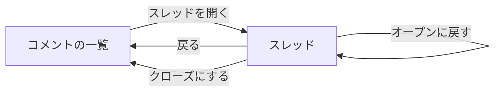

# プレビュー

## スレッドのクローズ・オープン（#377）とスレッドの横のはみ出し（#585）

### 現状

<!-- table: {"kind": "data"} -->

| 分類 | ページ / ファイル | 概要 | 補足 |
| --- | --- | --- | --- |
| ドキュメント | [docs/scenario/SC-489-5.yaml](https://github.com/shuhei1101/mindstella/blob/4fe2d1b8/docs/scenario/SC-489-5.yaml) | 単一ユースケース『スレッドで話す』。話が済んだら任意の理由つきでクローズにする | 更新対象 |
| ドキュメント | [docs/screen/SCR-489-4.tsx.yaml](https://github.com/shuhei1101/mindstella/blob/4fe2d1b8/docs/screen/SCR-489-4.tsx.yaml) | 画面設計『スレッド』。上端でクローズとオープンへの戻しをする | 更新対象 |
| ドキュメント | [docs/interface/IF-489-50.yaml](https://github.com/shuhei1101/mindstella/blob/4fe2d1b8/docs/interface/IF-489-50.yaml) | 画面からのスレッドの状態の書き換え。理由は任意 | 入出力は変えない。理由を `null` で送信する呼び出しの確認 |
| ドキュメント | [docs/module/MOD-489-14.tsx.yaml](https://github.com/shuhei1101/mindstella/blob/4fe2d1b8/docs/module/MOD-489-14.tsx.yaml) | プレビュー / thread-view | 更新対象 |
| 実装 | [frontend/src/features/comments/thread/thread-view.tsx](https://github.com/shuhei1101/mindstella/blob/4fe2d1b8/frontend/src/features/comments/thread/thread-view.tsx) | 状態のボタンが `setReason({ open: true, ... })` で理由の入力欄を開き、もう一度押すと `reason` を付けて状態を変える | 理由の入力欄を削除する |
| 実装 | [frontend/src/features/comments/shared/thread-post.tsx](https://github.com/shuhei1101/mindstella/blob/4fe2d1b8/frontend/src/features/comments/shared/thread-post.tsx) | スレッドの書き込み。#633 で `min-w-0 grid-cols-1` を持つ | #585 の調査の対象 |
| テスト | [frontend/src/features/comments/thread/thread-view.test.tsx](https://github.com/shuhei1101/mindstella/blob/4fe2d1b8/frontend/src/features/comments/thread/thread-view.test.tsx) | thread-view の単体テスト | 理由の入力欄の前提を修正 |
| テスト | [tests/integration/preview/test_spa_thread_screen.py](https://github.com/shuhei1101/mindstella/blob/4fe2d1b8/tests/integration/preview/test_spa_thread_screen.py) | スレッドの画面の結合テスト。`test_wide_table_scrolls_inside` は 1280px・390px で表の横スクロールを確認する | クローズの操作と 390px の幅の確認を追加 |

<!-- /table -->

### 変更方針

<!-- table: {"kind": "data"} -->

| 対象 | 方針 | 補足 |
| --- | --- | --- |
| 状態の切り替え | 「クローズにする」「オープンに戻す」のボタンを押したら、理由を `null` にして画面からのスレッドの状態の書き換えを呼ぶ。理由の入力欄と、その送信・取り消しのボタンを削除する | 書き換えの失敗の表示は、入力欄の代わりにボタンの下へ出す |
| 状態表示 | 書き換えの途中はボタンを押せなくする | - |
| 成功後遷移 | クローズにできたら、コメントの一覧に戻る（URL の search params の `thread` を削除する）。オープンに戻したときは詳細に留まる | - |
| 既存機能への影響 | AI の `set_thread_status` の理由と、配信のエンドポイントの入出力は変えない | - |
| レスポンシブ対応 | iPhone の幅（390px）でスレッドを開いたときに画面全体の幅が端末の幅を超える条件を、本文の中身（列の多い表・長い URL・コード）・開く経路・トップバーの状態の表示の並びで調べて特定し、その要素の幅を親に収める | 調査の結果は `## 実装` に記載する |

<!-- /table -->

### 画面一覧

| 種別 | 画面 | 概要 | アクション | 判定の根拠 | 補足 |
| --- | --- | --- | --- | --- | --- |
| 変更 | スレッド | 開いたスレッド 1 件 | クローズにする オープンに戻す | コメントの一覧のパネルの中で一覧と詳細を切り替える今の配置のまま。状態の切り替えは 1 件をすばやく修正するだけなので、その場で行う（入力欄・モーダルを挟まない） | クローズの後は戻るの操作と同じく一覧へ移り、履歴に追加しない。状態の絞り込みでクローズにした行が一覧から消えるときは、一覧の次の行（無ければ前の行、行が無ければ空の表示）へフォーカスを移す（画面設計『スレッド』） |
| 変更 | コメントの一覧 | スレッドの一覧 | スレッドを開く | クローズの後の戻り先。クローズしたスレッドも状態の絞り込みに合えば一覧に残る | - |

### 画面遷移

<!-- map: {"title": "スレッドのクローズの後の遷移"} -->

<!-- /map -->

## 更新のボタン（#482）とトップバーのアイコン化（#573）

### 現状

<!-- table: {"kind": "data"} -->

| 分類 | ページ / ファイル | 概要 | 補足 |
| --- | --- | --- | --- |
| ドキュメント | [docs/scenario/SC-489-12.yaml](https://github.com/shuhei1101/mindstella/blob/4fe2d1b8/docs/scenario/SC-489-12.yaml) | 単一ユースケース『プレビューを開く』。記録を書き換えるたびに再描画する | 更新のボタンで接続し直す流れを追加 |
| ドキュメント | [docs/component/CMP-489-20.tsx.yaml](https://github.com/shuhei1101/mindstella/blob/4fe2d1b8/docs/component/CMP-489-20.tsx.yaml) | 部品設計『トップバー』 | 更新のボタンとアイコンだけの表示を追加 |
| ドキュメント | [docs/module/MOD-489-88.tsx.yaml](https://github.com/shuhei1101/mindstella/blob/4fe2d1b8/docs/module/MOD-489-88.tsx.yaml) | プレビュー / topbar | 更新対象 |
| ドキュメント | [docs/module/MOD-489-57.ts.yaml](https://github.com/shuhei1101/mindstella/blob/4fe2d1b8/docs/module/MOD-489-57.ts.yaml) | プレビュー / events-client | 接続し直す関数を追加 |
| 実装 | [frontend/src/shared/components/topbar.tsx](https://github.com/shuhei1101/mindstella/blob/4fe2d1b8/frontend/src/shared/components/topbar.tsx) | 文字を `max-xl:hidden`・`max-2xl:hidden` で幅によって隠し、つながらない表示は幅で文言を変え、名前を `title` で持つ | アイコンと件数だけにする |
| 実装 | [frontend/src/shared/adapters/events-client.ts](https://github.com/shuhei1101/mindstella/blob/4fe2d1b8/frontend/src/shared/adapters/events-client.ts) | `new EventSource` でつなぎ、つなぎ直しは `EventSource` に任せる | 作り直しの対象 |
| 実装 | [frontend/src/shared/stores/connection-store.ts](https://github.com/shuhei1101/mindstella/blob/4fe2d1b8/frontend/src/shared/stores/connection-store.ts) | 接続の状態のストア | - |
| 実装 | [frontend/src/shared/stores/refresh-hold-store.ts](https://github.com/shuhei1101/mindstella/blob/4fe2d1b8/frontend/src/shared/stores/refresh-hold-store.ts) | 入力中は再読み込みを保留する | 更新のボタンでも入力中のコメントを保つ |
| テスト | [tests/integration/storybook_react/test_topbar_stories.py](https://github.com/shuhei1101/mindstella/blob/4fe2d1b8/tests/integration/storybook_react/test_topbar_stories.py) | トップバーのストーリーの結合テスト | 幅ごとの確認を修正 |
| テスト | [frontend/src/shared/components/topbar.test.tsx](https://github.com/shuhei1101/mindstella/blob/4fe2d1b8/frontend/src/shared/components/topbar.test.tsx)・[frontend/src/shared/adapters/events-client.test.ts](https://github.com/shuhei1101/mindstella/blob/4fe2d1b8/frontend/src/shared/adapters/events-client.test.ts) | 単体テスト | 更新のボタンと作り直しを追加 |

<!-- /table -->

### 変更方針

<!-- table: {"kind": "data"} -->

| 対象 | 方針 | 補足 |
| --- | --- | --- |
| 更新のボタン | トップバーの接続の状態の表示のすぐ右に、アイコンだけの更新のボタンを常に配置する。押すと `EventSource` を閉じて作り直し、記録の query を読み込み直す。接続中でも押せる | 回る矢印のアイコン。反映を保留している間は右上に点を出し、ツールチップを「更新があります。最新の記録を読み込む」にする（確認ログ） |
| 状態の保持 | 開いている項目・絞り込み（URL の search params）と入力中のコメント（レビュー中の書き込み・入力欄）を、読み込み直しの前後で保つ | 入力中の保留は今の `refresh-hold-store` に従う |
| 自動のつなぎ直し | 画面がもう一度表示されたとき（`visibilitychange`）に接続が閉じていれば、更新のボタンと同じ処理でつなぎ直す | - |
| アイコン化 | 状態の表示とボタンを幅に関わらずアイコンと件数だけにし、名前と状態（記録を読み込んだ日時）はホバーと `:focus-visible` で出す CSS のツールチップと `aria-label` に持たせる。`title` は使用しない | 今の画面の [#567](https://github.com/shuhei1101/mindstella/pull/567) の部品設計に合わせる |
| 残す表示 | 音声入力中の経過時間と、幅 901px 以上の検索のキーの案内は見た目に残す | - |
| レスポンシブ対応 | 音声入力中・つながらない表示・更新があります・更新のボタンが並んでも、幅 320px 以上でトップバーとページが横にはみ出さない | - |

<!-- /table -->

### 画面一覧

| 種別 | 画面 | 概要 | アクション | 判定の根拠 | 補足 |
| --- | --- | --- | --- | --- | --- |
| 変更 | `components/topbar` | 画面の最上部のバー | 接続し直して読み込み直す | 全ての画面に共通のバーへの操作の追加で、今の画面に留まったまま読み込み直すため、画面と遷移を増やさない | 更新のボタンは接続の状態の表示のすぐ右に常に出す（要件の「接続中でも押せる」による）。アイコンは回る矢印 |

## 設計書の確定コミット

| 工程 | 範囲 | 補足 |
| --- | --- | --- |
| 単一ユースケース設計 | `bf3528db..c7a5a32f` | スレッドで話す・プレビューを開く |
| 単一ユースケース設計 | `ff88a0a0..e1dee9b7` | レビューの指摘の修正 |
| 単一ユースケース設計 | `ee54b386..8e09859a` | レビューの指摘の修正（スマホの幅のシナリオを 2 つの状態に分割） |
| 部品設計 | `8e09859a..a297e51a` | トップバー（アイコンと件数だけの表示・ツールチップ・更新のボタン） |
| 画面設計 | `a297e51a..8f7ba69f` | スレッド（理由の入力を挟まない状態の切り替え・クローズの後の一覧への戻りとフォーカス） |
| 部品設計 | `8f7ba69f..b32e1c3b` | レビューの指摘の修正（詰める状態の引数・Offline の見せ方） |
| モジュール構成設計 | `d38a18b7..e124f5e8` | events-client・connection-store・preview-shell・topbar（更新のボタンの接続し直し）、thread-view・comments-panel（クローズの後の一覧への戻りとフォーカス） |
| モジュール構成設計 | `90991d84..ccb5034a` | 実装の工程での修正（comments-panel の単体テストの条件と期待値を新しい順の並びに合わせる） |
| 部品設計 | `076a60c5..5f7a6ef5` | レビューの指摘の修正（状態 Offline の説明から更新のボタンを外す） |

## 実装

### スマホの幅で画面全体が広がる条件（#585）

Playwright の iPhone 13 の端末の設定（幅 390px・`isMobile`）で、書き込みの本文（短い本文・列の多い表・コードブロック・長い行内のコード・長い URL・空白の無い長い単語・長い日本語・ID の並び・引用の中の表・リストの中のコード・長い見出し）と開く画面ごとに、画面全体の幅（`document.documentElement.scrollWidth`）を測った。

| 開いた画面 | 修正の前 | 修正の後 |
| --- | --- | --- |
| 概要のタブ（スレッドを開いても開かなくても） | 390px | 390px |
| 検討事項・タスクのタブ（同上） | 513px | 390px |
| 資料のタブ（同上） | 631px | 390px |

- 書き込みの本文・開く経路・トップバーの状態の表示は条件に含まれない
- 原因は一覧の画面（`list-screen.tsx`）の上端の行。並べ替えのボタンの並び（`card-sort.tsx` の `flex-none`）と「項目追加」が折り返さずに 390px を超え、スマホのブラウザが画面全体の幅を中身に合わせて広げるため、上に重ねたスレッドの画面も同じ幅になる
- 上端の行に `flex-wrap` を付けた（[8c92e026](https://github.com/shuhei1101/mindstella/commit/8c92e026)）
- 今の結合テスト（`test_wide_table_scrolls_inside`）は `set_viewport_size` で幅だけを 390px にするため、画面全体の幅が広がらず再現しない

### Web の実装ガイド

トップバーのツールチップは `interest-triggered-tooltips` を参照した。interest invokers・`popover="hint"` は Safari で有効にならないため、モック作成で入れたホバーと `:focus-visible` の CSS のツールチップと Esc で閉じる処理のままにした。

### Storybook

修正したストーリー `shared-topbar--offline`・`shared-topbar--offline-narrow` と、ツールチップの文言を変えた `shared-topbar--voice-recording`・`shared-topbar--voice-transcribing` を開き、エラー無く描かれることを確認した。

## テスト結果

### 単体

<!-- table: {"kind": "data"} -->

| ファイル | メソッド | 変更種別 | 結果 | 補足 |
| --- | --- | --- | --- | --- |
| [frontend/src/shared/stores/connection-store.test.ts](https://github.com/shuhei1101/mindstella/blob/4fe2d1b8/frontend/src/shared/stores/connection-store.test.ts) | 全実行 | 変更 | ✅ | `テスト結果/20261125165806_b2bf6063_単体テスト.log` |
| [frontend/src/shared/adapters/events-client.test.ts](https://github.com/shuhei1101/mindstella/blob/4fe2d1b8/frontend/src/shared/adapters/events-client.test.ts) | 全実行 | 変更 | ✅ | `テスト結果/20261125165806_b2bf6063_単体テスト.log` |
| [frontend/src/shared/components/topbar.test.tsx](https://github.com/shuhei1101/mindstella/blob/4fe2d1b8/frontend/src/shared/components/topbar.test.tsx) | 全実行 | 変更 | ✅ | `テスト結果/20261125165806_b2bf6063_単体テスト.log` |
| [frontend/src/features/comments/thread/thread-view.test.tsx](https://github.com/shuhei1101/mindstella/blob/4fe2d1b8/frontend/src/features/comments/thread/thread-view.test.tsx) | 全実行 | 変更 | ✅ | 状態の変更の失敗の応答を、サーバーの応答と同じ `application/problem+json` に修正した（[ccb5034a](https://github.com/shuhei1101/mindstella/commit/ccb5034a)） `テスト結果/20261125165806_b2bf6063_単体テスト.log` |
| [frontend/src/features/comments/comments-panel/comments-panel.test.tsx](https://github.com/shuhei1101/mindstella/blob/4fe2d1b8/frontend/src/features/comments/comments-panel/comments-panel.test.tsx) | 全実行 | 変更 | ✅ | クローズの後のフォーカスの期待値を、一覧の並び（新しい順の TH-3・TH-2・TH-1）に合わせて修正した。モジュール構成『comments-panel』の単体テストの条件と期待値も同じく修正した（[ccb5034a](https://github.com/shuhei1101/mindstella/commit/ccb5034a)） `テスト結果/20261125165806_b2bf6063_単体テスト.log` |
| [frontend/src/app/preview-shell.test.tsx](https://github.com/shuhei1101/mindstella/blob/4fe2d1b8/frontend/src/app/preview-shell.test.tsx) | 全実行 | 変更 | ✅ | 入力中の保留の確認から、更新のボタンのツールチップの文言を外した（設計書の期待値は「更新があります」のバーが無いこと。[95d15c3e](https://github.com/shuhei1101/mindstella/commit/95d15c3e)） `テスト結果/20261125165806_b2bf6063_単体テスト.log` |
| `frontend/src` のほかのファイル | 全実行 | 実行のみ | ✅ | 536 件 pass `テスト結果/20261125165806_b2bf6063_単体テスト.log` |

<!-- /table -->

### 結合テストの実行範囲

#### 結合テスト（フロント）（TL-4）

<!-- table: {"kind": "data"} -->

| 変更したファイル | 結果 | 実行する結合テスト | 結合テストが無いエントリーポイント |
| --- | --- | --- | --- |
| `docs/component/CMP-489-20.tsx.yaml` | R7（設計書。実行に影響しない） | - | - |
| `docs/guide/プレビューを見る.mark.md` | R7（文書。実行に影響しない） | - | - |
| `docs/module/MOD-489-136.ts.yaml` | R7（設計書。実行に影響しない） | - | - |
| `docs/module/MOD-489-14.tsx.yaml` | R7（設計書。実行に影響しない） | - | - |
| `docs/module/MOD-489-2.tsx.yaml` | R7（設計書。実行に影響しない） | - | - |
| `docs/module/MOD-489-5.tsx.yaml` | R7（設計書。実行に影響しない） | - | - |
| `docs/module/MOD-489-57.ts.yaml` | R7（設計書。実行に影響しない） | - | - |
| `docs/module/MOD-489-88.tsx.yaml` | R7（設計書。実行に影響しない） | - | - |
| `docs/pr/703/README.mark.md` | R7（PR ドキュメント。実行に影響しない） | - | - |
| `docs/pr/703/サーバー.mark.md` | R7（PR ドキュメント。実行に影響しない） | - | - |
| `docs/pr/703/スキル.mark.md` | R7（PR ドキュメント。実行に影響しない） | - | - |
| `docs/pr/703/タスク一覧.yaml` | R7（PR ドキュメント。実行に影響しない） | - | - |
| `docs/pr/703/テスト結果/20261125150455_3a41d4fe_単体テスト.log` | R7（PR ドキュメント。実行に影響しない） | - | - |
| `docs/pr/703/テスト結果/20261125165806_b2bf6063_単体テスト.log` | R7（PR ドキュメント。実行に影響しない） | - | - |
| `docs/pr/703/テスト結果/20261125165806_b2bf6063_lint.log` | R7（PR ドキュメント。実行に影響しない） | - | - |
| `docs/pr/703/プレビュー.mark.md` | R7（PR ドキュメント。実行に影響しない） | - | - |
| `docs/pr/703/確認ログ.yaml` | R7（PR ドキュメント。実行に影響しない） | - | - |
| `docs/pr/703/要件.mark.md` | R7（PR ドキュメント。実行に影響しない） | - | - |
| `docs/pr/703/要件.yaml` | R7（PR ドキュメント。実行に影響しない） | - | - |
| `docs/scenario/SC-489-12.yaml` | R7（設計書。実行に影響しない） | - | - |
| `docs/scenario/SC-489-5.yaml` | R7（設計書。実行に影響しない） | - | - |
| `docs/screen/SCR-489-4.tsx.yaml` | R7（設計書。実行に影響しない） | - | - |
| `frontend/src/app/preview-shell.test.tsx` | R7（単体テスト） | - | - |
| `frontend/src/app/preview-shell.tsx` | R7 | [tests/integration/preview/test_spa_open.py](https://github.com/shuhei1101/mindstella/blob/4fe2d1b8/tests/integration/preview/test_spa_open.py) | - |
| `frontend/src/features/comments/comments-panel/comments-panel.test.tsx` | R7（単体テスト） | - | - |
| `frontend/src/features/comments/comments-panel/comments-panel.tsx` | R7 | [tests/integration/preview/test_spa_comments_screen.py](https://github.com/shuhei1101/mindstella/blob/4fe2d1b8/tests/integration/preview/test_spa_comments_screen.py)・[tests/integration/preview/test_spa_thread_screen.py](https://github.com/shuhei1101/mindstella/blob/4fe2d1b8/tests/integration/preview/test_spa_thread_screen.py) | - |
| `frontend/src/features/comments/thread/thread-view.test.tsx` | R7（単体テスト） | - | - |
| `frontend/src/features/comments/thread/thread-view.tsx` | R7 | [tests/integration/preview/test_spa_thread_screen.py](https://github.com/shuhei1101/mindstella/blob/4fe2d1b8/tests/integration/preview/test_spa_thread_screen.py) | - |
| `frontend/src/shared/adapters/events-client.test.ts` | R7（単体テスト） | - | - |
| `frontend/src/shared/adapters/events-client.ts` | R7 | [tests/integration/preview/test_spa_open.py](https://github.com/shuhei1101/mindstella/blob/4fe2d1b8/tests/integration/preview/test_spa_open.py) | - |
| `frontend/src/shared/components/icon.tsx` | R7 | [tests/integration/storybook_react/test_topbar_stories.py](https://github.com/shuhei1101/mindstella/blob/4fe2d1b8/tests/integration/storybook_react/test_topbar_stories.py)・[tests/integration/preview/test_spa_open.py](https://github.com/shuhei1101/mindstella/blob/4fe2d1b8/tests/integration/preview/test_spa_open.py) | - |
| `frontend/src/shared/components/list-screen.tsx` | R7 | [tests/integration/preview/test_spa_decisions_screen.py](https://github.com/shuhei1101/mindstella/blob/4fe2d1b8/tests/integration/preview/test_spa_decisions_screen.py)・[tests/integration/preview/test_spa_tasks_screen.py](https://github.com/shuhei1101/mindstella/blob/4fe2d1b8/tests/integration/preview/test_spa_tasks_screen.py)・[tests/integration/preview/test_spa_docs_screen.py](https://github.com/shuhei1101/mindstella/blob/4fe2d1b8/tests/integration/preview/test_spa_docs_screen.py)・[tests/integration/preview/test_spa_records_screen.py](https://github.com/shuhei1101/mindstella/blob/4fe2d1b8/tests/integration/preview/test_spa_records_screen.py) | - |
| `frontend/src/shared/components/topbar.stories.tsx` | R7 | [tests/integration/storybook_react/test_topbar_stories.py](https://github.com/shuhei1101/mindstella/blob/4fe2d1b8/tests/integration/storybook_react/test_topbar_stories.py) | - |
| `frontend/src/shared/components/topbar.test.tsx` | R7（単体テスト） | - | - |
| `frontend/src/shared/components/topbar.tsx` | R7 | [tests/integration/storybook_react/test_topbar_stories.py](https://github.com/shuhei1101/mindstella/blob/4fe2d1b8/tests/integration/storybook_react/test_topbar_stories.py)・[tests/integration/preview/test_spa_open.py](https://github.com/shuhei1101/mindstella/blob/4fe2d1b8/tests/integration/preview/test_spa_open.py) | - |
| `frontend/src/shared/stores/connection-store.test.ts` | R7（単体テスト） | - | - |
| `frontend/src/shared/stores/connection-store.ts` | R7 | [tests/integration/preview/test_spa_open.py](https://github.com/shuhei1101/mindstella/blob/4fe2d1b8/tests/integration/preview/test_spa_open.py) | - |
| `frontend/src/testing/fake-event-source.ts` | R7（単体テスト） | - | - |
| `plugins/mindstella/skills/mindmap/preview/export/index.html` | R7（生成物。生成元の `frontend/src` と同じ判定） | [tests/integration/preview/test_spa_thread_screen.py](https://github.com/shuhei1101/mindstella/blob/4fe2d1b8/tests/integration/preview/test_spa_thread_screen.py)・[tests/integration/preview/test_spa_comments_screen.py](https://github.com/shuhei1101/mindstella/blob/4fe2d1b8/tests/integration/preview/test_spa_comments_screen.py)・[tests/integration/preview/test_spa_open.py](https://github.com/shuhei1101/mindstella/blob/4fe2d1b8/tests/integration/preview/test_spa_open.py)・[tests/integration/storybook_react/test_topbar_stories.py](https://github.com/shuhei1101/mindstella/blob/4fe2d1b8/tests/integration/storybook_react/test_topbar_stories.py)・[tests/integration/preview/test_spa_decisions_screen.py](https://github.com/shuhei1101/mindstella/blob/4fe2d1b8/tests/integration/preview/test_spa_decisions_screen.py)・[tests/integration/preview/test_spa_tasks_screen.py](https://github.com/shuhei1101/mindstella/blob/4fe2d1b8/tests/integration/preview/test_spa_tasks_screen.py)・[tests/integration/preview/test_spa_docs_screen.py](https://github.com/shuhei1101/mindstella/blob/4fe2d1b8/tests/integration/preview/test_spa_docs_screen.py)・[tests/integration/preview/test_spa_records_screen.py](https://github.com/shuhei1101/mindstella/blob/4fe2d1b8/tests/integration/preview/test_spa_records_screen.py) | - |
| `plugins/mindstella/skills/mindmap/preview/spa/assets/index-7ZCQVDEX.js` | R7（生成物。生成元の `frontend/src` と同じ判定） | [tests/integration/preview/test_spa_thread_screen.py](https://github.com/shuhei1101/mindstella/blob/4fe2d1b8/tests/integration/preview/test_spa_thread_screen.py)・[tests/integration/preview/test_spa_comments_screen.py](https://github.com/shuhei1101/mindstella/blob/4fe2d1b8/tests/integration/preview/test_spa_comments_screen.py)・[tests/integration/preview/test_spa_open.py](https://github.com/shuhei1101/mindstella/blob/4fe2d1b8/tests/integration/preview/test_spa_open.py)・[tests/integration/storybook_react/test_topbar_stories.py](https://github.com/shuhei1101/mindstella/blob/4fe2d1b8/tests/integration/storybook_react/test_topbar_stories.py)・[tests/integration/preview/test_spa_decisions_screen.py](https://github.com/shuhei1101/mindstella/blob/4fe2d1b8/tests/integration/preview/test_spa_decisions_screen.py)・[tests/integration/preview/test_spa_tasks_screen.py](https://github.com/shuhei1101/mindstella/blob/4fe2d1b8/tests/integration/preview/test_spa_tasks_screen.py)・[tests/integration/preview/test_spa_docs_screen.py](https://github.com/shuhei1101/mindstella/blob/4fe2d1b8/tests/integration/preview/test_spa_docs_screen.py)・[tests/integration/preview/test_spa_records_screen.py](https://github.com/shuhei1101/mindstella/blob/4fe2d1b8/tests/integration/preview/test_spa_records_screen.py) | - |
| `plugins/mindstella/skills/mindmap/preview/spa/assets/index-D3bzTaNa.css` | R7（生成物。生成元の `frontend/src` と同じ判定） | [tests/integration/preview/test_spa_thread_screen.py](https://github.com/shuhei1101/mindstella/blob/4fe2d1b8/tests/integration/preview/test_spa_thread_screen.py)・[tests/integration/preview/test_spa_comments_screen.py](https://github.com/shuhei1101/mindstella/blob/4fe2d1b8/tests/integration/preview/test_spa_comments_screen.py)・[tests/integration/preview/test_spa_open.py](https://github.com/shuhei1101/mindstella/blob/4fe2d1b8/tests/integration/preview/test_spa_open.py)・[tests/integration/storybook_react/test_topbar_stories.py](https://github.com/shuhei1101/mindstella/blob/4fe2d1b8/tests/integration/storybook_react/test_topbar_stories.py)・[tests/integration/preview/test_spa_decisions_screen.py](https://github.com/shuhei1101/mindstella/blob/4fe2d1b8/tests/integration/preview/test_spa_decisions_screen.py)・[tests/integration/preview/test_spa_tasks_screen.py](https://github.com/shuhei1101/mindstella/blob/4fe2d1b8/tests/integration/preview/test_spa_tasks_screen.py)・[tests/integration/preview/test_spa_docs_screen.py](https://github.com/shuhei1101/mindstella/blob/4fe2d1b8/tests/integration/preview/test_spa_docs_screen.py)・[tests/integration/preview/test_spa_records_screen.py](https://github.com/shuhei1101/mindstella/blob/4fe2d1b8/tests/integration/preview/test_spa_records_screen.py) | - |
| `plugins/mindstella/skills/mindmap/preview/spa/assets/index-a5kfW_hN.css` | R7（生成物。生成元の `frontend/src` と同じ判定） | [tests/integration/preview/test_spa_thread_screen.py](https://github.com/shuhei1101/mindstella/blob/4fe2d1b8/tests/integration/preview/test_spa_thread_screen.py)・[tests/integration/preview/test_spa_comments_screen.py](https://github.com/shuhei1101/mindstella/blob/4fe2d1b8/tests/integration/preview/test_spa_comments_screen.py)・[tests/integration/preview/test_spa_open.py](https://github.com/shuhei1101/mindstella/blob/4fe2d1b8/tests/integration/preview/test_spa_open.py)・[tests/integration/storybook_react/test_topbar_stories.py](https://github.com/shuhei1101/mindstella/blob/4fe2d1b8/tests/integration/storybook_react/test_topbar_stories.py)・[tests/integration/preview/test_spa_decisions_screen.py](https://github.com/shuhei1101/mindstella/blob/4fe2d1b8/tests/integration/preview/test_spa_decisions_screen.py)・[tests/integration/preview/test_spa_tasks_screen.py](https://github.com/shuhei1101/mindstella/blob/4fe2d1b8/tests/integration/preview/test_spa_tasks_screen.py)・[tests/integration/preview/test_spa_docs_screen.py](https://github.com/shuhei1101/mindstella/blob/4fe2d1b8/tests/integration/preview/test_spa_docs_screen.py)・[tests/integration/preview/test_spa_records_screen.py](https://github.com/shuhei1101/mindstella/blob/4fe2d1b8/tests/integration/preview/test_spa_records_screen.py) | - |
| `plugins/mindstella/skills/mindmap/preview/spa/assets/index-kQvVH9Bw.js` | R7（生成物。生成元の `frontend/src` と同じ判定） | [tests/integration/preview/test_spa_thread_screen.py](https://github.com/shuhei1101/mindstella/blob/4fe2d1b8/tests/integration/preview/test_spa_thread_screen.py)・[tests/integration/preview/test_spa_comments_screen.py](https://github.com/shuhei1101/mindstella/blob/4fe2d1b8/tests/integration/preview/test_spa_comments_screen.py)・[tests/integration/preview/test_spa_open.py](https://github.com/shuhei1101/mindstella/blob/4fe2d1b8/tests/integration/preview/test_spa_open.py)・[tests/integration/storybook_react/test_topbar_stories.py](https://github.com/shuhei1101/mindstella/blob/4fe2d1b8/tests/integration/storybook_react/test_topbar_stories.py)・[tests/integration/preview/test_spa_decisions_screen.py](https://github.com/shuhei1101/mindstella/blob/4fe2d1b8/tests/integration/preview/test_spa_decisions_screen.py)・[tests/integration/preview/test_spa_tasks_screen.py](https://github.com/shuhei1101/mindstella/blob/4fe2d1b8/tests/integration/preview/test_spa_tasks_screen.py)・[tests/integration/preview/test_spa_docs_screen.py](https://github.com/shuhei1101/mindstella/blob/4fe2d1b8/tests/integration/preview/test_spa_docs_screen.py)・[tests/integration/preview/test_spa_records_screen.py](https://github.com/shuhei1101/mindstella/blob/4fe2d1b8/tests/integration/preview/test_spa_records_screen.py) | - |
| `plugins/mindstella/skills/mindmap/preview/spa/index.html` | R7（生成物。生成元の `frontend/src` と同じ判定） | [tests/integration/preview/test_spa_thread_screen.py](https://github.com/shuhei1101/mindstella/blob/4fe2d1b8/tests/integration/preview/test_spa_thread_screen.py)・[tests/integration/preview/test_spa_comments_screen.py](https://github.com/shuhei1101/mindstella/blob/4fe2d1b8/tests/integration/preview/test_spa_comments_screen.py)・[tests/integration/preview/test_spa_open.py](https://github.com/shuhei1101/mindstella/blob/4fe2d1b8/tests/integration/preview/test_spa_open.py)・[tests/integration/storybook_react/test_topbar_stories.py](https://github.com/shuhei1101/mindstella/blob/4fe2d1b8/tests/integration/storybook_react/test_topbar_stories.py)・[tests/integration/preview/test_spa_decisions_screen.py](https://github.com/shuhei1101/mindstella/blob/4fe2d1b8/tests/integration/preview/test_spa_decisions_screen.py)・[tests/integration/preview/test_spa_tasks_screen.py](https://github.com/shuhei1101/mindstella/blob/4fe2d1b8/tests/integration/preview/test_spa_tasks_screen.py)・[tests/integration/preview/test_spa_docs_screen.py](https://github.com/shuhei1101/mindstella/blob/4fe2d1b8/tests/integration/preview/test_spa_docs_screen.py)・[tests/integration/preview/test_spa_records_screen.py](https://github.com/shuhei1101/mindstella/blob/4fe2d1b8/tests/integration/preview/test_spa_records_screen.py) | - |

<!-- /table -->

### 結合

なし（結合テスト作成で記入する）

ドキュメント修正（`docs/guide/` の 4 ページ）には、規約『V字モデル』の対応表で対応する単体・結合テストが無い（公開ドキュメントはテストの対象の設計書ではない）。
