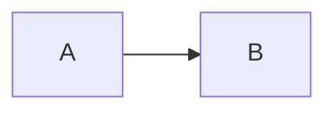

# 見出し 1

段落の 1 行目
段落の 2 行目
段落の 3 行目

- 項目 A
- 項目 B
  続きの行
- 項目 C

| 列 1 | 列 2 |
| --- | --- |
| a1 | b1 |
| a2 | b2 |

```python
def f():
    return 1
print(f())
```

## 見出し 2

> 引用の 1 行目
> 引用の 2 行目



```html
<p>html のブロック</p>
```

1. 番号 1
2. 番号 2

用語 [リンク](#x) と `code` を含む段落

字下げのコードの前の段落

    indent_a = 1
    indent_b = 2

~~~
tilde_a
tilde_b
~~~

> ```py
> quote_a = 1
> quote_b = 2
> ```

- a
  - b

    ```py
    nest_a = 1
    nest_b = 2
    ```
